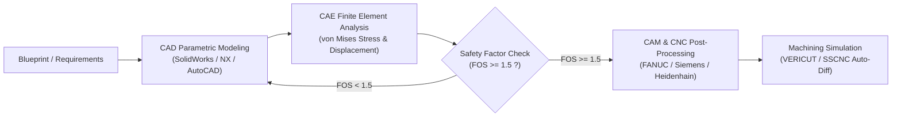

# D:\Virtu模型 Workspace Architecture & Operational Constitution

## 1. Workspace Identity & High-Level Mission
This workspace (`D:\Virtu模型`) is an integrated autonomous engineering laboratory combining:
- **CAD/CAE/CAM Digital Manufacturing**: Native COM API, journals, and desktop automation for the six major industrial software packages (`SOLIDWORKS 2021`, `AutoCAD 2026`, `Siemens NX 12.0`, `CIMCO Edit 2026`, `VERICUT 9.6`, `斯沃数控仿真 SSCNC 7.2`).
- **Closed-Loop Physical Verification**: 2D Blueprint OCR ➔ 3D Parametric CAD ➔ Finite Element Analysis (FEA) Strength Check ($FOS \ge 1.5$) ➔ Sheet Metal True-Shape Nesting ➔ Multi-Controller CNC Post-Processing ➔ Virtual Machining Simulation.
- **Multi-Agent Swarm Orchestration**: Meta-SOP document contracts, Blackboard shared memory locks, and Red-Blue adversarial debate.

---

## 2. Six Industrial Software Operational Axioms

### A. SOLIDWORKS 2021 (Millwright Discipline)
- **Coordinate System**: World $Y$ is **UP** (Front Plane = $XY$, Normal $+Z$; Top Plane = $XZ$, Normal $+Y$; Right Plane = $YZ$, Normal $+X$).
- **Units**: Dimensions in **mm**, angles in **degrees**.
- **Volume Conservation Assertion**: Every feature must be verified against physical volume:
  - Extrusions: $\Delta V > 0$
  - Cut-extrusions: $\Delta V < 0$
  - Fillets/Chamfers: $\Delta V \neq 0$
- **Feature Diagnostics**: On rebuild warning or error, call `diagnose_document()` and inspect `feature_errors` directly; never guess from screenshots.

### B. AutoCAD 2026
- Enforce standard layers (`OUTLINE`, `DIM`, `HIDDEN`, `CENTER`, `HATCH`, `TITLE_BLOCK`).
- Verify viewport bounds and check for text-dimension overlaps before export.

### C. Siemens NX 12.0
- Execute through NXOpen Python journals and UF_MODL APIs.
- Check Operation Navigator CAM trees for exclamation warnings before exporting toolpaths.

### D. CIMCO Edit 2026
- Verify 3D backplot traces: inspect rapid traverse ($G00$) moves to ensure zero high-speed plunge into raw stock.
- Validate FANUC Macro B variable logic (`#100`, `#500`, `WHILE/DO`).

### E. VERICUT 9.6
- Run Auto-Diff color deviation map analysis:
  - **Red**: Gouge (过切) ➔ Fatal; immediate stop and toolpath fix.
  - **Blue**: Excess material (残料) ➔ Add semi-finishing passes.
  - **Green**: In-tolerance (合格).

### F. 斯沃数控仿真 SSCNC 7.2
- Verify virtual FANUC 0i panel mode (`AUTO`, `EDIT`, `MDI`, `JOG`).
- Inspect CRT coordinate readouts (`MACHINE`, `RELATIVE`, `ABSOLUTE` / G54) and touch-off spark alignment before cycle start.

---

## 3. The CAD-CAE-CAM Closed-Loop Protocol

---

## 4. Super Agent (超级智能体) Unified Architecture & Swarm Protocol
- **Super Agent Centralization**: The workspace agent architecture is unified under `VirtuSuperAgent` (`virtu_omni.agent.VirtuSuperAgent`), integrating all 8 industrial disciplines into omnipotent internal facets:
  - `Architect Facet`: System requirements decomposition & parametric intent parsing.
  - `Modeling Facet`: 3D Parametric CAD (SolidWorks/NX/build123d), FeatureTree, swEqnMgr, Volume Conservation ($\Delta V \neq 0$).
  - `Standards Facet`: 2D Drafting (ezdxf sub-10ms), standard layer discipline, GD&T (H7/g6).
  - `Machining Facet`: CNC toolpaths, post-processing dialects (FANUC Macro B, Siemens, Heidenhain), speeds & feeds.
  - `CAE Simulation Facet`: Lamé thick cylinder stress analysis, von Mises yield check, Safety Factor ($FOS \ge 1.5$).
  - `Auditor & Sandbox Facet`: Headless virtual simulation, $G00$ plunge collision sentinel, self-reflection optimizer.
  - `Memory & Evolution Facet`: Dense vector memory, Hindsight Recall & Reflect, dynamic skill distillation.
  - `Desktop & Modality Dispatcher`: Windows GUI closed-loop control + 7 access modalities.
- **Operational Modes**:
  - `AUTONOMOUS`: Full-cycle industrial engineering solve with stage-gated memory reclamation (`ProcessMemoryReclaimer`).
  - `REACT`: Dynamic Thought ➔ Action ➔ Observation ➔ Reflection loop with native tool calling.
  - `MODALITY`: Direct modality tool call with fixed fallback cascade.
  - `SWARM`: Hierarchical delegation to specialized workers under Blackboard write-lock leases.
- **Meta-SOP Pipeline**: Follow strict document handoffs: `PRD.md` ➔ `ARCHITECTURE.md` ➔ `TASKS.md` ➔ `Code / Model` ➔ `VERIFICATION_REPORT.json`.
- **Zero Chit-Chat**: Subagents communicate strictly via structured JSON/markdown artifacts.
- **Blackboard Locking**: Parallel subagents must acquire a `Write-Lock Lease` before modifying any shared file or CAD COM handle to prevent race conditions.
- **Specialized Roles**:
  - `system_architect`: Plans DAG tasks and coordinates locks.
  - `industrial_engineer`: Executes CAD/CAM/CAE operations.
  - `adversarial_critic`: Performs red-team defect hunting and verifies evidence.

---

## 5. Supreme Verification Gatekeeper
**Evidence Before Assertions Always**:
No agent or subagent may claim a task is complete, a feature is created, or a bug is fixed without executing an explicit, runnable verification command and inspecting output logs or visual confirmation artifacts.

---

## 6. The Extreme Step-by-Step Self-Verification & Circuit Breaker Axiom (极速极限单步自查与熔断公理)
**Operational Rule**: “又快又准到极限，未到极限则继续，到了极限则放弃”
1. **单步强制自查 (Step-by-Step Self-Checking)**:
   - 严禁在未经验证的代码、模型、G 代码或配置文件上连续叠加后续步骤。
   - 每完成一次文件修改、命令执行或 CAD 几何特征操作，必须立即在当前回合执行极速自查（Tier 0 状态校验 + Tier 1 静态语法校验）。
2. **极速与精度上限 (Fast & Accurate to the Limit)**:
   - **快**: 优先采用轻量级静态分析（AST 语法、退出码、JSON 解析、ezdxf 审计，耗时 < 100ms）。达到极限置信度 ($C_t = 1.0$) 立即 Early-Exit 推进。
   - **准**: 结合局部语义断言（单点单元测试、$\Delta V \neq 0$ 体积守恒、G00 碰撞分析）。
3. **未到极限则继续 (Self-Correction Under Limit)**:
   - 若单步自查失败且未达极限（尝试次数 $k < 3$ 且错误未发生停滞），禁止将半成品报错抛给用户，立刻分析 Traceback，执行单点修补并重新自查。
4. **到了极限则放弃 (Circuit Breaker & Rollback on Limit Reached)**:
   - 当达到极限（连续 3 次尝试失败，或连续 2 次产生无任何收敛的同构错误停滞/Plateau），立即触发熔断放弃：
     - **停止进一步修改**（禁止盲目猜错污染代码库）；
     - **执行原子回滚**（`git restore .` 或撤回 CAD 事务）；
     - **输出 RCFA 故障根因分析报告**，清晰向用户交代失败瓶颈并提供人工介入建议。

---

## 7. The Extreme CAD/CAM Lifecycle Engine (GitHub Grounding)
- **Engine Core**: `virtu_omni.engine.extreme_cadcam_pipeline.ExtremeCADCAMPipeline`
- **MCP Tool**: `cadcam_extreme_chain`
- **Skill**: `extreme-cadcam-lifecycle`
- **SOTA GitHub Grounding Projects**:
  - **Drafting (绘图)**: `ezdxf/ezdxf` (Mozman), `reclosedev/pyautocad` — Sub-10ms GB layer discipline (`OUTLINE`, `DIM`, `CENTER`, `HATCH`), GD&T tolerance annotation.
  - **Modeling (建模)**: `raylanlin/Millwright`, `gumyr/build123d`, `CadQuery/cadquery` — Volume conservation assertion ($\Delta V \neq 0, |V_{cad} - V_{theory}|/V_{theory} \le 1\%$), sketch normal standard (+Z Front Plane).
  - **Simulation (仿真)**: `JWock82/PyNite`, Lamé thick-cylinder elasticity theory ($FOS \ge 1.5$) + `burnshall-ui/vibeCNC` & `michaelfranzl/gcode-machine` rapid $G00$ plunge collision sentinel.
  - **Machining (加工)**: `cnc4me/fanuc-macro-b`, `konkers/Mill-Post-Processors`, `makalin/GCode-Parser` — FANUC Macro B logic (`#100`, `#500`, `WHILE/DO`), spindle/coolant modal safety verification.

---

## 8. 测量宪法（2026-11-05 事故后追加，对所有会话生效）

今日实测到的根因不是某个 bug，而是三条缺失：数字可以不回答"哪段字节产生了你"、被测对象是**可改名的共享状态**、闸门可以空转。以下六条为硬约束。

1. **数字必须可归因**。任何进 `benchmarks/`、`README.md`、`checkpoints/PROVENANCE.json` 的数值，必须经 `virtu_eval/provenance.py`：`run_id`（内容指纹）+ 样本量 `n` + 证据文件路径 + 口径 `basis` 取 measured/asserted/inferred。没测就写"未测"，**禁止**把源码字面量当测量结果（今日：`physics_compliance = 1.0` 被印成"物理合规率 100%（否决项）"；`HISTORICAL_BASELINES` 常量被印成三个实测臂）。
2. **被测对象按内容寻址，不按名字**。起腿前 `RunIdentity.capture()` 记 Ollama 层哈希（model/template/system）、用例文件 sha256、判分器 sha256；腿结束时 `drift()` 非空即**该腿作废**，不得改称"某标签的成绩"。今日四个标签（`virtu-comprehensive`/`virtu-master`/`virtu-ties-v1`/`virtu-test-tool`）在不同会话手里被重指成同一 manifest，双脚手架消融当场失效。
3. **共享可变状态需要写权限自觉**。Ollama 库、`data/sft/*`、`virtu_eval/arms.json`、`virtu_eval/graders.py`、他人 `runs/**` 目录都是共享的。删除构件前先查引用（`deploy_and_cleanup.py::evaluation_referenced_tags`）；不得向他人封缄过的腿目录写入（`provenance.verify_seal` 判"证据被改写"）；不得重写他人 run 目录的 `raw.jsonl`（今日一条腿的 30 条 404 记录被外部替换，事后无法自证）。
4. **闸必须能被证伪**。新增任何判据或门禁，同时提交"植入坏样本 ⇒ 必须红"的反证测试（范式见 `tests/test_provenance_gates.py`、`scratch/_mutation_probe_gate.py`）。空匹配集、解析失败、`if not exists: continue` 一律判红，不得当作通过。
5. **一套定律只有一个参照**。物理/几何公式的权威是 `virtu_eval/derivation.LAWS` 与 `scripts/wm_verifier.recompute`；判分器直接 import 执行器的 `validate()`；单位写进字段名且可量纲核验（`scripts/corpus_unit_audit.py`）；禁止 `V = max(V,1)`、`... if False else ...` 这类静默改写靶值（今日据此揪出 255 条 mm⁵ 冒充 mm⁴ 的训练靶）。
6. **测量链是独占资源**。起链前漂移哨兵与 foreign-runner 必须为空；链在跑时不得改 `runner.py`、`arms.py`、`graders.py` 与用例目录；发生外部改动以 `drift_log.jsonl` 为准并作废受影响腿，而不是"记得几分算几分"。
