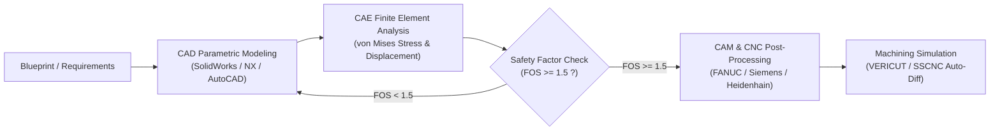

# D:\Virtu模型 Workspace Architecture & Operational Constitution

## 1. Workspace Identity & High-Level Mission
This workspace (`D:\Virtu模型`) is an integrated autonomous engineering laboratory combining:
- **CAD/CAE/CAM Digital Manufacturing**: Native COM API, journals, and desktop automation for the six major industrial software packages (`SOLIDWORKS 2021`, `AutoCAD 2026`, `Siemens NX 12.0`, `CIMCO Edit 2026`, `VERICUT 9.6`, `斯沃数控仿真 SSCNC 7.2`).
- **Closed-Loop Physical Verification**: 2D Blueprint OCR ➔ 3D Parametric CAD ➔ Finite Element Analysis (FEA) Strength Check ($FOS \ge 1.5$) ➔ Sheet Metal True-Shape Nesting ➔ Multi-Controller CNC Post-Processing ➔ Virtual Machining Simulation.
- **Multi-Agent Swarm Orchestration**（**已实现 2026-11-13**：`virtu_omni/agent/swarm_orchestrator.py`，见 §4 实现状态表与 `tests/test_swarm_orchestrator.py` / `tests/test_swarm_entry.py`）: Meta-SOP document contracts, Blackboard shared memory locks, and Red-Blue adversarial debate.

---

## 2. Six Industrial Software Operational Axioms

### A. SOLIDWORKS 2021 (Millwright Discipline)
- **Coordinate System**: World $Y$ is **UP** (Front Plane = $XY$, Normal $+Z$; Top Plane = $XZ$, Normal $+Y$; Right Plane = $YZ$, Normal $+X$).
- **Units**: Dimensions in **mm**, angles in **degrees**.
- **Volume Conservation Assertion**: Every feature must be verified against physical volume:
  - Extrusions: $\Delta V > 0$
  - Cut-extrusions: $\Delta V < 0$
  - Fillets/Chamfers: $\Delta V \neq 0$
- **Feature Diagnostics**: On rebuild warning or error, call `diagnose_document()` and inspect `feature_errors` directly; never guess from screenshots.

### B. AutoCAD 2026
- Enforce standard layers (`OUTLINE`, `DIM`, `HIDDEN`, `CENTER`, `HATCH`, `TITLE_BLOCK`).
- Verify viewport bounds and check for text-dimension overlaps before export.

### C. Siemens NX 12.0
- Execute through NXOpen Python journals and UF_MODL APIs.
- Check Operation Navigator CAM trees for exclamation warnings before exporting toolpaths.

### D. CIMCO Edit 2026
- Verify 3D backplot traces: inspect rapid traverse ($G00$) moves to ensure zero high-speed plunge into raw stock.
- Validate FANUC Macro B variable logic (`#100`, `#500`, `WHILE/DO`).

### E. VERICUT 9.6
- Run Auto-Diff color deviation map analysis:
  - **Red**: Gouge (过切) ➔ Fatal; immediate stop and toolpath fix.
  - **Blue**: Excess material (残料) ➔ Add semi-finishing passes.
  - **Green**: In-tolerance (合格).

### F. 斯沃数控仿真 SSCNC 7.2
- Verify virtual FANUC 0i panel mode (`AUTO`, `EDIT`, `MDI`, `JOG`).
- Inspect CRT coordinate readouts (`MACHINE`, `RELATIVE`, `ABSOLUTE` / G54) and touch-off spark alignment before cycle start.

---

## 3. The CAD-CAE-CAM Closed-Loop Protocol



---

## 4. Super Agent (超级智能体) Unified Architecture & Swarm Protocol

> **【实现状态】2026-11-13 更新：§4 的 SWARM 四项契约已落成可运行代码并带可复跑测试。**
> 逐项标注如下（依据行号为本次实测）：
>
> | 机制 | 状态 | 依据 |
> | :--- | :--- | :--- |
> | `AUTONOMOUS` 模式 | **已实现** | `super_agent.py::_solve_autonomous`（`solve()` 默认分支） |
> | `REACT` 模式 | **已实现** | `super_agent.py::_solve_react`（10 步流水线，含 `web_verify_and_correct` / `verify_product_integrity` / `observe_surface`） |
> | `MODALITY` 模式 | **已实现** | `super_agent.py::_solve_modality` |
> | `SWARM` 层级委派 | **已实现（2026-11-13）** | `super_agent._solve_swarm` 调 `swarm_orchestrator.SwarmCommander.solve`：并行扇出 几何解析‖标准可行性 → 工艺规划 → 刀路生成 → 仿真审计；`solve()` SWARM 分支透传 `params`，默认 `require_real_swarm=True` |
> | Blackboard 写锁租约（Write-Lock Lease） | **已实现（2026-11-13）** | `swarm_orchestrator.Blackboard`：`threading.Condition` + 租约 TTL + 无租约拒写 + 全量写审计；并发测试 4×50 写完整串行化 |
> | Meta-SOP 文档交接（`PRD→ARCHITECTURE→TASKS→CODE_MODEL→VERIFICATION_REPORT`） | **已实现（2026-11-13）** | `handoff_gate()` 校验前置文档齐备才放行；五文档落 Blackboard + 本地目录，缺前置即 `HandoffError` |
> | `adversarial_critic` / 红蓝辩论 | **已实现（2026-11-13）** | `AdversarialCritic`：可证伪缺陷门（无几何证据却宣称成功 / 残料超差 / 毛坯非成品派生 / 假联网 / 成品门失败），坏样本必判红 |
> | 8 facets（Architect/Modeling/Standards/Machining/CAE/Auditor/Memory/Desktop） | **部分实现** | 以 `facet_*` 方法注册表存在，**非** 8 个独立 facet 类；`swarm_orchestrator` 里的 5 个 worker 是真实专业分工（接真实模块），与 facet 表并存 |
> | Super Agent 集中化骨架 `VirtuSuperAgent` | **已实现（骨架）** | 类存在且 `solve()` 可按 4 种模式分派 |
>
> 结论：**SWARM / Blackboard 写锁 / Meta-SOP / adversarial_critic 自 2026-11-13 起为可调用运行时能力**，证据见
> `virtu_omni/agent/swarm_orchestrator.py`、`tests/test_swarm_orchestrator.py`、`tests/test_swarm_entry.py`。
> 其它章节（尤其 §8 测量宪法）不受本说明影响。

### 4.1 运行时收敛：`agent_team.py` 与 `swarm_orchestrator.py` 的职责边界（2026-11-13）

历史上存在两套"多智能体"实现，容易被误用。现已按下表收敛，**不再是"两套并行"**：

| 运行时 | 入口 | 职责 | 证据等级 |
| :--- | :--- | :--- | :--- |
| **legacy 信封** | `IndustrialAgentTeam.solve()` | 7 步「落盘 → 关软件 → 回收内存」+ Hindsight 记忆 + 安全审计。**工程内容自 2026-11-13 起为实算**（见 §4.4），但仍是单进程顺序流水线、无 Blackboard/红蓝辩论 | 返回体自标 `runtime=agent_team.legacy_stub_pipeline`（运行时标签）、`evidence_basis=asserted`；工程字段自带 `basis`，审计结论来自真实沙箱 |
| **真实工程运行时** | `IndustrialAgentTeam.solve_engineering()` / `solve_full()` / `SwarmCommander.solve()` | 几何实测 → 工艺规划（含联网修正）→ 刀路 + VERICUT 工程 → 仿真审计（成品门 + Auto-Diff 偏差回灌 + 红蓝辩论） | `evidence_basis=measured`，`engineering_verified` 由真实门决定 |
| **合并入口** | `IndustrialAgentTeam.solve_full()` | 先跑 legacy 信封（内存安全/记忆），再跑真实工程；**状态以真实门为准** | `status` = 真实门；`legacy_status` 单独保留作对照 |

关键约束：**桩 agent 自报 `COMPLETED` 不得掩盖真实工程失败**——`solve_full()` 在真实门判红时返回
`status=FAILED`（`tests/test_agent_team_convergence.py` 的 D 组用例可证伪）。
`IndustrialAgentTeam.to_swarm()` 提供一行桥接到真实运行时。

### 4.2 VERICUT Auto-Diff 回灌（2026-11-13 接入）

此前 `swarm_orchestrator` 里 **0 处 autodiff**，§2E 的红/蓝/绿门在 Swarm 中被完全跳过。现已接入：

- 适配层 `vericut_autodiff_adapter.py`：复用 `skills/vericut-autodiff-triage/scripts/triage_autodiff.py`
  的 `normalize`/`audit`（不另立口径），支持旧版扁平载荷与现行嵌套 `metrics` 载荷。
- SWARM 审计参数：`task["autodiff_payload"]`（视觉巡检 JSON 路径）、`task["vericut_log"]`（仿真日志，
  用于图像/日志交叉校验）、`task["require_autodiff"]`（强制取证）。
- 判定：红=过切 ⇒ 不通过；蓝=残料超限 ⇒ 不通过；**空白/未渲染图（有效像素 0）⇒
  `INSUFFICIENT_EVIDENCE`，绝不因"绿色 100%"判合格**；未提供载荷 ⇒ 红队记 `RED-NO-AUTODIFF`（major，
  标注"该门未取证"，不伪装通过）。
- 证据：`tests/test_autodiff_ingestion.py` 9/9（含"自报 PASS 但有过切像素必须拦截"与"空图不得判合格"）。

### 4.3 门序原则：安全门必须前置于审批门（2026-11-13 修复）

`bridges/tool_calling_specs.py::execute_tool_call` 的执行顺序固定为：

```
schema → payload_size → path_traversal_gate → security_audit_gate → approval_gate → 派发
```

原因：审批门只表示"需要人批准"，**不等于已拦截**。此前审批门排在路径穿越与代码注入检查之前，
导致 `out_root=C:/Windows/System32` 或 `Shell "cmd.exe /c whoami"` 这类明显攻击返回
`TOOL_APPROVAL_REQUIRED`（待批准），把"已拦截"降级成"等一个批准就能过"。
现两条安全门前移，攻击一律返回 `PATH_TRAVERSAL_BLOCKED` / `SECURITY_AUDIT_VIOLATION`。

配套：`self_reflection_optimizer.audit_code` 的严重度分层——**沙箱模拟错误（语法/碰撞/主轴未转即切削）
才是 fatal**；静态规则未命中（少写 `ViewZoomtofit2`、宏未用 `#100` 变量）为 style 建议，
不再把"合法且无碰撞的程序"判成失败（`fatal_issues` / `style_issues` 分别可见）。

### 4.4 `agent_team` 五个 agent 由桩改为实算（2026-11-13）

| agent | 之前 | 现在 | 可证伪点 |
| :--- | :--- | :--- | :--- |
| `ChiefArchitectAgent` | 固定三条子模块（基座/传动/夹爪），与零件无关 | `classify_geometry()` 按语义+长径比判定几何族（回转体-轴类/盘套类/板类/异形），`decompose_modules()` 按族拆 4 个模块，尺寸取自 spec | 回转件与板类模块集合不同；长径比 3.0→轴类、0.1→盘套类 |
| `ParametricModelingAgent` | `width/thickness` 都取 `overall_len`，包络失真 | 回转件包络 = 外径×外径×长度；板类 = 长×宽(0.75D)×厚；节圆按特征数推导 | 改 `overall_len` → `bbox_mm.thickness` 变 |
| `StandardsAndGDAgent` | 写死 `H7 (+0.021/0)`、`g6 (-0.010/-0.029)`、平行度 0.015、同轴度 0.020 | `iso286_tolerance_um()`（`i=0.45·D^(1/3)+0.001D`）+ `iso286_fit()` 实算 H7/g6/h6；形位公差按 IT5/IT6 换算；Ra 由公差等级反推 | Ø80 g6 必须命中标准 −10/−29 µm；Ø14 与 Ø80 的 H7 不同 |
| `MachiningAndToolpathAgent` | 材料→(Vc,fz,rpm) 常量三元组 | `cutting_params_for()`：`n=1000·Vc/(π·D)` 按实际直径反解，粗车次数 = ⌈径向余量/背吃刀量⌉，进给率 = n·f | 直径加倍 → 转速减半；同材料不同直径转速不同；余量增大 → 分层增多 |
| `AuditorAndSandboxAgent` | 已接真实沙箱 | 不变（真实 `HeadlessSandboxVerifier` + 安全审计） | 生成 Macro B 必须过运动学沙箱、无 G00 负向扎刀 |

验证：`tests/test_agent_team_real_agents.py` **19/19**；既有 `tests/test_agent_team.py` +
`test_memory_safe_agent_team.py` + `test_security_audit.py` 共 **19 passed**（旧契约不回归）。

诚实边界：`ChiefArchitectAgent` 的几何族判定是**规则式**（关键词 + 长径比），不是几何拓扑识别；
`ParametricModelingAgent` 的特征树仍由 `BlueprintInverseEngine` 的尺寸规则推导，非真实特征识别。

- **Super Agent Centralization**: The workspace agent architecture is unified under `VirtuSuperAgent` (`virtu_omni.agent.VirtuSuperAgent`), integrating all 8 industrial disciplines into omnipotent internal facets:
  - `Architect Facet`: System requirements decomposition & parametric intent parsing.
  - `Modeling Facet`: 3D Parametric CAD (SolidWorks/NX/build123d), FeatureTree, swEqnMgr, Volume Conservation ($\Delta V \neq 0$).
  - `Standards Facet`: 2D Drafting (ezdxf sub-10ms), standard layer discipline, GD&T (H7/g6).
  - `Machining Facet`: CNC toolpaths, post-processing dialects (FANUC Macro B, Siemens, Heidenhain), speeds & feeds.
  - `CAE Simulation Facet`: Lamé thick cylinder stress analysis, von Mises yield check, Safety Factor ($FOS \ge 1.5$).
  - `Auditor & Sandbox Facet`: Headless virtual simulation, $G00$ plunge collision sentinel, self-reflection optimizer.
  - `Memory & Evolution Facet`: Dense vector memory, Hindsight Recall & Reflect, dynamic skill distillation.
  - `Desktop & Modality Dispatcher`: Windows GUI closed-loop control + 7 access modalities.
- **Operational Modes**:
  - `AUTONOMOUS`: Full-cycle industrial engineering solve with stage-gated memory reclamation. **已实现**
  - `REACT`: Dynamic Thought ➔ Action ➔ Observation ➔ Reflection loop with native tool calling. **已实现**
  - `MODALITY`: Direct modality tool call with fixed fallback cascade. **已实现**
  - `SWARM`: Hierarchical delegation to specialized workers under Blackboard write-lock leases. **已实现（2026-11-13）**：`_solve_swarm` → `SwarmCommander.solve`，并行扇出 + 串行终检，写锁租约强制串行化，红蓝辩论门决定 `success`
- **Meta-SOP Pipeline**（**已实现 2026-11-13**）: Follow strict document handoffs: `PRD.md` ➔ `ARCHITECTURE.md` ➔ `TASKS.md` ➔ `Code / Model` ➔ `VERIFICATION_REPORT.json`. 前置文档缺失即拒行（`handoff_gate`）。
- **Zero Chit-Chat**: Subagents communicate strictly via structured JSON/markdown artifacts. **已实现**（子代理本就走结构化产物）
- **Blackboard Locking**（**已实现 2026-11-13**）: Parallel subagents must acquire a `Write-Lock Lease` before modifying any shared file or CAD COM handle to prevent race conditions. `Blackboard.acquire/release` 带 TTL + 审计日志；无租约写直接 `LeaseError`。
- **Specialized Roles**:
  - `system_architect`: Plans DAG tasks and coordinates locks. **已实现**（`SwarmCommander` 生成 PRD/ARCHITECTURE/TASKS 并编排 DAG）
  - `industrial_engineer`: Executes CAD/CAM/CAE operations. **已实现**（5 个 worker 接真实模块：surface_observability / verify_and_correct / stock_derivation+setup_vericut_simulation / product_integrity_gate）
  - `adversarial_critic`: Performs red-team defect hunting and verifies evidence. **已实现 2026-11-13**（`AdversarialCritic`，坏样本必判红）

### 4.5 桌面输入仲裁：`input_guard` 是键鼠总线的唯一入口（2026-11-13 修复"突然失控抢鼠标"）

**事故现象**：操作者正在用电脑，鼠标突然被拽走、点击、甚至被按住不放。

**根因不是模型幻觉单点，而是四条通道全部绕过闸门**。`bridges/desktop_gate.py` 只认
`cadcam_desktop_gui` 这一个 tool name，下列直连 `SendInput`/`SetCursorPos` 的路径不受它管辖：

| 通道 | 位置 | 当时的缺陷 |
| :--- | :--- | :--- |
| `ActionEngine` | `virtu_omni/computer_use/action.py` | `drag` 在 `return` 之后残留不可达代码（该路径从未被完整走通）；down/up 之间无异常保护 |
| `HumanoidMouse` | `virtu_omni/engine/humanoid_controller.py` | 120Hz 轨迹动画；`duration` 无上限（传 30s 就连续抢 30 秒）；`_to_normalized_absolute` 用 `65536/w` 而非 `65535/(w-1)`，高分屏系统性偏 1-2px |
| `DesktopController` | `bridges/desktop_controller.py` | `click`/`drag` 同样无异常保护；`focus` 无条件 `SetForegroundWindow` |
| `win_input` + `input_action.py` | 根目录 / `skills/computer-use/scripts/` | `click` 点完**无条件把光标复位**：连点几次就是"抽走—弹回—再抽走"；`click_control` 即使一次没点成也报 `clicked=True` |

**最稳定的复现源是测试**：`tests/test_computer_use_integration.py` 会对真机执行
`move(400,300)` → `click` → `type("OK")` → `ctrl+s` → `drag(10,10→50,50)`。
任何一次 `pytest tests/` 都会真的操作一次桌面——这解释了"突然"：后台一跑测试就开始抢。

**现在的契约**（`virtu_omni/computer_use/input_guard.py`，六条，均可证伪）：

1. **fail-closed**：`VIRTU_DESKTOP_INPUT` 不为 `1` 一律拒绝，返回 `input_sent=false`，不做"静默真发"。
2. **可中止**：`VIRTU_DESKTOP_KILL=1` 或 `runs/desktop_input/STOP` 存在 → `DESKTOP_KILLED`；
   光标落到屏幕四角（failsafe）→ 自动 panic + 写 STOP。
3. **单人操作**：`msvcrt.locking` 跨进程租约，并发者排队；超时抛 `DESKTOP_INPUT_BUSY`
   而不是去抢。这是"光标乱跳"的直接解法——两个 agent 不再各自 `SetCursorPos` 互相打断。
4. **不留残留**：所有 down 都在 `try/finally` 里配 up；`release_all_buttons()` 兜底释放
   鼠标三键与 Ctrl/Alt/Shift/Win。
5. **用户优先**：轨迹中每步回读光标，偏离预期 >6px 即判定"有别的写入者"并立即让位。
6. **可追溯**：每次放行/拒绝写 `runs/desktop_input/input_audit.jsonl`（含 agent 标识与拒绝码）。

**测试隔离**（`conftest.py::_isolate_desktop_input`）：pytest 会话内强制
`VIRTU_DESKTOP_INPUT=0` + `DRYRUN=1` + 状态目录指向 tmp，三道锁。要验证"真的会发事件"，
测试必须 monkeypatch 底层 Win32 调用并断言调用序列，而不是放开闸门。

**操作手册**：

```bash
python scripts/desktop_panic.py            # 止血：写 STOP + 释放所有按下的键
python scripts/desktop_panic.py --status   # 看急停/授权/租约占用者/最近审计
python scripts/desktop_panic.py --clear    # 确认安全后解除急停
```

**证据**：`tests/test_input_guard.py` **18/18**；进程内插桩确认历史肇事用例的
`SetCursorPos`/`mouse_event`/`send_inputs`/`keybd_event` 调用次数全部为 **0**；
`test_input_guard + test_computer_use_integration + test_desktop_gate + test_toolchain_access_modes`
合计 **47 passed**；编排层 `swarm/agent_team/autodiff` **6 passed + 23/23 断言**。

**诚实边界**：本闸门只管仓内四条通道。第三方 MCP（`external/windows-mcp`、
`external/windows-computer-use-mcp`）有自己的 approve/rate 机制，若不经过本模块仍可能动鼠标；
`--status` 显示租约被持有而光标仍在动，就是这种情况的信号。

---

## 4.6 能力传授层（Capability Transfer，2026-11-17 落成）

仓内 52 个技能几乎全是 CAD/CAM 领域校验（对刀台账、公差链、刀路策略、Auto-Diff 三色门）。
通用能力层——**检索来源分级、代码改动纪律、数据分析口径、写作交付、工具编排、注入防护、
记忆卫生、澄清时机**——此前没有任何可执行载体，模型只能靠通用先验，且无法自证做到没有。

现已落成为可检索、可注入、可证伪的一层：

| 组件 | 位置 | 作用 |
| :--- | :--- | :--- |
| 能力目录（单一真源） | `virtu_omni/capabilities/catalog.py` | 12 族 / 35 原子的结构化定义：触发词、步骤、硬约束、验收门、真实反例 |
| 检索引擎 | `virtu_omni/capabilities/__init__.py` | 中英混合分词 + 触发词专有度加权；检索不到返回空，不返回"最相近的一条" |
| 机器可读导出 | `virtu_omni/capabilities/registry.json` | 供非 Python 运行时/外部 agent 消费 |
| 技能文件 | `skills/core-<family>/SKILL.md` | 由 `scripts/export_capability_skills.py` 生成，与既有技能同格式 |
| 桌面操控 | `desktop.safe_ui_control` / `skills/core-desktop/SKILL.md` | 当前窗口唯一定位、观察→单步操作→刷新；真实键鼠必须经 `input_guard`，过期状态与网页诱导外发必须判红 |
| 运行时注入 | `super_agent.build_runtime_memory_context` | 命中触发词才注入 1-2 条，预算 900 字符 |
| 可调用 facet | `capability_lookup` / `capability_guard` | 前者查 SOP，后者是"证据先于断言"的可执行门 |
| 测试 | `tests/test_capability_transfer.py` | 10 条契约：结构、检索精度、注入门、证据门、技能同步、facet 注册与桌面坏样本拦截 |
| 训练语料 | `data/sft/virtu_capability_discipline_v1.jsonl` | 118 条，35 原子全覆盖；execute/resist/tool_lookup/tool_guard 四类 |
| 语料体检 | `scripts/validate_render_dataset.py` | 官方 Qwen3 模板渲染 118/118 通过，C1–C5 全 PASS（2026-11-18） |

**语料存在的理由（实测）**：既有 4206 条能力语料中 `证据`/`未验证`/`分母`/`重试` 出现次数均为 0——
训练了「算得对」，完全没训练「什么时候不能说完成」。新语料只补这一段，与既有人工语料不重叠。
其中 `resist` 样本按让步等级（hard / conditional / advisory）分层，**hard 档禁止出现
"你确认风险我就做"这类放行话术**（生成器内置自检，`tests/test_capability_corpus.py` 卡死）。

**使用规则（对所有会话生效）**：

1. 不确定"这类事该按什么步骤做、做到什么程度算完成"时，调 `capability_lookup`，
   **不要凭感觉发明流程**；返回 `matched=false` 就是没有对应 SOP。
2. 准备说"已完成/已验证/已通过"之前，先过 `capability_guard`：
   `NO_EVIDENCE` / `INCOMPLETE_EVIDENCE` / `ASSERTED_ONLY` 三种判决都不得表述为完成。
   该门只证明"有实测证据"，不证明"证据支持该结论"——后者仍由各领域 gate 负责。
3. 改 `catalog.py` 后必须重跑 `PYTHONPATH=. python scripts/export_capability_skills.py`，
   否则 `--check` 与测试会红灯（防止文档与运行时漂移）。
4. **边界必须说清**：这一层传授的是**方法论与验收判据**，不是模型权重里的推理能力。
   它能让 agent 知道"该查来源、该写测试、该做负对照"，但不能替代领域 gate 的实测，
   更不能把 `asserted` 变成 `measured`。
5. 改 `catalog.py` 后**语料也要重生成**（`scripts/generate_capability_corpus.py`），
   否则 `tests/test_capability_corpus.py` 的"语料 SOP 与 catalog 一致"用例会红灯。
   语料训练前必须过 `validate_render_dataset.py`，C1–C5 全 PASS 才允许进训练。

**注入阈值（实测标定，勿随意调）**：`min_score=7.0`。真实任务命中落在 8–50 分，
噪声（"零件""diff""个报"这类泛词）落在 3–6.5 分。调低会让无关规范被当成硬约束执行。

---

### 4.7 工具链体检与修复（2026-11-16 实测，全量回归可用）

诊断 `reports/toolchain_audit_2026-11-16.md` → 修复与证据 `reports/toolchain_repair_2026-11-16.md`。
本轮修掉 4 处真实缺陷 + 4 项环境缺口：9 个多参 facet 在 REACT 下不可用（D1，已加签名绑定层与
真实 inputSchema，契约破损 9/10→0/10，`tests/test_facet_call_contract.py` 19/19）；D1 修复自身引入
的 AST 抽取回归（D1b，绑定层已抽成零依赖模块 `virtu_omni/agent/tool_binding.py`，被抽取方法改用
函数内 import）；subprocess 未指定编码致 cp936 解码崩溃（D2）；v3 DPO 负样本语义正确致训练对失效（D3）；
桥接层思维链契约矛盾（D4，见下）；NX 12.0 介质被清理致预检只 5/6（E1，已改动态发现并实测 NxOpen
journal 端到端跑通，现 6/6）；缺 `virtu-ties-v1:latest`（E2）；一个用例挂死整仓 pytest（E3）；
Auto-Diff 判分器把语义互换误报成语义缺失、且正语义不做否定识别造成假绿（E5，判分器哈希变更 ⇒
旧 receipt 全部成「旧法判决」，需重出）；安全审计两类越界共用一条理由串（E6）。

**D4 的契约裁决（重要，勿再改反）**：`test_deep_thinking.py` 与 `test_bridge_protocol.py`
曾对同一个桥接方法要求相反（暴露 `reasoning_content` vs 私有）。权威契约 = **思维链私有、
不得出现在客户端输出**（生产代码注释「Private model reasoning is never included in client
output.」+ `_handle_streaming_response` 无生产调用点）。最终形态：正常 chat 路径**不转发**
`backend.last_thought`；`_handle_json_response` 仅在调用方显式传入时序列化；legacy SSE 助手
默认私有、需 `expose_reasoning=True` 显式 opt-in。

**新增规矩（2026-11-16）**：① 多参 facet 必须广播真实 inputSchema——`deep_agent` 的
`tool_brief`/`validate_plan` 直接消费它，不写真实形参规划器只能猜形状；② Windows 上
`subprocess.run(capture_output=True)` 是管道死锁源——长任务改文件捕获或 `stdout=DEVNULL`，
否则父进程被 timeout 杀掉会把整仓 pytest 一起拖死（无 summary、无 FAILED 列表）；
③ 工业软件路径不要硬编码——用动态发现（注册表/快捷方式/已知容器目录），否则介质一搬家就静默失效；
④ 会被 `ast.get_source_segment` 抽取后 exec 的方法**不能依赖模块级名字**，依赖一律走函数内 import；
⑤ 测试红了先问**是不是过期**——两份测试冻结了不同时代的契约时，只满足一份必然打翻另一份，
裁决要落到生产代码的行为与注释上。

---

## 5. Supreme Verification Gatekeeper
**Evidence Before Assertions Always**:
No agent or subagent may claim a task is complete, a feature is created, or a bug is fixed without executing an explicit, runnable verification command and inspecting output logs or visual confirmation artifacts.

---

## 6. The Extreme Step-by-Step Self-Verification & Circuit Breaker Axiom (极速极限单步自查与熔断公理)
**Operational Rule**: “又快又准到极限，未到极限则继续，到了极限则放弃”
1. **单步强制自查 (Step-by-Step Self-Checking)**:
   - 严禁在未经验证的代码、模型、G 代码或配置文件上连续叠加后续步骤。
   - 每完成一次文件修改、命令执行或 CAD 几何特征操作，必须立即在当前回合执行极速自查（Tier 0 状态校验 + Tier 1 静态语法校验）。
2. **极速与精度上限 (Fast & Accurate to the Limit)**:
   - **快**: 优先采用轻量级静态分析（AST 语法、退出码、JSON 解析、ezdxf 审计，耗时 < 100ms）。达到极限置信度 ($C_t = 1.0$) 立即 Early-Exit 推进。
   - **准**: 结合局部语义断言（单点单元测试、$\Delta V \neq 0$ 体积守恒、G00 碰撞分析）。
3. **未到极限则继续 (Self-Correction Under Limit)**:
   - 若单步自查失败且未达极限（尝试次数 $k < 3$ 且错误未发生停滞），禁止将半成品报错抛给用户，立刻分析 Traceback，执行单点修补并重新自查。
4. **到了极限则放弃 (Circuit Breaker & Rollback on Limit Reached)**:
   - 当达到极限（连续 3 次尝试失败，或连续 2 次产生无任何收敛的同构错误停滞/Plateau），立即触发熔断放弃：
     - **停止进一步修改**（禁止盲目猜错污染代码库）；
     - **执行原子回滚**（`git restore .` 或撤回 CAD 事务）；
     - **输出 RCFA 故障根因分析报告**，清晰向用户交代失败瓶颈并提供人工介入建议。

---

## 7. The Extreme CAD/CAM Lifecycle Engine (GitHub Grounding)
- **Engine Core**: `virtu_omni.engine.extreme_cadcam_pipeline.ExtremeCADCAMPipeline`
- **MCP Tool**: `cadcam_extreme_chain`
- **Skill**: `extreme-cadcam-lifecycle`
- **SOTA GitHub Grounding Projects**:
  - **Drafting (绘图)**: `ezdxf/ezdxf` (Mozman), `reclosedev/pyautocad` — Sub-10ms GB layer discipline (`OUTLINE`, `DIM`, `CENTER`, `HATCH`), GD&T tolerance annotation.
  - **Modeling (建模)**: `raylanlin/Millwright`, `gumyr/build123d`, `CadQuery/cadquery` — Volume conservation assertion ($\Delta V \neq 0, |V_{cad} - V_{theory}|/V_{theory} \le 1\%$), sketch normal standard (+Z Front Plane).
  - **Simulation (仿真)**: `JWock82/PyNite`, Lamé thick-cylinder elasticity theory ($FOS \ge 1.5$) + `burnshall-ui/vibeCNC` & `michaelfranzl/gcode-machine` rapid $G00$ plunge collision sentinel.
  - **Machining (加工)**: `cnc4me/fanuc-macro-b`, `konkers/Mill-Post-Processors`, `makalin/GCode-Parser` — FANUC Macro B logic (`#100`, `#500`, `WHILE/DO`), spindle/coolant modal safety verification.


---

## 8. 测量宪法（2026-11-05 事故后追加，对所有会话生效）

今日实测到的根因不是某个 bug，而是三条缺失：数字可以不回答"哪段字节产生了你"、被测对象是**可改名的共享状态**、闸门可以空转。以下六条为硬约束。

1. **数字必须可归因**。任何进 `benchmarks/`、`README.md`、`checkpoints/PROVENANCE.json` 的数值，必须经 `virtu_eval/provenance.py`：`run_id`（内容指纹）+ 样本量 `n` + 证据文件路径 + 口径 `basis` 取 measured/asserted/inferred。没测就写"未测"，**禁止**把源码字面量当测量结果（今日：`physics_compliance = 1.0` 被印成"物理合规率 100%（否决项）"；`HISTORICAL_BASELINES` 常量被印成三个实测臂）。
2. **被测对象按内容寻址，不按名字**。起腿前 `RunIdentity.capture()` 记 Ollama 层哈希（model/template/system）、用例文件 sha256、判分器 sha256；腿结束时 `drift()` 非空即**该腿作废**，不得改称"某标签的成绩"。今日四个标签（`virtu-comprehensive`/`virtu-master`/`virtu-ties-v1`/`virtu-test-tool`）在不同会话手里被重指成同一 manifest，双脚手架消融当场失效。
3. **共享可变状态需要写权限自觉**。Ollama 库、`data/sft/*`、`virtu_eval/arms.json`、`virtu_eval/graders.py`、他人 `runs/**` 目录都是共享的。删除构件前先查引用（`deploy_and_cleanup.py::evaluation_referenced_tags`）；不得向他人封缄过的腿目录写入（`provenance.verify_seal` 判"证据被改写"）；不得重写他人 run 目录的 `raw.jsonl`（今日一条腿的 30 条 404 记录被外部替换，事后无法自证）。
4. **闸必须能被证伪**。新增任何判据或门禁，同时提交"植入坏样本 ⇒ 必须红"的反证测试（范式见 `tests/test_provenance_gates.py`、`scratch/_mutation_probe_gate.py`）。空匹配集、解析失败、`if not exists: continue` 一律判红，不得当作通过。
5. **一套定律只有一个参照**。物理/几何公式的权威是 `virtu_eval/derivation.LAWS` 与 `scripts/wm_verifier.recompute`；判分器直接 import 执行器的 `validate()`；单位写进字段名且可量纲核验（`scripts/corpus_unit_audit.py`）；禁止 `V = max(V,1)`、`... if False else ...` 这类静默改写靶值（今日据此揪出 255 条 mm⁵ 冒充 mm⁴ 的训练靶）。
6. **测量链是独占资源**。起链前漂移哨兵与 foreign-runner 必须为空；链在跑时不得改 `runner.py`、`arms.py`、`graders.py` 与用例目录；发生外部改动以 `drift_log.jsonl` 为准并作废受影响腿，而不是"记得几分算几分"。

### 8.1 全仓回归的环境假红与跑挂归因（2026-11-13/14 实测）

全量 `pytest tests/` 报 27 failed，逐文件隔离 + 换环境复跑后 **22 个是环境假红**，真缺陷只有 3 个。下次看到成批失败先按下列条目排除，不要直接改代码：

1. **删除守卫 shim 会让 pytest 进程 `SystemExit: 1`**。报错栈落在
   `...\WorkBuddy\...\cli\vendor\shim\sitecustomize.py`，特征是同一批测试全挂在
   `SystemExit` 上，且都做了临时目录清理。跑法：
   ```bash
   env -u CODEBUDDY_SAFE_DELETE_BULK_STATE_DIR -u CODEBUDDY_TOOL_CALL_ID \
       -u CODEBUDDY_SAFE_DELETE_BULK_GUARD \
       .venv/Scripts/python.exe -m pytest tests/ -q
   ```
   实测 `test_provenance_gates` 5 failed → 17 passed、`test_runner_repeats` 2 → 9 passed。
   **2026-11-14 已从测试侧根治**：`test_eval_in_situ_gate` / `test_train_data_gate` /
   `test_provenance_gates` / `test_runner_repeats` / `test_paired_verdict_ruler` /
   `test_security_audit` 的临时产物统一迁到 `tempfile.gettempdir()`（shim 明确放行系统
   TEMP 下的删除），不再「往仓库里写又删」；`env -u` 退为兜底而非常规跑法。
2. **另一会话并发写同一仓库**（`data/sft/*.jsonl`、`virtu_omni/**`）会让数据闸随机红。
   实测 `test_train_data_gate` 全量跑 3 failed、单独跑 6 passed。判定批量红之前先
   `git status` 看有没有别人正在改。
3. **显存被 Ollama 占着时带宽探针报 6.8 GB/s（空闲 173 GB/s）**。这不是显卡慢，
   是 copy 掉到主机内存往返。`test_operator_extreme` 会因此红；清显存后重跑即可，
   **不要**把 `> 50` 阈值调低——偏低的带宽会把整套 roofline 下界算错。
4. **REACT 真循环能把整仓 pytest 进程杀掉**（2026-11-14 实测）。
   `test_sleep_integration_dual_track.py::test_02_super_agent_react_hooks_wake_step`
   走 `_solve_react_deep`，默认 `VIRTU_REACT_BUDGET_S=90`，规划 + 验收两次模型调用
   = 180s > `--timeout=120`；Windows 上 pytest-timeout 直接终止进程，日志停在
   `++++ Timeout ++++` 且**没有任何 summary / FAILED 列表**，看起来像「跑挂了」。
   堆栈会指向 `bridges/deep_agent.py::chat` 的 `urllib` 读响应。该文件已加 autouse
   fixture 把预算压到 3s，让引擎走「超时 → 可见降级 → 硬编码流水线」，离线、快速，
   且保住降级分支覆盖。
5. **服务端提前回 4xx 却不读请求体 → Windows RST**（2026-11-14 已修，属真缺陷）。
   `workbuddy_virtu_bridge.py::_require_auth` 原先直接回 401 并 close，POST 的 body
   还留在内核接收队列里，客户端读到 `ConnectionAbortedError [WinError 10053]`
   而不是 401；偶发，只有连续多次请求才稳定复现。修法与既有 503 容量路径一致：
   回 4xx 前 `_drain_unread_request_body()` 排空，并给 4xx 加 `Content-Length`；
   `test_00b_rejected_post_body_never_resets_connection` 连发 12 次复验。
6. **别对 `max_cycles=1` 的 daemon 断言「sleep 后仍 alive」**。真 cycle 会联网 /
   跑 Ollama，耗时从 <0.5s 到 >10s 不等，隔离后必翻红。`test_06_daemon_thread_lifecycle`
   已改为 stub 掉 cycle，只断言「线程真被 start + 恰好跑一轮 + 遥测落盘 + 可停止」。
7. **`subprocess.run(capture_output=True, timeout=N)` 在 Windows 上仍可能永久卡住**（2026-11-14 已修）。
   `test_agent_team.py::test_industrial_agent_team_solve` → `unload_ollama_model()` →
   `ollama stop ...` 会派生孙进程继承 stdout 管道；父进程被 timeout kill 后管道不 EOF，
   `communicate()` 的 reader thread 无限 `join()`，整个 pytest 被 `--timeout=120` 杀掉
   （日志只有 `++++ Timeout ++++`，没有 summary / FAILED 列表）。修法：这类外部进程
   调用一律 `stdout=DEVNULL, stderr=DEVNULL` + `timeout`，**不要** `capture_output`
   （调用方本就只取 returncode）；`taskkill /F /IM ... /T` 同理。实测
   `test_agent_team` + `test_reclaimer_baseline` + `test_agent_8b_serving_defaults` 18 passed / 12.15s。
8. **Ollama「服务在线」≠「有模型」**（2026-11-14 实测）。
   `test_internet_search_and_learn.py::test_05_hub_discovers_models` 无条件断言
   `"ollama" in source_types`，但本机 `/api/tags` 返回 200 且 `models=[]`、`ollama list`
   只有表头，`discover_workspace_models()` 发现不到 ollama 是**正确行为**。现改为
   实测「CLI 缺失 / 服务不可达 / 零可用模型」才 `pytest.skip` 并写明原因；
   **服务里确实有模型却漏发现仍然判红**，不得用 skip 掩盖发现逻辑缺陷。

顺带一条：默认 3.12 解释器（`python`）缺 `sympy`，跑仓库测试一律用 `.venv/Scripts/python.exe`；
全仓回归也用 Python 3.12（`C:\Users\Administrator\AppData\Local\Programs\Python\Python312\python.exe`），
该环境已装齐 torch / sympy / shapely / bs4，102 文件可全量收集。
### 8.2 探针判分器的两类假阴性（2026-11-15 六软件 v3 验收实测）

`virtu-six-software:v3` 首次部署验收判 `PROBE_FAILED`（`lame_stress_probe`、
`vericut_coordinate_unit_probe`）。复现后定性：**两项都是测量缺陷，不是模型缺陷**。
凡「模型答错」的红条，先按本节三类排查，再谈再训一轮：

1. **token 预算截断**：探针 `num_predict` 过小，模型在推导中途被硬截断，
   旧判分器把「被截断」报成「模型没给该结论」。2026-11-15 实测 Lamé 探针
   `num_predict=260` 时，模型已正确写出 σ_θ=33.33 MPa，但在写出 σ_r 之前戛然而止。
   ⇒ 探针预算必须留足推导长度（现为 420），且判分器要用 `_looks_truncated()`
   把截断**单独报出来**（`truncated_before_…`），不得冒充模型缺陷。
2. **字符集过窄**：数学负号有 `ASCII '-'` / `U+2212 '−'` / `U+FF0D '－'` 三种，
   只认 ASCII 会把正确答案判成「没有 -20」。
3. **否定词表缺口（镜像缺陷，最隐蔽）**：判「禁止/不可」语义的词表若缺「不得」，
   正确表述「不得擅自改写为 millimeter」会被判成「缺隔离」，
   而「**不得**直接等价套用」又会被「声称等价」那条**反向**拦下 ——
   同一处缺口同时制造漏放与误杀。

**硬约束（新增）**：

- 判分器改动必须配「植入坏样本 ⇒ 必须红」的反证测试
  （范例：`tests/test_six_software_probe_measurement_fix.py`，14 passed）；
  只让好样本变绿不算修复。
- 凭证必须记录判分器身份：`measurement_version` + `grader_sha256`。
  `grader_sha256` 取**导入时**对本文件的快照（`deploy_trained_adapter.py` 内的
  `_snapshot_grader_sha256()`），这样同一时刻启动的并发测量腿共享同一判分器版本，
  磁盘后续被改动也不会篡改已在跑的腿的凭证（§8.2「按内容寻址，不按名字」）。
- 同一 Ollama 标签并发跑 `--verify-only` 会互相覆盖
  `checkpoints\deployment_receipt_<tag>.json` ⇒ 开跑前先备份既有凭证，
  跑完立即按时间戳另存快照。
- **验收前先复现再下结论**：本次两条「模型缺陷」若不复现原始输出，
  就会把判分器缺陷当成模型缺陷去烧训练额度（而云端 GPU 那时已关停，训不了）。

---

## 9. Google Sleep 框架有效性验收口径（2026-11-12 修复后追加）

定位澄清：`VirtuSuperAgent` 是自研框架（5 模式 / 36 工具，2026-11-15 对 `super_agent.py` 的 `register_tool` 去重实测；旧文档"32 工具"为过期口径），**Google Sleep 不是框架本体**，只是 `virtu_omni/memory/sleep_framework.py` 提供的一个离线巩固 facet（`trigger_sleep_cycle`）；另有 `virtu_omni/google_suite.py` 的 Google DeepMind 四件套。论文 arXiv:2606.03979 属实，但本地实现是"Wake/Sleep 三阶段范式"的自研简化版，**无参数更新、无低秩 expert、无 GKD 蒸馏、无梯度筛选 RL**，不得宣称等同于 Google 官方实现。

2026-11-12 实测判定原实现无效，根因与修复：

- 自动触发链路（`internet/autonomous_engine.py`）用无 `model_caller` 的单例，`run_sleep_cycle` 以硬编码字符串兜底应答 → 改为经 `build_ollama_model_caller()` 注入真实模型，不可用时诚实降级。
- 稳态门禁用 `baseline = stability` 自比较，CF 恒 0、gate 恒 True → 改为绝对阈值 `S>=0.95 / P>=0.90 / CF<=0.05`，`pre_baseline_score` 必须由外部独立实测提供；缺基线即 `basis=unmeasured` + gate=False。
- 梦境为硬编码题 + 解析解自证，空梦境 `pass_rate` 默认 1.0 → 标 `solution_source` / `evidence_basis`，仅 `measured` 梦境计入通过率，空集判 0.0，`dream_gate_passed` 纳入总门禁；fallback 域补 `generate_anchor_dreams()` 保证有可证伪梦境。
- token 未测时回退 `len(text)*2` 字符近似 → 改为 `compression_ratio=None` / `token_basis=unmeasured`，禁止冒充 §8.1 实测。
- 生产/验证脚本失败时返回 `"ERROR: ..."` 字符串当模型应答、报告硬编码 `basis=measured` 与 `PASS` → 统一走 `build_ollama_model_caller()`，失败即 None；报告口径由 cycle_report 继承。

有效性判据（五项须同时成立，证据见 `benchmarks/GOOGLE_SLEEP_EFFECTIVENESS_2026-11-12.json`）：

1. 项目 Python 3.12 环境可导入运行（IDE 注入的 3.13 裸环境缺 `sympy`；`sympy>=1.12` 已在 `pyproject.toml [project.dependencies]` 核心依赖中声明，按 `pip install -e .` 安装即可）。
2. `measurement_valid=True`：有真实 `model_caller`、稳态 `basis=measured`、梦境 `evidence_basis=measured`。
3. 门禁绝对阈值 + 独立基线通过，且 `dream_oracle_pass_rate>=0.80`。
4. 可证伪：坏模型 / 无模型 / 缺基线 / 植入坏物理四种情况 gate 必须为 False（反证在 `tests/test_sleep_framework.py`）。
5. 未测项一律 `unmeasured`，不得以字符估算、空集 1.0 或硬编码 PASS 充当证据（§8.1 / §8.4）。

残留风险：锚点判分仍是关键词包含匹配，错误答案若含关键词可能被判命中；后续应改为物理 oracle 或 `wm_verifier.recompute` 判定。

---

## 10. VERICUT 9.6 官方培训知识库（2026-11-14 摄入）

**来源**：`E:/training`（CGTech VERICUT 9.6 Training Sessions，586 MB / 1186 文件 / 902 页讲义），**只读**，脚本不改动源目录任何文件。

**为什么必须换掉旧知识库**：摄入前 `knowledge_base/web_knowledge_store.json` 只有 18 条，正文全是「关于 '故障与知识补齐…' 的工业制造标准规范，系统遵循 GB/ISO 国标及力学安全守则」这类模板套话，SFT 也是同一套模板 —— 没有任何可核验的 VERICUT 事实。落盘 ≠ 学会。

**链路**（入口 `scripts/ingest_vericut_training.py`）：

```
E:/training (只读)
  -> virtu_omni/knowledge/vericut_training.py::scan()     实测解析
  -> ContinualLearningPipeline.ingest_structured_records() 安全门 + 去重 + 本地向量
  -> knowledge_base/web_knowledge_store.json              530 条 measured 条目
  -> data/sft/vericut_official_training.jsonl             1060 条证据驱动训练对
  -> augmentation.training_context_block() / SuperAgent.facet_recall_vericut_training()
```

**解析口径**：`.vcproject` 抽版本/单位/关联文件/`<AutoDiff>` 的 Gouge-Excess 容差；`.ctl`/`.tls`/`.vcfm` 抽 XML 字段与刀具明细；`.mcd`/`.nc`/`.eia` 抽真实 G/M/T/S/F 代码（括号注释不算执行代码）；PDF 按 4 页一块抽讲义原文；STL 纯标准库算包围盒/面数，**STL 头不含单位，字段一律 `unit=unknown_from_stl`，不臆断 mm/inch**。几何资产聚合为 1 条统计，不用 286 个 STL 淹没语义检索。

**测量宪法约束**：每条带 `source_path` + `source_sha256` + `evidence` + `basis=measured`；模板套话 / `basis≠measured` / 假 sha256 / 空内容一律拒收（`tests/test_vericut_training_ingest.py` 四类反证）；`scan_corpus` 对 240 案例题板 0 hard leak；`HarmfulContentFilter` 实测 530/530 通过且 0 改写。

**Agent 真的能用到**（这是「学会」的判据，不是落盘）：
1. `virtu_omni/internet/augmentation.py` 增加 `TRAINING_MARKER` 独立上下文块，与联网资料**严格分离**、明确标注「本地实测资料，非互联网检索」，citations 带 `source_path`/sha256/`basis=measured`。开关 `VIRTU_TRAINING_KB` 独立于 `VIRTU_INTERNET`，**离线仍可召回**；pytest 会话由 `conftest.py::_hermetic_internet` 置 off 保证 hermetic。
2. `VirtuSuperAgent` 注册 `recall_vericut_training` 工具 + facet，REACT/SWARM 可显式召回；召回不到返回 `basis=no_evidence`，不拿套话补位。
3. 入库与查询向量统一用 `deterministic_bigram_hash_128`，**不走 Ollama embedding**（否则维度不等会让 cosine 恒 0、且 530 条 × 2 模型 × 3s 会拖死摄入）；中英混合查询另加 `_CN_TO_EN_TERMS` 术语加权。空查询直接返回 `[]`。

**复跑**：`python scripts/ingest_vericut_training.py --root E:/training`（幂等：第二次 `accepted=0 / duplicates=530`，SFT 整文件重建仍 1060 行）；报告 `reports/vericut_training_ingest_report.json`，摄入前知识库备份 `knowledge_base/web_knowledge_store.pre_vericut.json`。

**边界（诚实）**：这是**知识入库 + SFT 语料**，不是权重微调；没有跑 LoRA/全参训练，模型能力变化未经 24 案例基准实测，不得宣称「模型变强」。讲义以英文为主，`retrieve_training_knowledge` 是 128 维 hash 向量 + 关键词加权，不是语义 embedding，召回是「相关条目」而非精确问答。`VIRTU_PYTEST_OLLAMA_TIMEOUT_S` 等测试隔离未改变生产默认超时。
