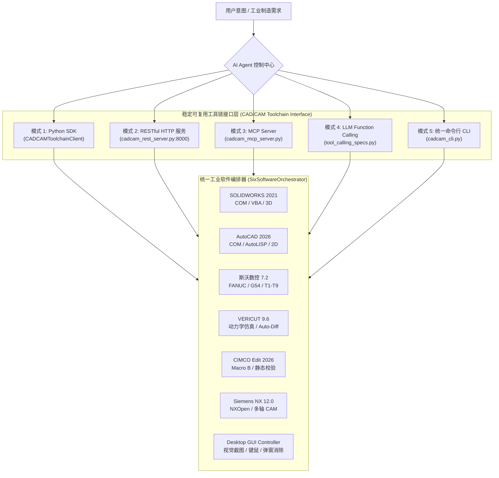

# 工业 CAD/CAM 六大软件 Agent 稳定可复用工具链接口规范

> **面向 AI 智能体 (Agent) 的统一工业工具链基础设施**  
> 适配 Windows 宿主机桌面安装的 6 款工业设计、数控编程与机床仿真软件，提供多协议、高可靠、可自愈的标准化调用能力。

---

## 一、 桌面快捷方式与底层进程映射基准

工具链内核内嵌「双通道容错解析引擎」：优先通过 Windows `WScript.Shell COM` 动态解析桌面 `.lnk` 目标路径；在遇到 Windows Installer 间接跳转时，自动无缝穿透定位真实主程序二进制文件，并实时监控进程生命周期。

| 软件名称 | 用户桌面快捷方式路径 (.lnk) | 底层主程序二进制真实路径 | 进程名称 | 自动化通讯协议 / 驱动方式 | 核心 Agent 能力 |
| :--- | :--- | :--- | :--- | :--- | :--- |
| **SOLIDWORKS 2021** | `c:\Users\Public\Desktop\SOLIDWORKS 2021.lnk` | `D:\SOLIDWORKS (2)\SLDWORKS.exe` | `SLDWORKS.exe` | ActiveX COM (`SldWorks.Application`) / VBA 宏脚本驱动 | 参数化特征建模、全局方程式驱动 (`EquationMgr`)、草图拉伸/旋转、STEP 导出 |
| **AutoCAD 2026** | `c:\Users\Public\Desktop\AutoCAD 2026 - 简体中文 (Simplified Chinese).lnk` | `D:\cad2026\AutoCAD 2026\acad.exe` | `acad.exe`, `accoreconsole.exe` | ActiveX COM (`AutoCAD.Application`) / AutoLISP 注入 / 无头 `ezdxf` | 国标 2D 工程图生成、图层/线型/标注公差、无头控制台批处理绘图 |
| **斯沃数控仿真 7.2** | `c:\Users\Public\Desktop\斯沃数控仿真软件.lnk` | `E:\仿真软件\2斯沃7.2（内含安装说明）\SSCNC\CNCLogin.exe` | `CNCLogin.exe`, `SSCNC.exe` | 进程管理 / Windows 窗口句柄控制 / 虚拟数控面板键鼠驱动 | FANUC 0i-TF/0i-MD 仿真机床拉起、G54~G59 坐标系标定、T1~T9 刀尖象限补偿计算、循环启动 |
| **CGTech VERICUT 9.6** | `c:\Users\Public\Desktop\Vericut 9.6.lnk` | `E:\windows64\commands\vericut.bat` | `vericut.exe`, `javaw.exe` | 无头批处理 CLI (`vericut.bat -b`) / 仿真日志结构化解析 | 五轴机床切削动力学模拟、防碰撞干涉检验、Auto-Diff 0.003mm 过切/欠切分析 |
| **CIMCO Edit 2026** | `c:\Users\Public\Desktop\CIMCO Edit 2026.lnk` | `E:\仿真软件\CIMCOEdit_20260102\CIMCO 2026\CIMCOEdit\CIMCOEdit.exe` | `CIMCOEdit.exe` | 正则 AST 语法解析器 / CLI 调用 / GUI 视窗拉起 | FANUC Macro B 变量与分支控制语法校验 (#100, #500, WHILE/DO/END)、模态 G 代码核验 |
| **Siemens NX 12.0** | `c:\Users\Administrator\Desktop\中文版NX12.0.lnk` | `E:\BaiduNetdiskDownload\NX 12.0.2.9\NX12.2.9waigua\NX12.2.9\NX\NXBIN\run_journal.exe` | `ugraf.exe`, `run_journal.exe` | 无头日志运行器 (`run_journal.exe`) / NXOpen Python 脚本 | 复杂曲面造型、多轴多工步 CAM 刀路规划、参数化表达式集合 (`ExpressionCollection`) |

---

## 二、 五大可复用接入模式 (5 Access Modalities)

工具链提供 5 种互通且完全解耦的调用方式，任意 Agent（Python 脚本、LLM 函数调用、MCP 生态、HTTP 服务、终端 CLI）均可即插即用。



---

### 模式 1：Python SDK 编程接口（本地单进程 / 远程 HTTP）

提供强类型、开箱即用的高阶面向对象调用。

```python
from bridges.toolchain_client import CADCAMToolchainClient

# 本地单进程直接调用（速度最快，无网络开销）
client = CADCAMToolchainClient()

# 1. 软件健康与快捷方式预检
status = client.preflight()
print(f"6大软件就绪数: {status['ready_count']}/6")

# 2. CIMCO Macro B 宏程序校验
res_cimco = client.cimco.validate("#100=53.0\nWHILE [#100 GT 0] DO 1\n#100=#100-1\nEND 1\nM30")
print("CIMCO 校验结果:", res_cimco["is_valid"], res_cimco["variables"])

# 3. 斯沃数控刀偏与象限计算
res_sscnc = client.sscnc.calculate_offsets([
    {"tool_num": 1, "type": "turning_rough", "x": 120.5, "z": 45.2, "r": 0.8, "quadrant": 3},
    {"tool_num": 2, "type": "threading", "x": 122.1, "z": 46.0, "r": 0.1, "quadrant": 8}
])

# 4. AutoCAD 无头工程图 DXF 生成
client.autocad.create_dxf("shaft_drawing", [
    {"type": "circle", "center": [0, 0], "radius": 26.5},
    {"type": "line", "start": [-30, 0], "end": [30, 0]}
])

# 5. 桌面视觉感知与窗口控制
client.gui.capture(output_path=r"d:\Virtu模型\scratch\current_desktop.png")
client.gui.dismiss_dialogs()  # 自动点掉阻塞弹窗

# 6. 一键驱动六大软件全流水线
chain_report = client.chain.run(wish="双工位伺服打螺丝机 铝合金机架 包含上下料滑台与电批模组")
```

若 Agent 运行在远程或独立环境，只需传入 `base_url` 即可透明切换为 HTTP 模式：
```python
client = CADCAMToolchainClient(base_url="http://127.0.0.1:8000")
```

---

### 模式 2：HTTP RESTful 微服务接口

启动轻量化服务（内置原生多线程，无第三方依赖）：
```powershell
python cadcam_cli.py server --port 8000
```

#### 核心 API 端点：
1. **健康检查与预检**:
   - `GET /health`
   - `GET /v1/cadcam/preflight`
2. **工具列表与调用**:
   - `GET /v1/cadcam/tools`
   - `POST /v1/cadcam/tools/call`  
     Payload: `{"name": "cadcam_cimco_validate", "arguments": {"action": "validate_macro", "code": "#100=10\nM30"}}`
3. **软件指令分发**:
   - `POST /v1/cadcam/dispatch`  
     Payload: `{"target_software": "solidworks", "action": "create_parametric_part", "parameters": {"part_name": "flange", "dimensions": {"d_outer": 53.0}}}`
4. **全流水线链路执行**:
   - `POST /v1/chain/run`  
     Payload: `{"wish": "制造一套双工位打螺丝机", "out_root": "runs/test"}`
5. **桌面 GUI 控制**:
   - `POST /v1/cadcam/gui`  
     Payload: `{"action": "capture", "software": "solidworks"}`

---

### 模式 3：Model Context Protocol (MCP) 标准服务

完全遵循 Anthropic / Antigravity 官方 MCP 协议标准（JSON-RPC 2.0 stdio）。

#### 1. 注册至 Antigravity MCP 工具目录
已自动导出 9 个标准化 JSON Schema 到系统 MCP 目录：
`C:\Users\Administrator\.gemini\antigravity\mcp\industrial-cadcam\`
- `cadcam_preflight.json`
- `cadcam_solidworks_model.json`
- `cadcam_nx_journal.json`
- `cadcam_autocad_draw.json`
- `cadcam_cimco_validate.json`
- `cadcam_vericut_simulate.json`
- `cadcam_sscnc_control.json`
- `cadcam_run_full_chain.json`
- `cadcam_desktop_gui.json`
- `instructions.md`

#### 2. 配置至任意 MCP 客户端（Claude Desktop / Cursor）
项目根目录下生成了标准配置文件 `mcp_cadcam_config.json`：
```json
{
  "mcpServers": {
    "industrial-cadcam": {
      "command": "python",
      "args": ["D:/Virtu模型/bridges/cadcam_mcp_server.py"],
      "env": {
        "PYTHONIOENCODING": "utf-8"
      }
    },
    "windows-computer-use": {
      "command": "D:/Virtu模型/external/windows-computer-use-mcp/.venv/Scripts/python.exe",
      "args": ["-m", "windows_computer_use_mcp.main"],
      "cwd": "D:/Virtu模型/external/windows-computer-use-mcp",
      "env": {
        "PYTHONIOENCODING": "utf-8",
        "windows_computer_use_mcp_ENABLE_KEYLOGGER": "0",
        "windows_computer_use_mcp_ENABLE_FACE": "0",
        "windows_computer_use_mcp_MAX_ACTIONS_PER_MINUTE": "40",
        "windows_computer_use_mcp_DEPOT_URL": "http://127.0.0.1:10727"
      }
    }
  }
}
```

关键词：鼠标键盘与读屏走两条通道——① `cadcam_desktop_gui`（仓内 ctypes/win32，已新增 `type_text`/`hotkey`/`inspect_window`/`button`/`double`，全程不经 shell）；② `windows-computer-use` MCP 服务（外部项目，实测 20 个工具，含 `get_desktop_state`/`get_window_state`/`automation_elements`/`automation_keyboard`/`approve_automation`/`automation_safety`）。它自带节流与 HITL：`automation_safety(operation=status)` 可读到 `max_actions_per_minute`、`kill_switch`、`dry_run`与本会话变更计数；全局键盘监听与人脸识别工具默认不存在于工具列表（需 `ENABLE_KEYLOGGER`/`ENABLE_FACE` 显式置真才注册），故本配置把它们显式写死为 0。

---

### 模式 4：大模型 Function Calling 标准工具定义 (LLM Tool Calling)

提供标准 OpenAI / Claude / Qwen 格式的函数签名，可直接装载到本地 `virtu-production:v3`、`virtu-toolcall` 或云端模型：

```python
from bridges.tool_calling_specs import get_cadcam_tool_definitions, execute_tool_call

# 1. 获取给 LLM 的 tools 参数
tools = get_cadcam_tool_definitions()

# 2. 当 LLM 输出 tool_calls 时，一键派发执行
res = execute_tool_call(
    tool_name="cadcam_solidworks_model",
    arguments={
        "action": "create_parametric_part",
        "part_name": "wheel_mold",
        "dimensions": {"d_outer": 53.0, "d_inner": 14.0, "overall_len": 45.0}
    }
)
```

---

### 模式 5：统一命令行 CLI 接口 (`cadcam_cli.py`)

便于在 PowerShell、批处理任务或 CI/CD 流水线中即时调用：

```powershell
# 1. 系统预检（表格/纯JSON）
python cadcam_cli.py preflight
python cadcam_cli.py preflight --json

# 2. 单软件指令派发
python cadcam_cli.py dispatch -s cimco -a validate_macro --code "#100=50\nM30"
python cadcam_cli.py dispatch -s sscnc -a calculate_offsets -p '{"tools":[{"tool_num":1,"type":"turning","x":100,"z":50,"r":0.8,"quadrant":3}]}'

# 3. 驱动全链制造流水线
python cadcam_cli.py chain -w "我想制造一套双工位伺服打螺丝机 铝合金机架"

# 4. 启动 HTTP REST 服务
python cadcam_cli.py server --port 8000

# 5. 启动 MCP stdio 模式
python cadcam_cli.py mcp

# 6. 桌面视觉感知与弹窗消除
python cadcam_cli.py gui capture -s solidworks -o sw.png
python cadcam_cli.py gui dismiss-dialogs
```

---

## 三、 稳定性与高可用保障设计

1. **双通道容错解析 (Double-Layer Fallback)**：
   - 优先通过 COM 接口读取桌面快捷方式的目标参数与工作目录；
   - 遇 MSI 安装包跳转时，自动回退到已验证的物理主程序路径，确保无论用户是否重命名桌面图标均能命中；
   - **入口形态容错**：桌面入口可以是 `.lnk`，也可以被用户换成直连 `.exe`（本机 NX 即如此）。
     `software_registry.resolve_entry(key)` 按「用户桌面 → 公共桌面」×「同名 `.lnk` → 同名 `.exe`」
     的顺序探测，取第一个真实存在的入口；`resolve_shortcut()` 对 `.exe`/`.bat`/`.cmd` 直接视自身为目标。
     因此入口形式变化不会让 `is_ready` 误判为缺失。
2. **弹窗自愈与防卡死守护 (Modal Dialog Dismissal Guard)**：
   - 工业软件容易出现“许可提示”、“每日一贴”、“文件恢复警告”等模态遮挡弹窗；
   - 工具链提供 `dismiss_dialogs()` 机制，自动检索当前前景顶层对话框并发送 ESC / Enter 快速消除；
3. **无头轻量执行优先 (Headless First)**：
   - AutoCAD 支持 `ezdxf` 纯无头生成与 `accoreconsole.exe` 命令行渲染；
   - Siemens NX 支持 `NXBIN\run_journal.exe` 纯无头脚本批处理；
   - VERICUT 支持 `vericut.bat -b` 后台静默仿真与日志提取；
   - 大幅减少拉起完整 GUI 带来的资源争抢与渲染延迟；
4. **统一规范化 JSON 响应契约**：
   所有接入通道（SDK / REST / MCP / Function Calling / CLI）的返回值统一带信封字段：

   | 字段 | 说明 |
   | :--- | :--- |
   | `status` | `success` / `ok`（成功）、`error`（执行错误）、`blocked`（闸门拦截）、`timeout`（等待超时）、`warning`（部分成功）。缺省时由信封层按"无 `error` 即 `success`"补齐，不做美化。 |
   | `data` | 业务字段聚合（`is_valid` / `variables` / `ready_count` / `software` ...）。 |
   | `execution_time_ms` | 本次派发端到端耗时（毫秒，浮点）。 |
   | `verdict_code` | 仅在拦截/失败时出现：`UNKNOWN_TOOL` / `PATH_TRAVERSAL_BLOCKED` / `SECURITY_AUDIT_VIOLATION` / `TOOL_APPROVAL_REQUIRED` / `PAYLOAD_TOO_LARGE` / `TOOL_TIMEOUT` / `TOOL_EXECUTION_ERROR`。 |

   兼容性：历史扁平业务字段（`is_valid`、`variables`、`ready_count` ...）仍保留在顶层，
   老调用方无需修改。实现位置：`bridges/tool_calling_specs.py::execute_tool_call`。

   **诊断语义必须准确**：拼错的工具名返回 `UNKNOWN_TOOL`，不会退化成
   `TOOL_APPROVAL_REQUIRED`——「没有这个工具」与「需要授权」是两件事，
   后者会让人误以为授权即可用。
