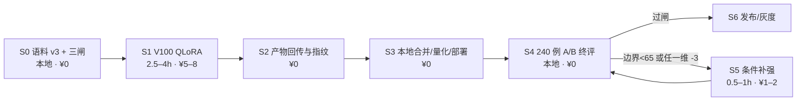

# Virtu 云端全面强化训练计划（V3.0）

| 项目 | 内容 |
|---|---|
| 文档编号 | VIRTU-CLOUD-TRAIN-2026-11-01-R01 |
| 版本 | V3.0（全面强化版，取代 v2 的单维度边界补强口径） |
| 编制日期 | 2026-11-01 |
| 状态 | 可执行：数据/脚本/评测器已就绪；v3 语料需按 §3.2 构建一次 |
| 依据 | [CLOUD_FINETUNE_PLAN_2026-11-01_v2.md](file:///d:/Virtu%E6%A8%A1%E5%9E%8B/CLOUD_FINETUNE_PLAN_2026-11-01_v2.md)、[云端训练实施全案](file:///d:/Virtu%E6%A8%A1%E5%9E%8B/benchmarks/virtu_capability_v1/%E4%BA%91%E7%AB%AF%E8%AE%AD%E7%BB%83%E5%AE%9E%E6%96%BD%E5%85%A8%E6%A1%88.md)、[AI模型系统性能力测评报告](file:///d:/Virtu%E6%A8%A1%E5%9E%8B/benchmarks/virtu_capability_v1/AI%E6%A8%A1%E5%9E%8B%E7%B3%BB%E7%BB%9F%E6%80%A7%E8%83%BD%E5%8A%9B%E6%B5%8B%E8%AF%84%E6%8A%A5%E5%91%8A.md)、本次语料实测 |

> **口径声明**：本文每个数字标注 **【实测】**（有文件/命令证据可复算）、**【估算】**（按实测 token/吞吐外推）或 **【计划目标】**（验收门槛，非承诺）。任何"训练后必然提升"的表述都不成立；只有过 §6 硬闸才算完成。

---

## 0. 一页执行摘要

| 项 | 决策 |
|---|---|
| 一句话方案 | 在 **Qwen3-8B base** 上做**一次** fp16 QLoRA 文本 LoRA，语料 = 既有 5,991 条实测干净集 + 边界强化 + 硬层专项 + 防过拒负例；训完先过硬闸，再本地合并/量化/灰度 |
| 为什么不拆多 LoRA | 多适配器 `peft_linear` 直加已实测乱码（Σw=5.7，[实施全案 §0](file:///d:/Virtu%E6%A8%A1%E5%9E%8B/benchmarks/virtu_capability_v1/%E4%BA%91%E7%AB%AF%E8%AE%AD%E7%BB%83%E5%AE%9E%E6%96%BD%E5%85%A8%E6%A1%88.md) P0-1）；线上只认单适配器 delta 合并 |
| 工具调用 | **不混进文本 LoRA**；沿用 `virtu-toolcall`（7 维臂 30 例 78.89 / 210 例综合 72.56），仅在退化时单独重训；TIES 合并臂的 30 例 88.89 仅作参考 |
| 主硬件 | Tesla V100-SXM2-32GB，**¥1.98/h**【实测价】；L40S 48GB（¥4.50/h）为质量优先备选 |
| 语料规模 | 名义 **7,216 条**（6,788 唯一 + 224 硬层唯一 + 204 负例）【实测基数 + 计划增量】 |
| 训练 token | **3.2–3.5M / epoch**，2 epoch **6.4–7.0M**【估算】 |
| 机时/成本 | GPU **3–5 h**，**¥6–12**；计划总预算 **≤¥30**，硬上限 **¥50** |
| 验收 | 综合 72.91 → **≥78**；边界 53.45 → **≥65**；任一维度较本轮基线跌 **>3 分拒收**；公式留出 **200/200** |
| 交付 | adapter（≤350MB）+ `training_receipt.json` 四元组指纹 + 240 例 `raw.jsonl` + 分维报告 |

**不改变的边界**：视觉维度由独立 Qwen3-VL 通道承担，本计划不训视觉；`virtu_omni_10b_base.pt`/LoopTransformer 仍禁止作为基座或合并源。

---

## 1. 现状锚定（全部【实测】）

### 1.1 八维基线（240 例，`_eval_full4`，`transport_error=0`，VALID）

| 维度 | 权重 | 分数 | 通过率 | hard 层均值 |
|---|---:|---:|---:|---:|
| 多模态理解 | 0.06 | 88.33 | 86.7% | — |
| 指令遵循 | 0.14 | 86.59 | 66.7% | — |
| 工具编排 | 0.18 | 75.55 | 63.3% | 38.89 |
| 推理逻辑 | 0.17 | 74.71 | 50.0% | — |
| 知识覆盖 | 0.15 | 73.78 | 53.3% | 40.83 |
| 泛化适配 | 0.08 | 67.87 | 36.7% | 80.77 |
| 内容生成 | 0.10 | 62.77 | 36.7% | 60.52 |
| 边界处理 | 0.12 | 53.45 | **10.0%** | 46.95 |
| **加权综合** | 1.00 | **72.91** | — | — |

补充臂：文本 7 维（210 例）`ollama_virtu_toolcall` **72.56**（其中 30 例工具编排 78.89）；TIES/Delta 合并件 30 例工具编排 **88.89**。三臂覆盖范围不同，禁止混成单一分数。

### 1.2 已定位的失败根因

**边界维度（53.45，通过率 10%）**——不是"不会拒绝"，而是三类行为错误（逐条核验模型原始输出）：

1. **缺关键量擅自假设/编造**（e01/e08/m01 直接 fail）；
2. **矛盾输入不做裁决**（e07）；
3. **虚构实体被要求时编造**（e09）。

**难度断崖**——所有维度 hard 层显著掉分（知识 hard 40.83、工具 hard 38.89、边界 hard 46.95）。这是 8B 基座规模 + hard 工况语料不足的共同结果，**不能靠调 lr 解决**；必须补 hard 层可复算样本。

### 1.3 可直接复用的资产

| 资产 | 路径 | 实测状态 |
|---|---|---|
| 文本 SFT 干净集 | `data/train/virtu_fix_v1/train/virtu_fix_text_sft_v1.jsonl` | 5,991 条；语义污染 0；3.10M tok/epoch@2048 |
| 边界强化集 | `data/sft/virtu_capability_sft_v6.jsonl` | 4,233 条（S1 1147 / S2 460 / S3 797 / S4 1029 / legacy 800） |
| 工具调用集 | `data/toolcall_optimal.jsonl` | 2,316 条；A800 实测 0.45h / ¥3.2 |
| 公式留出 | `data/benchmark/virtu_fix_v1/formula_holdout_200.jsonl` | 200 条，数值与训练集不相交 |
| V100 训练器 | `scripts/train_virtu_v100.py` | fp16 + NF4 + 断点续训 + preflight/smoke |
| 一键开训 | `scripts/bootstrap_v100_train.sh` | 失败即写 `TRAIN_STATUS.json`，只认 `COMPLETED` |
| 打包器 | `scripts/make_cloud_bundle.py --route c` | sha256 闸 + LF 归一 + 可复现 tar |
| 合并/量化/部署 | `scripts/merge_numpy.py`、`scripts/hf_to_gguf_numpy.py`、`scripts/deploy_local_sft.py` | delta 合并 + GGUF + 灰度切桥 |
| 评测 | `virtu_eval/runner.py`、`virtu_eval/report.py`、`virtu_eval/contamination_check.py` | 240 例 / 8 维 / 确定性判分 |

---

## 2. 强化目标（验收门槛与拉伸目标分列）

| 维度 | 基线 | **硬闸（不过即拒收）** | 拉伸目标【计划目标】 | 依据 |
|---|---:|---:|---:|---|
| 综合加权 | 72.91 | **≥78** | 80 | 基线 +5 与本计划 hard 补强 |
| 边界处理 | 53.45 | **≥65** | 70 | 三类错误行为专项语料 |
| 知识覆盖 | 73.78 | **≥72 且 hard ≥45** | hard 60 | GB/T 1800 与 MMC 可复算样本 |
| 推理逻辑 | 74.71 | **≥72** | 78 | 多步链 + Taylor/公差 |
| 工具编排 | 8 维臂 75.55；7 维臂 30 例 78.89 | **30 例 ≥78.89；210 例综合 ≥72.56（不退化）** | 30 例 90 | 工具通道独立 |
| 指令遵循 | 86.59 | **≥82** | 88 | 防"增强数据把话风训散" |
| 内容生成 | 62.77 | **≥60** | 68 | 防灾难性遗忘 |
| 泛化适配 | 67.87 | **≥65** | 70 | 负例与通用对话保留 |
| 多模态 | 88.33 | **≥85.33（不跌超 3 分；视觉通道不动）** | 88.33 | 独立通道，不参与训练 |
| 任一维度 | — | **较本轮基线（§1.1）下降 >3 分 → 拒收** | — | 全局防退化条款 |

**公式留出闸**：200 条四类各 50，数值/单位 **200/200** 命中；缺参题必须反问。

---

## 3. 数据工程：强化语料 v3

### 3.1 实测总账（本次逐文件核验）

| 桶 | 条数【实测】 | 来源 | 用途 |
|---|---:|---|---|
| A 文本主桶 | **5,991** | `virtu_fix_v1`：master 1,200 / wish 800 / 公式 2,400 / 图纸链 360 / 缺参反问 300 / 知识推理 858 / 通用 73 | 领域、计算、图纸、通用 |
| B 边界桶 | **797** | `virtu_capability_sft_v6.jsonl` 的 `meta.stage=S3` | 拒答/矛盾/虚构/注入 |
| C 硬层专项 | **224 唯一** | `cloud_train_pack/prepare_v100_targeted_corpus.py` | hard 公式、GB/T 1800、MMC 补偿、几何冲突 |
| D 防过拒负例 | **+204**（计划） | 由 `scripts/build_capability_sft.py` 负例模板补 | 正常请求不得拒答 |
| E 工具调用 | **2,316** | `data/toolcall_optimal.jsonl` | **独立通道，不入 A–D** |
| F 评测留出 | **240 + 200** | `virtu_eval_v1` / `formula_holdout_200` | **只评测，永不训练** |

### 3.2 三个必须遵守的构建结论（本次核验发现）

1. **B 桶与 A 桶零重叠**：按 prompt 归一化哈希比对，797 条 S3 **全部为新增**，可直接并入 A（6,788 条唯一）。
2. **C 桶存在 81.1% 的精确重复**：生成器实际产出 **1,188 行，但只有 224 个唯一 prompt**（964 行是 `×30/×40/×10` 复制）。**若原样入训，等于用 5 倍 token 学同一句话**——必须按 `prompt hash` 去重后再并入。
3. **B 桶负例不足**：S3 内"正常请求负例"仅 **138 条**，占边界桶 **17.3%**，低于[实施全案 §2.2](file:///d:/Virtu%E6%A8%A1%E5%9E%8B/benchmarks/virtu_capability_v1/%E4%BA%91%E7%AB%AF%E8%AE%AD%E7%BB%83%E5%AE%9E%E6%96%BD%E5%85%A8%E6%A1%88.md)要求的 **≥30%**。需再补 **≥204 条**正常负例（求解：`N/(797+N) ≥ 0.30 ⇒ N ≥ 342`）。

> **结论**：v3 语料 = A 5,991 + B 797 + C 224（去重后）+ D 204 = **7,216 条**。其中边界相关 **1,340 条（18.6%，含 A 桶既有缺参反问 300）**；在 B+C+D 边界强化桶（1,040 条）内负例 342 条（138 + 204），占 **32.9%**；硬层可复算样本 ≥185 条。

### 3.3 配比（v3，名义 7,216 条）

| 类别 | 条数 | 占比 |
|---|---:|---:|
| 公式/参数计算（n/Vf/MRR/T + 硬层公式） | 2,564 | 35.5% |
| 六软件/许愿/图纸链 | 2,360 | 32.7% |
| 知识/推理/标准公差 | 879 | 12.2% |
| 边界（拒答/矛盾/注入/负例/缺参反问） | 1,340 | 18.6% |
| 通用对话 | 73 | 1.0% |
| **合计** | **7,216** | **100%** |

### 3.4 入库三闸（任一失败不得打包）

| 闸 | 命令 | 通过标准 |
|---|---|---|
| 语义污染 | `python virtu_eval/contamination_check.py <v3.jsonl> --eval-dir data/benchmark/virtu_eval_v1 --ignore-gold-numeric --drop <clean>` | **contaminated = 0** |
| 精确去重 | 构建脚本内置 `prompt hash` 去重 | **重复行 = 0** |
| 负例比例 | 构建脚本断言 | **负例 / 边界桶 ≥ 30%** |
| 数值一致性 | `pytest tests/test_arithmetic_guard.py -q` | 全部通过 |
| 语料 sha | manifest 写 `sha256`，训练器 preflight 校验 | **sha 一致** |

### 3.5 token 与成本估算（不虚报）

| 项 | 值 | 口径 |
|---|---:|---|
| A 桶 token/epoch@2048 | 3,104,927 | 【实测】manifest |
| B/C/D 增量 token | +0.25–0.35M | 【估算】按短样本 250–300 tok |
| v3 token/epoch | **3.2–3.5M** | 【估算】 |
| 2 epoch | **6.4–7.0M** | 【估算】 |
| V100 机时 | **2.5–4 h** | 【估算】按 v2 的 V100 吞吐折扣 |
| GPU 成本 | **¥5–8** | 【估算】¥1.98/h |

---

## 4. 训练配置

### 4.1 主路线：V100-SXM2-32GB（本次实机）

```yaml
base_model: /root/models/Qwen3-8B        # ModelScope，16GB，禁止重复下载
precision: fp16  # V100 sm70 无 bf16；脚本 pick_precision 自适应
quantization: 4-bit NF4 + double_quant   # 失败可 --no-4bit 回退 fp16 LoRA
attention: sdpa                          # 禁止安装 flash-attn（V100 无 FA2）
gradient_checkpointing: true
max_seq_length: 2048
per_device_batch_size: 1
gradient_accumulation_steps: 32          # 有效 batch 32
learning_rate: 1.0e-4
scheduler: cosine
warmup_ratio: 0.03
epochs: 2
optimizer: adamw_torch                   # 可选 paged_adamw_8bit
lora: {r: 32, alpha: 64, dropout: 0.05,
       target_modules: [q_proj,k_proj,v_proj,o_proj,gate_proj,up_proj,down_proj]}
checkpoint: 每 100 step，原子写，保留最近 3 个
```

### 4.2 备选：L40S 48GB（质量优先）

bf16 全精度基座 + LoRA，`max_len=4096`（不截断 301 条长样本），`batch=4 / accum=4`，`lr=2e-4`，约 ¥7–12。仅在 V100 反复 OOM 或评分距目标 >5 分时启用。

### 4.3 双通道隔离（硬约束）

| 通道 | 模型 | 语料 | 归因 |
|---|---|---|---|
| 文本 | 本计划新 LoRA（`virtu-hardened-v1`） | A–D | 7 个文本维度 |
| 工具 | 既有 `virtu-toolcall` | E（2,316） | toolcall 维度 |
| 视觉 | 既有 Qwen3-VL-2B | 不入训 | 多模态维度 |

线上用 `VIRTU_OLLAMA_MODEL` / `VIRTU_TOOL_MODEL` 两条独立变量；**禁止把 E 混进文本 LoRA**（`train_virtu.py` 会跳过 `tool_calls`，混入只会浪费 token）。

### 4.4 明确排除的省事方案

- 8B 全参：单卡 45GiB 放不下优化器状态，成本 >¥500，遗忘风险高；
- 多 LoRA `peft_linear` 直加：已实测乱码（Σw=5.7）；
- 用 240 例评测题、200 公式留出集做训练：污染即失效；
- 云端直接出 GGUF：磁盘与内存预算不足，合并/量化一律本地。

---

## 5. 阶段编排（S0–S6）



| 阶段 | 内容 | 输入 | 产出 | 时长/成本 | 卡口（不达标处置） |
|---|---|---|---|---|---|
| **S0** | 构建 v3、去重、补负例、三闸、更新 bundle | A/B/C + 负例模板 | `data/train/virtu_v3/train/*.jsonl` + manifest | 本地 / ¥0 | 污染≠0、重复≠0、负例<30%、sha 漂移 → 停 |
| **S1** | preflight → smoke 20 步 → 正式 2 epoch | v3 + Qwen3-8B | adapter + `training_receipt.json` | 2.5–4h / ¥5–8 | OOM→max_len 1536 或 `--no-4bit`；二次冒烟仍败→不训 |
| **S2** | SFTP 回传、校验 adapter 配置与四元组 | adapter ≤350MB | `checkpoints/virtu_hardened_v1_lora` | 10 min / ¥0 | `status != COMPLETED`、r≠32、target 缺项 → 拒收 |
| **S3** | delta 合并 + 幅度探针 + GGUF q4_0 + Ollama 注册 + 灰度 | adapter + base | `virtu-hardened-v1` 独立模型名 | 本地 / ¥0 | 幅度均值 1–5% 且 max<20%；20 探针乱码率 <1% |
| **S4** | 240 例新臂 + ties-v1 + base；200 公式留出；30 例工具 | 三个臂 | `raw.jsonl` + `results.json` + 雷达图 | 2–3h / ¥0 | §6 硬闸任一不过 → 不进 S6 |
| **S5** | 条件补强：从现有 adapter 续训边界/硬层桶，`lr=5e-5`、1 epoch、r 不变 | B/C/D 子集 | adapter v2 | 0.5–1h / ¥1–2 | 最多 2 轮；2 轮不过 → 熔断并出 RCFA |
| **S6** | 灰度切桥 + 终验 + 台账/报告 | 过闸模型 | 发布记录 + 证据链 | 本地 / ¥0 | 线上 `served_model` 与 receipt 指纹一致 |

**排期原则**：S1 结束即关机，评估全在本地（Ollama q4）做，避免为评测多付云端机时；仅当 S4 失败需要 S5 时再开实例并 `--resume`。

---

## 6. 验收与评测

### 6.1 硬闸（任一不过即不得发布）

| # | 闸 | 通过标准 |
|---|---|---|
| 1 | 覆盖完整性 | `raw.jsonl` 240 行、0 malformed；`transport_error ≤ 5%` |
| 2 | 综合分 | **≥78**（同 240 例、同判分器、`temperature=0`） |
| 3 | 边界 | **≥65**；五类子项各 ≥4/6 |
| 4 | 防退化 | 任一维度较 §1.1 基线下降 **>3 分 → 拒收** |
| 5 | 公式留出 | **200/200** 数值/单位命中；缺参题 100% 反问 |
| 6 | 工具 | 30 例 ≥78.89；210 例综合 ≥72.56、toolcall ≥78.89（不退化） |
| 7 | 输出卫生 | 无西里尔/拉丁扩展乱码；同题多跑唯一率 >95% |
| 8 | 指纹 | receipt 含 `base_sha256 + dataset_sha256 + adapter_sha256 + config_sha256`，与部署件一致 |
| 9 | 合并 | `merge_numpy --probe-amplitude`：delta/base 均值 1–5%，max <20% |
| 10 | 服务真实性 | 同输入不同题输出哈希不同；后端不可用返回 503，禁止模板兜底 |

### 6.2 评测方法

- 240 例固定集、8 维度、`case_id` 去重 last-wins；三臂（新 / ties-v1 / base）同参数跑；
- 首轮用全 240 例验收；若进入 S5 二次调参，则按 `case_id` 哈希对半切 A/B：A 折调参、B 折发布；
- 报告必须能逐条回溯到响应原文与判分证据，否则视为不可复核。

### 6.3 发布阻断

`transport_error > 5%`；`raw.jsonl` 行数 < 计划用例数；任一维度 0 分且病因是判分器异常；receipt 缺 `dataset_sha256`；`served_model` 与训练件不符。

---

## 7. 执行命令（全部为当前仓库真实脚本）

### 7.1 S0 本地构建与三闸

```bash
# ① 构建 v3（需新增 scripts/build_train_v3.py，职责固定为：
#    A + B 合并 → 精确去重 → C 去重后并入 → 负例补至 30% → 写 manifest/sha256）
python scripts/build_train_v3.py \
  --fix data/train/virtu_fix_v1/train/virtu_fix_text_sft_v1.jsonl \
  --boundary data/sft/virtu_capability_sft_v6.jsonl \
  --targeted cloud_train_pack/prepare_v100_targeted_corpus.py \
  --min-negative-ratio 0.30 \
  --out data/train/virtu_v3/train

# ② 三闸
python virtu_eval/contamination_check.py data/train/virtu_v3/train/virtu_v3_text_sft.jsonl \
  --eval-dir data/benchmark/virtu_eval_v1 --ignore-gold-numeric \
  --drop data/train/virtu_v3/reports/semantic_clean.jsonl
python -m pytest tests/test_arithmetic_guard.py -q --basetemp=build/ptmp_v3
```

> **注意**：`scripts/make_cloud_bundle.py` 的 `CORPUS` 列表与 `check_corpus_gate()` 当前硬编码 `virtu_fix_v1` 路径与 sha。改用 v3 时必须同步两者（新增 v3 路径 + 对应 manifest），否则云端 preflight 的 sha 闸会直接失败。

### 7.2 打包与上传

```bash
python scripts/make_cloud_bundle.py --route c           # 产出 cloud_handoff/virtu_bundle_route_C.tar.gz
python scripts/make_cloud_bundle.py --route c --check   # 二次只校验，确认 sha 未漂移
```

上传后云端只跑一条：

```bash
tar xzf virtu_bundle_route_C.tar.gz -C ~ && bash ~/virtu/scripts/bootstrap_v100_train.sh
```

`bootstrap_v100_train.sh` 自带：硬件/磁盘检查 → 依赖（torch cu124）→ ModelScope 拉基座 → preflight → 20 步冒烟（OOM/4bit 自动降级）→ `timeout` 包裹的正式训练 → 只认 `training_receipt.json.status == COMPLETED`。

### 7.3 回传、合并、量化、部署

```bash
# ① 回传 adapter 到 checkpoints/virtu_hardened_v1_lora（adapter_config.json + adapter_model.safetensors）

# ② delta 合并 + 幅度探针
python scripts/merge_numpy.py --base checkpoints/_base_qwen3_8b \
  --lora checkpoints/virtu_hardened_v1_lora --out checkpoints/virtu_hardened_v1 \
  --mode delta --weight 1.0 --probe-amplitude

# ③ 量化 GGUF 并注册独立 Ollama 名（不覆盖 qwen3:8b / ties-v1）
python scripts/hf_to_gguf_numpy.py --model checkpoints/virtu_hardened_v1 \
  --out checkpoints/virtu-hardened-v1-q4_0.gguf
# 生成 Modelfile 后 ollama create virtu-hardened-v1 -f <Modelfile>

# ④ 灰度切桥（内部自动 setx/重启，旧模型保留可回滚）
python scripts/deploy_local_sft.py --adapter-dir checkpoints/virtu_hardened_v1_lora \
  --switch --run-eval
```

### 7.4 终评与灰度

```bash
# 先在 virtu_eval/arms.json 注册新臂（ollama_virtu_hardened_v1 → virtu-hardened-v1）
python -m virtu_eval.runner --arm ollama_virtu_hardened_v1 --out-dir runs/eval/virtu_hardened_v1 --temperature 0.0
python virtu_eval/report.py --runs "virtu_hardened_v1:runs/eval/virtu_hardened_v1" --out benchmarks/virtu_capability_v1
```

过闸后：`VIRTU_OLLAMA_MODEL=virtu-hardened-v1` + `VIRTU_TOOL_MODEL=virtu-toolcall` 重启 8000，核对 `/v1/models`；回滚即切回 `virtu-ties-v1`，新产物移入 `checkpoints/_broken/`，不覆盖 canonical。

### 7.5 备用路线（今天即可跑，零代码）

若暂不构建 v3，可直接用已封板的 5,991 条包开训（`cloud_handoff/virtu_bundle_route_A.tar.gz`（L40S 48GB，max_len 5120 零截断）或 `..._route_C.tar.gz`（V100 32GB，max_len 2048 截 301 条），sha 已由 `MANIFEST_ROUTE_{A,C}.json` 固定，重建命令 `python scripts/make_cloud_bundle.py --route a|c`）。该路线可验证公式/知识/推理，但**不含边界桶**，边界大概率仍 <65；适合作为成本更低的 A 臂，而非"全面强化"终点。

---

## 8. 预算与排期

| 项 | V100 主线 | 说明 |
|---|---:|---|
| S1 训练机时 | 2.5–4 h | 6.4–7.0M token / 2 epoch【估算】 |
| S5 条件补强 | 0–2 h | 仅在不过闸时发生 |
| GPU 成本 | **¥5–12** | ¥1.98/h【实测价】 |
| 数据/存储/流量 | ¥0–5 | 本地构建 + 已有基座 |
| 评测 | ¥0 | 本地 Ollama + 既有 runner |
| **计划总成本** | **≤¥30** | 硬上限 ¥50，超时自动停机 |

对照【实测】：A800 上 3.14M token / 2 epoch / 0.45h / ¥3.2；本计划 token 翻倍且 V100 更慢，故按 ¥5–8 保守估算，不承诺"几块钱训完"。

**停机策略**：S1 回执 `COMPLETED` 后立即关机；checkpoint 与产物落持久盘；`timeout` 用 `MAX_HOURS`（默认 8h）包裹；预算监控按小时。

---

## 9. 风险与熔断

| 风险 | 触发信号 | 处置 |
|---|---|---|
| V100 无 bf16 / 无 FA2 | torch 报 dtype 或 attention 错 | 脚本已固定 fp16 + sdpa；**不安装 flash-attn** |
| bitsandbytes 在 sm70 异常 | NF4 初始化失败 | `--no-4bit` 回退 fp16 LoRA；再降 `max_len=1536` |
| OOM（32GB） | `CUDA out of memory` | batch=1/accum=32 已是最小；先降 max_len，再 `--no-4bit` |
| 边界数据导致"一问就拒" | 负例正确率 <90%，或正常题误拒 | 负例占比 ≥30%；S4 专项误拒集 ≤5% |
| 灾难性遗忘 | 任一维跌 >3 分 | 保留 73 条通用对话；拒收并回滚 |
| 公式背题而非会算 | 200 留出集 <200/200 | 留出集数值不相交；不足则回 S0 重生成 |
| 数据泄漏 | 语义闸命中 >0 | 阻断打包；剔除命中样本后重跑 |
| 合并乱码 | 探针乱码率 ≥1%、幅度 max >20% | 停止合并；只允许单 delta，禁 `peft_linear` |
| 云端静默失败 | 无 receipt 或 `SMOKE_ONLY` | 一律算失败；不进合并 |
| 远程进程被回收 | 日志不刷新 | `nohup setsid` + 同连接内等待脱离；`--resume` 续跑 |
| 价格/可用性波动 | 实际单价超 ¥2.5/h | 立即停机，改租 L40S/4090 前先复核当日价 |

**熔断规则**（与 AGENTS.md 一致）：同一错误连续 3 次失败，或连续 2 次无收敛停滞 → 停止修改、回滚、输出 RCFA，不把半成品报成完成。

---

## 10. 交付物与证据链

1. `data/train/virtu_v3/train/virtu_v3_text_sft.jsonl` + `manifest.json`（条数、来源、token、污染口径、sha256）
2. `cloud_handoff/virtu_bundle_route_C.tar.gz` + `MANIFEST_ROUTE_C.json`
3. `training_receipt.json`（四元组指纹、loss/lr/tok_per_s/grad_norm 序列、显存峰值、status=COMPLETED）
4. `checkpoints/virtu_hardened_v1_lora` + `checkpoints/virtu_hardened_v1`（合并件）+ GGUF + Ollama 模型名
5. `runs/eval/virtu_hardened_v1/raw.jsonl`（240 行，含响应原文）
6. `benchmarks/virtu_capability_v1/results.json` + 雷达图 + 分维报告
7. `checkpoints/PROVENANCE.json` 更新（新产物身份、sha、状态、禁用项）
8. 一页 A/B 结论：新模型 vs `virtu-ties-v1` vs base，逐维差值表

---

## 11. 明确不做

1. 不做 8B 全参微调；
2. 不用 `peft_linear` 多 LoRA 直加；
3. 不用 240 评测题 / 200 留出集训练或调参；
4. 不训视觉、不把视觉 LoRA 合进文本模型；
5. 不把 toolcall 混进文本 LoRA；
6. 不训练占位权重 `virtu_omni_10b_base.pt` / LoopTransformer；
7. 不在云端合并/量化全模（只出 adapter）；
8. 不以 `train_loss` 单调下降作为能力提升证据。

---

## 12. 开工前检查清单

- [ ] 云端实例可用：`nvidia-smi` 显示 V100-SXM2-32GB，空闲显存 ≥30GB，数据盘 ≥50GB
- [ ] 基座已在盘上：`/root/models/Qwen3-8B`（或缺则一次性下载，~16GB）
- [ ] v3 语料已构建：7,216± 条，重复 0，语义污染 0，负例 ≥30%
- [ ] 语料 manifest sha256 已同步到 `make_cloud_bundle.py` 的 v3 路径与闸
- [ ] `make_cloud_bundle.py --route c --check` 通过
- [ ] 基线已复测：240 例 `transport_error=0`，72.91 可复现
- [ ] 预算：单价 ≤¥2.5/h、硬上限 ¥50、超时 8h、checkpoint 落持久盘
- [ ] 回滚路径：`virtu-ties-v1` 可一键切回；`_broken/` 目录可写
