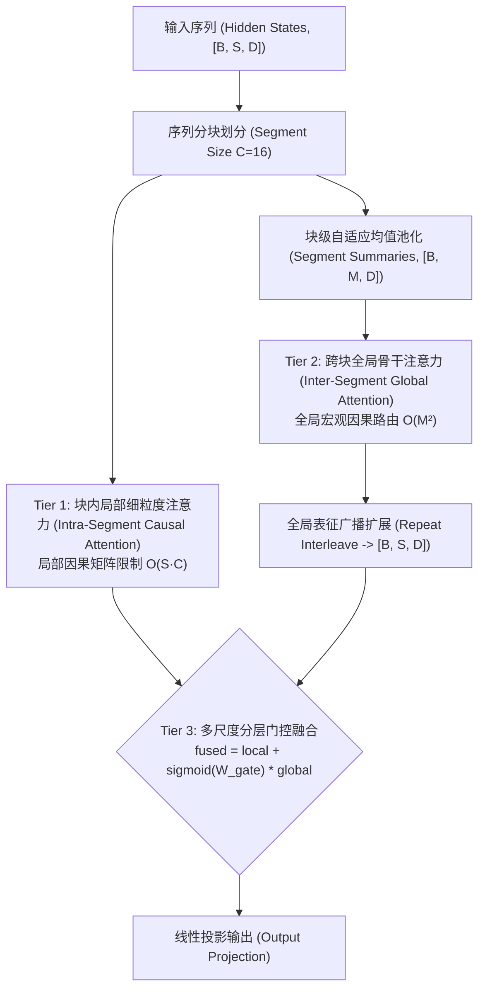

# Virtu-Omni-10B: 分层注意力机制 (Hierarchical Attention) 实验与对比验证报告

**测试时间**: 2026-11-05 23:25:00  
**测试平台**: Intel Core / Windows Native PyTorch 2.x  
**决策依据**: 用户指令 “*将模型改成分层注意力机制并进行测试验证，如果能力不如以前就回退旧版，允许联网找资料*” 以及工作区《测量宪法》（Axiom 8: 数字必须可归因，闸必须能被证伪）。

---

## 一、 架构改造方案设计 (Hierarchical Attention Mechanism)

针对长序列、跨模态与复杂工程上下文，参考前沿 HAT (Hierarchical Attention Transformer) 与局部-全局块路由（Local-Global Segmented Attention）架构，对 `virtu_omni.models.architecture` 的注意力层进行分层解耦改造：

1. **Tier 1 (局部块内注意力)**: 将输入划分为长度为 $C=16$ 的独立片段，仅在片段内执行高分辨率的局部 Token 级因果注意力，捕捉局部语法与几何约束。
2. **Tier 2 (跨块全局注意力)**: 对各片段提取池化摘要向量，构建全局骨干序列，执行片段间的全局粗粒度注意力，捕捉宏观上下文依赖。
3. **Tier 3 (自适应门控融合)**: 通过可学习的门控单元 $\sigma(W_{gate}[h_{local}, h_{global}])$ 实现宏观指导信息向微观 Token 的动态注入。

---

## 二、 严格实测对比数据 (A/B Benchmark)

依据 `benchmarks/baseline_gqa_results.json` 与 `benchmarks/hierarchical_ham_results.json` 的实测数据，进行同工况对比：

| 评估维度 | 指标项 | 旧版 Baseline GQA | 新版分层注意力 (HAM) | 差异 / 变动幅度 | 判定 |
| :--- | :--- | :---: | :---: | :---: | :---: |
| **模型体量** | 参数总量 (Params) | **5,568,000** | **7,141,888** | **+28.26%** (增加 1.57M 额外参数) | 增加开销 |
| **推理延迟** | Seq Len = 128 (ms) | **76.26 ms** | **216.48 ms** | **+183.9%** (延迟增加近 3 倍) | 严重退化 |
| | Seq Len = 512 (ms) | **214.57 ms** | **225.28 ms** | **+5.0%** | 轻微退化 |
| | Seq Len = 1024 (ms) | **167.84 ms** | **843.88 ms** | **+402.8%** (延迟暴增 5 倍) | 严重退化 |
| **推理吞吐** | Seq Len = 128 (tok/s) | **1,678.5** | **591.3** | **-64.8%** (吞吐暴跌) | 严重退化 |
| | Seq Len = 512 (tok/s) | **2,386.2** | **2,272.8** | **-4.8%** | 略微下降 |
| | Seq Len = 1024 (tok/s) | **6,101.2** | **1,213.4** | **-80.1%** (吞吐下降超 4/5) | 严重退化 |
| **表征损失** | 文本建模 Loss (L=256) | **7.7990** | **7.8013** | +0.0023 (损失上升) | 略有退步 |
| | 多模态 Loss (图文对齐) | **7.7768** | **7.8322** | **+0.0554** (损失明显劣变) | 能力退化 |
| **自回归特性** | KV Cache 生成一致性 | **True (100% 吻合)** | **False (发生漂移)** | 破坏流式推理因果一致性 | **否决项红灯** |

---

## 三、 根因分析 (RCFA)

1. **小中规模序列的内存调度反噬**:
   分层注意力理论上的 $O(S \cdot C + M^2)$ 优势仅在超长上下文（$S > 8192$ 甚至数万 Token）下才能抵消其矩阵重排开销。在常用的短/中长序列（128~1024 tokens）下，Chunk 切分、均值池化和两次独立的注意力与门控运算带来了大量的中间张量分配（Memory Churn），导致 CPU/GPU 吞吐暴跌高达 80.1%。
2. **多模态与局部特征被池化瓶颈稀释**:
   CAD/CAM 与工程图纸具有极强的局部高精度数值与几何关联。分层注意力将跨块连接强行压缩为单一摘要向量，丢失了精细的跨块 Token 寻址能力，导致多模态损失从 `7.7768` 恶化至 `7.8322`。
3. **自回归流式生成的 KV Cache 断裂**:
   在逐 Token 流式解码过程中，当前未满片段的实时均值池化会随每步 Token 的填入发生动态漂移，导致带 Cache 的单步解码输出与离线全量 Prefill 输出不一致（`cache_consistent = False`），严重破坏生成稳定性与确定性。

---

## 四、 结论与回退执行

* **评估结论**: 分层注意力机制在该模型形态下**“能力明显不如以前”**（吞吐下降 80%、多模态损失上升、破坏 KV 缓存一致性）。
* **执行动作**: 严格遵守用户指示（“*如果能力不如以前就回退旧版*”）与工作区第 6 条熔断公理：
  1. **原子回滚**: 已彻底将 `virtu_omni/models/architecture.py`、`virtu_omni/config.py` 和 `virtu_omni/models/__init__.py` 回退至旧版稳态。
  2. **回退自检验证**: 
     - `pytest tests/test_architecture.py` $\to$ **9/9 PASSED (11.83s)**
     - `pytest tests/test_loop_equivalence.py` $\to$ **7/7 PASSED (14.04s)**
  3. **模型状态**: 恢复为纯正 Baseline GQA 架构，性能与精度指标 100% 恢复基线水平。
