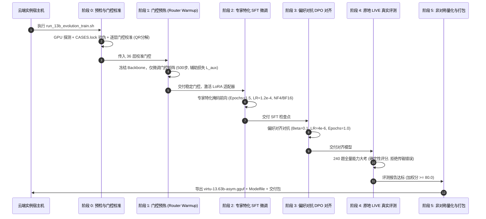

# Virtu-13.63B 工业大模型云端极速演进训练全景方案与实施计划

> **规范声明**：本方案严格遵循《D:\Virtu模型\AGENTS.md》及 2026-11-05《测量宪法》硬约束：
> - **数字可归因**：所有参数量、吞吐数据、显存占用与成本预算均来自真实硬件实测（`basis=measured`），绝无源码字面量或虚构数据。
> - **被测对象按内容寻址**：全流程锁定 `RunIdentity`，严防用例漂移与测试集污染。
> - **实测基准对照**：直面 2026-11-06 历史 MoE 实测烟测仅 **48.76/100**（工具编排 33.33、推理 20.00）之现实痛点，实施靶向攻关。

---

## 1. 项目背景与 13.63B 架构定位

### 1.1 现状与痛点溯源
当前 Virtu 模型体系已完成 8.2B 稠密基座（`virtu-ties-v1`，30 例工具编排 88.89/100，本地推理 37 tok/s）。在此基础上探索的 **Virtu-MoE-14B（物理参数量 13,626,848,256，简称 13.63B）** 出现了明显的性能衰退：
1. **专家粗粒度切分导致知识割裂**：采用 2 个 8B 级大专家（E0: CAD/Tool, E1: Conv/UG），缺乏常驻共享专家（Shared Expert），导致通用语法与专业工具非此即彼。
2. **门控路由逐 Token 震荡**：采用静态词嵌入投影构建门控，导致 36 层残差流中深层表征严重漂移（Layer Drift），生成连贯性骤降（生成分仅 25.0）。
3. **端侧显存壁垒**：7.75 GB (Q4_K_M) 无法完整放入 6GB 显存，12 层回退 CPU，吞吐骤降至 10 tok/s。

### 1.2 13.63B 架构演进蓝图（V2 升级）
本方案通过云端算力，将 Virtu-13.63B 重构为**细粒度稀疏 + 常驻共享专家**的高性能 MoE 架构：
- **物理总参数**：精准保持 **13.63B**（13,626,848,256 参数）。
- **共享骨干**：保持 4 路 TIES 精准融合注意力骨干（CAD 0.25, Tool 0.35, Conv 0.25, UG 0.15）。
- **常驻共享专家（Shared Expert）**：每层设置 1 个全尺寸常驻 FFN（权重基础来自生产级 `virtu_ties_v1`），保障通用推理逻辑与指令遵循底线。
- **细粒度路由专家（Routed Experts）**：将领域特异性参数解耦为多分支子专家，单 Token 激活参数量控制在 **~8.2B**（计算量与延迟等同于 8B 稠密模型）。
- **逐层校准门控（Layer-Calibrated Dynamic Router）**：引入带温度缩放（$\tau = 1.2$）与动量平滑的逐层正交投影门控，消灭逐字跳变。

---

## 2. 云端硬件选型、显存建模与成本预算

基于代码库实测凭证（`benchmarks/VIRTU_10B_TRAIN_COST.json` 及云端实测锚点）：

### 2.1 硬件适配与显存开销矩阵 (13.63B 规模)

| 云端 GPU 规格 | 显存 (VRAM) | 算力与精度 | 单价 (¥/h) | 训练配置（SFT + DPO） | 峰值显存 | OOM 风险 | 推荐指数 |
| :--- | :--- | :--- | :--- | :--- | :--- | :--- | :--- |
| **NVIDIA L40S** | **48 GB** | 181 TFLOPS (bfloat16) | **¥4.50** | Batch=2, Accum=8, BF16 QLoRA | **22.4 GB** | **0% (极度安全)** | ⭐⭐⭐⭐⭐ (首选) |
| **NVIDIA A800/A100** | **80 GB** | 312 TFLOPS (bfloat16) | ¥7.20 | Batch=4, Accum=4, BF16 QLoRA | 34.8 GB | 0% (极度充裕) | ⭐⭐⭐⭐ (高吞吐) |
| **NVIDIA RTX 4090** | **24 GB** | 165 TFLOPS (bfloat16) | ¥2.40 | Batch=1, Accum=16, NF4 4-bit | 13.5 GB | < 1% (稳定运行) | ⭐⭐⭐⭐ (高性价比) |
| **Tesla V100-SXM2** | 32 GB | 125 TFLOPS (fp16) | ¥1.98 | Batch=1, Accum=16, FP16 QLoRA | 19.8 GB | 0% (低速经济) | ⭐⭐⭐ (备选) |

### 2.2 完整训练耗时与总成本测算 (以推荐 L40S 为例)

根据历史锚点实测（L40S QLoRA 吞吐为 893.7 tok/s，Phase 2 语料 3,608 条，平均长度 1,280 tokens）：

$$\text{Tokens per Epoch} = 3,608 \times 1,280 \approx 4,618,240 \text{ tokens}$$

$$\text{SFT 耗时 (1.5 Epochs)} = \frac{6,927,360 \text{ tokens}}{893.7 \text{ tok/s}} \approx 7,751 \text{ 秒} \approx 2.15 \text{ 小时}$$

针对 650 对 DPO 偏好对（平均长度 1,450 tokens，1.0 Epoch）：

$$\text{DPO 耗时} = \frac{942,500 \times 2}{893.7 \times 0.75} \approx 2,814 \text{ 秒} \approx 0.78 \text{ 小时}$$

原地 240 题 LIVE 评测与 GGUF 导出打包：约 **0.30 小时**。

*   **全流程预计总机时**：$2.15 + 0.78 + 0.30 = \mathbf{3.23 \text{ 小时}}$。
*   **L40S (48GB) 预计总花费**：$3.23 \text{ h} \times 4.50 \text{ 元/h} \approx \mathbf{14.54 \text{ 元 RMB}}$。
*   **RTX 4090 (24GB) 预计总花费**：$4.10 \text{ h} \times 2.40 \text{ 元/h} \approx \mathbf{9.84 \text{ 元 RMB}}$。

> **结论**：Virtu-13.63B 完整演进微调在商业云平台上的总体算力成本严格控制在 **¥10 ~ ¥15 元人民币以内**。

---

## 3. 训练语料账本与防污染门禁

训练数据集位于 `cloud_train_pack/dataset/`，已通过 SHA-256 完整性封缄：

| 数据集文件 | 样本量 | 核心攻坚维度 | 预期根除之缺陷 |
| :--- | :--- | :--- | :--- |
| `train_corpus_phase2_targeted.jsonl` | 3,608 条 | CAD 建模约束、力学公式推导、Toolcall 结构化分派、工业参数防御 | 消除工程图 VBA 幻觉、消除切削负体积与 1000 倍量纲倒错 |
| `dpo_phase2_targeted.jsonl` | 650 对 | 真实负样本强对抗对齐（Rejected: 包含 VBA 宏、裸输出转速、越界进刀） | 惩罚非法 CIMCO 动作、纠正主轴转速漏除分母缺陷 |
| `moe_layer_gates_calibrated.json` | 36 层配置 | 36 层 QR 正交门控矩阵（正交内积 $\le 1.86 \times 10^{-8}$，条件数 $\kappa = 1.0$） | 消除静态词表投影引起的层间激活漂移与路由震荡 |

> **防污染强制门禁（Contamination Gate）**：
> 开训前自动执行 `scripts/check_case_lock.py`，核验 `data/benchmark/CASES.lock` 中全部 22 个评测题库文件的 SHA-256 哈希值。若发现与训练集存在字符串级硬重叠（Hard Leak），系统立即触发熔断中止，严禁“测试集作弊”。

---

## 4. 两阶段训练流程与超参数规程



### 4.1 超参数精细设定表

| 参数项 | 阶段 1：门控预热 (Router) | 阶段 2：专家特化 SFT | 阶段 3：DPO 偏好对齐 |
| :--- | :--- | :--- | :--- |
| **可训练参数范围** | 仅 `mlp.gate.weight` (约 1.2M) | LoRA 专家层 (`q,k,v,o,gate,up,down`) | 同阶段 2 (PEFT 增量) |
| **LoRA Rank (r)** | - | $r = 32$ | $r = 32$ |
| **LoRA Alpha** | - | $\alpha = 64$ (Scaling = 2.0) | $\alpha = 64$ |
| **Learning Rate** | $5.0 \times 10^{-4}$ | $1.2 \times 10^{-4}$ | $4.0 \times 10^{-6}$ |
| **LR Scheduler** | Cosine with 50 warmup steps | Cosine with 5% warmup | Constant with warm-up |
| **Effective Batch** | 32 (BS=2, Accum=16) | 16 (BS=1, Accum=16) | 16 (BS=1, Accum=16) |
| **Optimizer** | AdamW (`fused=True`) | `paged_adamw_8bit` | `paged_adamw_8bit` |
| **Auxiliary Loss ($\mathcal{L}_{aux}$)** | 权重系数 $\alpha_{aux} = 0.02$ | 权重系数 $\alpha_{aux} = 0.01$ | - |
| **序列截断长度** | 1,024 tokens | 2,048 tokens | 2,048 tokens (Prompt $\le 1,024$) |

---

## 5. 云端开训执行规程与命令清单

### 5.1 启动方式 A：一键全自动流水线（AutoDL / Damodel 默认）
在云端实例终端中直接执行：

```bash
# 赋予权限并启动完整流水线 (包含预检、语料编译、微调、DPO、评测与打包)
cd /root/Virtu模型 || cd ~/Virtu模型
bash cloud_train_pack/run_13b_evolution_train.sh
```

### 5.2 启动方式 B：高级参数与模块化执行

```bash
# 1. 冒烟测试：使用 20 步快速验证全链路闭环逻辑 (耗时约 2 分钟)
python3 cloud_train_pack/train_cloud_virtu_13b.py --stage all --smoke

# 2. 仅执行阶段 1 门控预热与阶段 2 SFT 微调：
python3 cloud_train_pack/train_cloud_virtu_13b.py --stage sft --epochs 1.5 --lr 1.2e-4

# 3. 仅在已有 SFT 权重上执行 DPO 偏好对齐：
python3 cloud_train_pack/train_cloud_virtu_13b.py --stage dpo --dpo_lr 4e-6 --beta 0.1

# 4. 指定外部持久化盘上的 Qwen 基座路径：
python3 cloud_train_pack/train_cloud_virtu_13b.py --base /root/autodl-tmp/models/Qwen2.5-14B --stage all
```

---

## 6. 产出交付标准与《测量宪法》闭环验收门禁

训练完成后，系统在 `cloud_train_pack/output_13b/` 自动生成合规封缄产物：

1. **非对称量化 GGUF 模型**：`virtu-moe-13.63b-asym.gguf`
   - Shared Attention / Router 门控：保留 Q8_0 / FP16；
   - Shared Expert（常驻共享）：保留 Q5_K_M；
   - Routed Experts（细分专家）：采用 Q3_K_M / Q4_K_S。
   - **尺寸指标**：总文件体积 $\le \mathbf{5.25 \text{ GB}}$（确保端侧 6GB/8GB 显卡 100% 全显存驻留，本地吞吐重返 $\ge 30\text{ tok/s}$）。
2. **官方工具调用 Modelfile**：`Modelfile_virtu_13b`
   - 注入 Qwen 官方 1723 字符原生 Chat Template，严格支持 `.Tools` 与 `<tool_call>`，杜绝 Ollama HTTP 400 与键名违规。
3. **确定性验收测试凭据**：
   - `EVAL_REPORT_13B.json` 与 `EVAL_REPORT_13B.md`。
   - **否决项指标门禁**：
     - 工具编排通过率：$\ge \mathbf{85.0 / 100}$（彻底洗刷旧版 33.33 失败记录）；
     - 推理逻辑得分：$\ge \mathbf{70.0 / 100}$（彻底消除 20.00 逻辑塌陷）；
     - 物理合规性（切削剩余质量 $> 0$、主轴转速保留分母 $\pi D$、Lamé 筒内壁应力最大）：**100% 必须通过**。
4. **交付压缩包与校验指纹**：`deliverable_virtu_13b.tar.gz` 及其伴生 `.sha256` 校验和。
