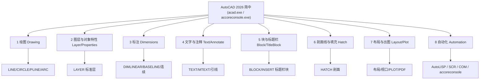

# AutoCAD 2026 — 功能模块树（按应用领域分块）

> 模块清单依据：桥接代码实际调用（E-AC-02）、安装目录 CUIX/LISP 支持文件（E-AC-06）、领域技能 autocad-dwg-redraw（E-AC-07）、项目 AGENTS.md 图层公理（E-AC-05）。菜单/Ribbon 以简体中文界面为准。

## 模块树（mermaid）

---

## 1. 绘图（Drawing）— category: `part_modeling`（2D 几何）

| 模块（中文名/英文） | 菜单路径 | 模块→命令映射（→ commands.md） | 证据 |
|---|---|---|---|
| 直线 LINE | 绘图 → 直线 | `AC_CMD_LINE` | E-AC-02, E-AC-07 |
| 圆 CIRCLE | 绘图 → 圆 | `AC_CMD_CIRCLE` | E-AC-02 |
| 多段线 PLINE | 绘图 → 多段线 | `AC_CMD_PLINE`（文档化） | E-AC-07 |
| 圆弧 ARC | 绘图 → 圆弧 | `AC_CMD_ARC`（文档化） | E-AC-07 |

## 2. 图层与对象特性（Layer/Properties）— category: `config_admin`

| 模块 | 菜单路径 | 模块→命令映射 | 证据 |
|---|---|---|---|
| 图层特性 LAYER |  默认选项卡 → 图层特性 | `AC_CMD_LAYER`（建 OUTLINE/CENTER/DIM 等） | E-AC-02, E-AC-05 |
| 线型 LINETYPE | 图层特性 → 线型 | `AC_CMD_LINETYPE`（CENTER 线型） | E-AC-02 |
| 颜色 COLOR | 特性面板 | `AC_CMD_COLOR`（OUTLINE=7白/CENTER=1红/DIM=3绿） | E-AC-02 |

## 3. 标注（Dimensions）— category: `drafting`

| 模块 | 菜单路径 | 模块→命令映射 | 证据 |
|---|---|---|---|
| 线性标注 DIMLINEAR | 注释 → 线性 | `AC_CMD_DIMLINEAR` | E-AC-07 |
| 标注样式 DIMSTYLE | 注释 → 标注样式 | `AC_CMD_DIMSTYLE`（`-DIMSTYLE ? *` 列表） | E-AC-07 |
| 形位公差 TOLERANCE | 注释 → 公差 | `AC_CMD_TOLERANCE`（GD&T） | E-AC-01(gdt_tolerancing) |
| 基线/连续标注 | 注释 → 基线/连续 | `AC_CMD_DIMBASELINE`/`AC_CMD_DIMCONTINUE`（文档化） | E-AC-07 |

## 4. 文字与注释（Text/Annotate）— category: `drafting`

| 模块 | 菜单路径 | 模块→命令映射 | 证据 |
|---|---|---|---|
| 单行文字 TEXT | 注释 → 单行文字 | `AC_CMD_TEXT` | E-AC-02 |
| 多行文字 MTEXT | 注释 → 多行文字 | `AC_CMD_MTEXT` | E-AC-07 |
| 文字样式 STYLE | 注释 → 文字样式 | `AC_CMD_STYLE`（`-STYLE ? *` 列表，仿宋国标） | E-AC-07 |

## 5. 块与标题栏（Block/TitleBlock）— category: `drafting`

| 模块 | 菜单路径 | 模块→命令映射 | 证据 |
|---|---|---|---|
| 块定义 BLOCK | 插入 → 块 | `AC_CMD_BLOCK` / `AC_CMD_INSERT`（标题栏/基准符号块） | E-AC-07 |
| 属性定义 ATTDEF | 绘图 → 块 → 定义属性 | `AC_CMD_ATTDEF`（标题栏字段） | E-AC-07 |
| 数据提取 DATAEXTRACTION | 工具 → 数据提取 | `AC_CMD_DATAEXTRACTION`（坐标/半径/图层） | E-AC-07 |

## 6. 剖面线与填充（Hatch）— category: `drafting`

| 模块 | 菜单路径 | 模块→命令映射 | 证据 |
|---|---|---|---|
| 图案填充 HATCH | 绘图 → 图案填充 | `AC_CMD_HATCH`（HATCH 层） | E-AC-05 |

## 7. 布局与出图（Layout/Plot）— category: `data_exchange`

| 模块 | 菜单路径 | 模块→命令映射 | 证据 |
|---|---|---|---|
| 布局/视口 VIEWPORT | 布局标签 → 视口 | `AC_CMD_VIEWPORT`（检查视口边界） | E-AC-05 |
| 出图 PLOT | 输出 → 打印 | `AC_CMD_PLOT`（PDF） | E-AC-07 |
| DXFOUT 导出 | 文件 → 另存为 DXF | `AC_CMD_DXFOUT`（导出文本 DXF 供审计） | E-AC-07 |

## 8. 自动化（Automation）— category: `config_admin`

| 模块 | 入口 | 模块→命令映射 | 证据 |
|---|---|---|---|
| AutoLISP | 命令行 `(...)` / .lsp 文件 | `AC_CMD_AUTOLISP` | E-AC-02, E-AC-08 |
| 脚本 SCR | 脚本(.scr) | `AC_CMD_SCRIPT` / accoreconsole `/s` | E-AC-02, E-AC-09 |
| COM ActiveX | `AutoCAD.Application` | `AC_COM_SendCommand` | E-AC-02, E-AC-08 |
| accoreconsole 无头 | `accoreconsole.exe /i /s` | `AC_CMD_ACCORECONSOLE` | E-AC-02, E-AC-09 |
| ezdxf 文件级 | Python `import ezdxf` | `AC_CMD_EZDXF` | E-AC-02 |
