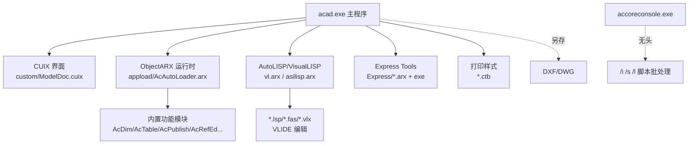

# AutoCAD 2026 — 插件/附加模块

> 第 10 个知识库文件。三态判定同主知识库。勘察根：`D:\cad2026\AutoCAD 2026\`。通道限制：无法现场加载 .arx/.vlx 复测，凡「文件在盘但未运行」标 documented-not-probed。

## 1. 插件/扩展机制总表

| 名称（中/英） | 类型 | 路径 | 可执行文件/库 | 与主程序集成方式 | 状态 | 证据 |
|---|---|---|---|---|---|---|
| CUIX 界面定制 | 自定义 UI 包 | `UserDataCache\zh-cn\Support\` | `custom.cuix`、`ModelDoc.cuix`、`acetmain.cuix`、`dbcon.cuix` | acad.exe 启动加载 Ribbon/菜单/工作空间 | verified-working（文件在盘） | E-AC-P01 |
| ObjectARX 插件机制 | 原生 C++ 扩展 | `D:\cad2026\AutoCAD 2026\` | `appload.arx`、`AcAutoLoader.arx` | APPLOAD 命令按需加载 `*.arx`/`*.dll` | verified-working（机制组件在盘；未加载第三方 arx） | E-AC-P02 |
| VisualLISP / AutoLISP 运行时 | 脚本引擎 | 安装根 | `vl.arx`、`vl_u.arx`、`asilisp.arx` | VLIDE 编辑器；运行 .lsp/.fas/.vlx | verified-working（运行时在盘） | E-AC-P03 |
| Express Tools 工具集 | 外挂工具集 | `D:\cad2026\AutoCAD 2026\Express\` | `alias.exe`、`dumpshx.exe`、`lspsurf.exe`、`RText.arx`、`acetutil.arx` 等 | Express 面板/菜单命令 | verified-working（目录在盘） | E-AC-P04 |
| 打印样式 Plot Styles | 配置 | `UserDataCache\Plotters\Plot Styles\` | `acad.ctb`、`monochrome.ctb`、`Screening 25/50/75/100%.ctb`、`Grayscale.ctb`、`DWF Virtual Pens.ctb`、`Fill Patterns.ctb` | PLOT 时选 ctb 控制笔宽/灰度 | verified-working（文件在盘） | E-AC-P05 |
| 动态块 Dynamic Blocks | 块机制 | 块定义内 | （`acblock.arx`、`acDcSymbols.arx` 支撑） | BLOCK 编辑器内参数/动作 | documented-not-probed（机制组件在盘，未现场建块） | E-AC-P06 |
| accoreconsole headless 扩展 | 批处理 | 安装根 | `accoreconsole.exe` | `/i /s /l /product /isolate /readonly /profile` | verified-working（桥接已用 /i /s） | E-AC-P07 |
| 内置 ARX 功能模块 | 原生扩展 | 安装根 | `AcDim.arx`、`AcTable.arx`、`AcPublish.arx`、`AcRefEd.arx`、`AcXrefService.arx`、`AcSection.arx`、`AcLayouts`(acDcLayouts.arx) 等 100+ | 启动即加载，提供标注/表格/发布/参照编辑/外部参照/截面等命令 | verified-working（文件在盘） | E-AC-P02 |

## 2. 插件关系图（mermaid）

## 3. 插件分节

### 3.1 CUIX 界面定制
- **功能域**：Ribbon 标签、工具栏、菜单、工作空间自定义。
- **关键文件**：`custom.cuix`（用户定制）、`ModelDoc.cuix`（主模型文档 UI）、`acetmain.cuix`（Express Tools UI）、`dbcon.cuix`（数据库连接）。
- **自动化接口**：CUI 命令 `CUI`/`CUIEXPORT`/`CUIIMPORT`；本轮未现场导出，`documented-not-probed`。

### 3.2 ObjectARX / .NET 插件机制
- **功能域**：加载第三方原生扩展（.arx C++、.NET 托管 dll）。
- **入口**：命令 `APPLOAD`（`appload.arx`）启动加载对话框；`AcAutoLoader.arx` 支持按需自动加载（需求文件 .arx 描述）。
- **自动化接口**：COM `SendCommand("(arxload \"...\")\n")` 或 APPLOAD；.NET 用 `NETLOAD`。本轮未加载第三方 arx，`documented-not-probed`。
- **内置模块证据**：安装根 100+ `.arx`（标注 AcDim、表格 AcTable、发布 AcPublish、参照编辑 AcRefEd、外部参照 AcXrefService、截面 AcSection、动态块 acblock 等）。

### 3.3 AutoLISP / VisualLISP
- **功能域**：参数化脚本。运行时 `vl.arx`/`vl_u.arx`（VisualLISP）、`asilisp.arx`（AutoLISP）。
- **编辑**：VLIDE（`VLISP` 命令打开集成开发环境）。
- **文件格式**：`.lsp`（文本源）、`.fas`（编译 fas）、`.vlx`（独立可执行 vlx）。
- **自动化**：桥接 `send_lisp_command` 经 `SendCommand` 发表达式；`.lsp` 落盘 scratch 供加载（见 automation_api.md §3）。

### 3.4 Express Tools
- **路径**：`D:\cad2026\AutoCAD 2026\Express\`。
- **可执行工具**：`alias.exe`（命令别名编辑）、`dumpshx.exe`（SHX 字体转储）、`lspsurf.exe`。
- **ARX 模块**：`RText.arx`（远程文字）、`acetutil.arx`、`acetftp.arx`、`acetmail.arx`、`ctextapp.arx`（弧形文字）、`dimsio.arx`（标注导入导出）、`dwglog.arx`、`edittime.arx`、`leaderex.arx`（引线）、`propulate.arx`、`sysvdlg.arx`。
- **状态**：目录/文件在盘 verified；具体命令调用本轮未复测 documented-not-probed。

### 3.5 打印样式 Plot Styles
- **路径**：`UserDataCache\Plotters\Plot Styles\`。
- **文件**：`acad.ctb`（默认）、`monochrome.ctb`（单色）、`Screening 25/50/75/100%.ctb`（淡显灰度）、`Grayscale.ctb`、`DWF Virtual Pens.ctb`、`Fill Patterns.ctb`。
- **用途**：PLOT/PDF 出图时按颜色映射线宽与灰度；标题含「Named Plot Styles」模板对应 `.stb`（命名打印样式，本轮未 Glob 到 .stb 文件）。

### 3.6 动态块 Dynamic Blocks
- **机制**：块定义内嵌参数与动作；支撑组件 `acblock.arx`、`acDcSymbols.arx`。
- **用途**：标题栏/紧固件参数化块；本轮未现场建块 documented-not-probed。

### 3.7 accoreconsole headless 扩展
- **参数族**：`/i`（输入 dwg）、`/s`（脚本 scr）、`/l`（语言）、`/product`、`/isolate <userid> <userDataFolder>`、`/readonly`、`/profile`（详见 automation_api.md §4，官方博客 E-AC-P08）。
- **状态**：`/i /s` 桥接 verified-working；其余开关 documented-not-probed。

## 4. 缺口

- 未现场加载任何第三方 .arx/.vlx；Express Tools 具体命令名本轮未枚举命令帮助。
- `.stb` 命名打印样式文件本轮未 Glob 到（仅 .ctb 颜色相关）。
- CUIX 内部命令表未解包（.cuix 为 zip 包，无 shell 未解）。
