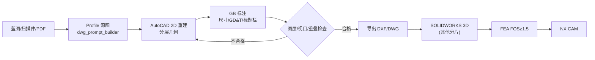

# AutoCAD 2026 — 端到端工作流

> 对齐 `D:\Virtu模型\AGENTS.md` 第 2.B 节与第 3 节闭环。AutoCAD 在闭环中承担 **2D 工程图底稿 / GB 标注 / 图层纪律 / DXF 交付** 角色；三维建模由 SOLIDWORKS，CAM 由 NX，仿真由 VERICUT/SSCNC。

## 闭环总览（AutoCAD 角色高亮）

## WF-AC-1 源 DWG 精确复现（autocad-dwg-redraw 范式）

步骤序列（E-AC-07）：
1. **Profile 源图**：`dwg_prompt_builder.py --source in.dwg --output prompt.md` → 导出实体计数、图层表、块清单、文字样式、标注样式、风险项。
2. **审阅 prompt**：确认图名、实体数、图层/块/样式表。
3. **精确重画**：`dwg_redraw.py --source in.dwg --output out.dwg`（COM 实体复制优先）。
4. **校验**：对比源/目标 ModelSpace/PaperSpace 实体数、对象类型分布、尺寸/引线数、文字/MTEXT 数、块引用、图层。

**检查点**：
- 保留尺寸/引线/文字/MTEXT/剖面线/块/图层/线型/颜色/线宽/文字样式/标注样式；
- 源有尺寸/引线而目标缺 = 校验失败；
- 不覆盖源 DWG，写新输出路径。

## WF-AC-2 PDF/图片→参数化 2D 图（无头 ezdxf 范式）

步骤序列（桥接 `create_headless_dxf`，E-AC-02）：
1. **规范化参数**：记录单位、总尺寸、重复特征、视图、图层、公差；缺失值显式标 unknown。
2. **几何权威**：书面尺寸 > 算术推导 > 图片比例；冲突以尺寸为准并记录差异。
3. **建层**：`doc.layers.add("OUTLINE",color=7)`、`add("CENTER",color=1,linetype="CENTER")`、`add("DIMENSION",color=3)`。
4. **画几何**：`msp.add_circle/add_line/add_text`。
5. **保存**：`doc.saveas(out.dxf)`（R2018）。

**关键参数与检查点**：
- 标准图层（AGENTS.md 2.B）：`OUTLINE`(轮廓) / `DIM`(标注) / `HIDDEN`(虚线) / `CENTER`(中心线) / `HATCH`(剖面) / `TITLE_BLOCK`(标题栏)。
- 文字高度默认 3.5 mm（桥接）。
- **检查点**：拒绝负/零尺寸、越界、未解释重叠、算术总和与总尺寸不符；`ZOOM E` 后目视复核。

## WF-AC-3 GB 工程图与标注交付

- 第一角投影（GB/T 17451）、中心线（GB/T 4457.4）、表面结构（GB/T 131）、公差（GB/T 4458.5/1800）、未注公差（GB/T 1804）。
- 标题栏用块 `TITLE_BLOCK` 层；BOM/孔表以块属性承载。
- **视口边界检查**（AGENTS.md 2.B）：出图前检查布局视口边界，防止内容溢出图框。
- **文字-尺寸重叠检查**：标注前检查文字与尺寸线是否重叠；密集区改用孔表/槽表，长引线不替代尺寸链（E-AC-07, E-AC-09 机械图底线）。

## WF-AC-4 无头批量（accoreconsole）

- 批量转 DXF / 批处理标注：`accoreconsole.exe /i in.dwg /s run.scr`，`/l` 选语言版脚本。
- 检查点：脚本中路径用正斜杠 `/s`（Autodesk 案例：反斜杠 `\s` 拼写错误导致 accoreconsole 崩溃，E-AC-09）。

## WF-AC-5 与下游 SW/CAM 衔接

- 输出 `Flange_Drawing_GB.dxf`（既有产物）作为 2D 底稿；SW 据此做参数化 3D（WF-SW-1）。
- DXF 头部 `$ACADVER=AC1032` 确保 SW/NX 可读；复杂代理对象/注释型标注须在 AutoCAD GUI 中复核（E-AC-07）。

## 检查点速查

| 检查点 | 判定 | 不通过动作 |
|---|---|---|
| 图层纪律 | 图元在 OUTLINE/CENTER/DIM 等标准层 | 归层 |
| 视口边界 | 无内容溢出图框 | 调视口比例 |
| 文字-尺寸重叠 | 无重叠/压线 | 调整标注位置或改孔表 |
| 实体数对比 | 源=目标（复现场景） | 补实体 |
| 负/零尺寸 | 无 | 拒绝并报错 |
