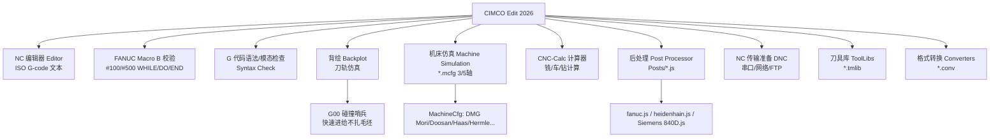

# CIMCO Edit 2026 功能模块树

> 按**应用领域分块**。证据：安装目录实测（Help/*.chm、Posts/*.js、MachineCfg/*.mcfg、Templates/*.TPL/*.TYP、ToolLibs/*.tmlib、Converters/*.conv、Sys、Drawings/*.cdd、Samples/*.NC、Tutorials/*.pdf，E-203）、`cimco_bridge.py`（E-204）、CIMCO 官方在线手册（E-205）。

## 模块树总览（mermaid）

## 分块明细

### 1. NC 编辑器 Editor（category: nc_editor）
- 菜单：`文件|打开`(File|Open)、编辑/查找/替换；多程序标签页 Program Tabs
- 帮助：`Help\nc-base_us.chm`（编辑器基础）、`Help\edit_*.chm`（E-203）
- 模块→命令：`cimco_open_nc`、`cimco_editor_setup`、`cimco_convert`

### 2. FANUC Macro B 校验（category: simulation_verification）
- 作用：检查 `#1~#33`（局部）、`#100~#199`（公共）、`#500~#999`（系统）变量；WHILE[cond]DO m 与 END m 配对（m=1/2/3，最多 3 层嵌套）
- 桥接：`cimco_bridge.py::validate_fanuc_macro_b`（E-204）
- 模块→命令：`cimco_macro_validate`

### 3. G 代码语法/模态检查（category: simulation_verification）
- 作用：G/M/O 字头 token 校验、模态组一致性（G90/G91、G17/G18/G19、G94/G95）
- 桥接：`cimco_bridge.py`（G/M/O token 校验骨架）；工具 `cadcam_cimco_validate`（E-204/E-206）
- 模块→命令：`cimco_gcode_syntax`

### 4. 背绘 Backplot（category: simulation_verification）
- 菜单：`Backplot`（快捷键 **Ctrl+Shift+P**）；Backplot File 直接从磁盘背绘
- 官方手册：Backplot（E-205）；信息栏 Milling/Turning（E-205）
- **公理强制：背绘检查 G00 快速进给不得高速扎入毛坯（碰撞哨兵，AGENTS.md §2.D）**
- 模块→命令：`cimco_backplot`、`cimco_backplot_file`

### 5. 机床仿真 Machine Simulation（category: virtual_machine）
- 配置：`MachineCfg\*.mcfg`（DMG Mori monoBlock、Doosan、Haas、Hermle、Hwacheon、Matsuura、Mikron、Quaser、Roeders、Cimco Mill 3/5 轴，含 STL 机床部件 + config.json）
- 模块→命令：`cimco_machine_sim`

### 6. CNC-Calc 计算器（category: nc_editor）
- 作用：铣/车/钻参数计算（螺旋下刀、凹槽、螺纹、倒角）；`Help\cnc-calc_*.chm`（E-203）
- 模块→命令：`cimco_cnc_calc`

### 7. 后处理 Post Processor（category: post_processing）
- 脚本：`Posts\Mill\*.js`（fanuc.js、haas.js、heidenhain.js、Siemens 840D.js、Deckel 4、Fadal、Fagor 8055i、Universal Iso）；`Posts\Lathe\*.js`（IsoLathe 变体、Siemens Lathe、IsoStoneShaper）
- 文档：`Posts\Post Processor Manual.pdf`、`Posts\Programming CNC-Calc Post Processor.html`（E-203）
- 模块→命令：`cimco_post_process`

### 8. NC 传输准备 DNC（category: nc_editor）
- 作用：串口/网络/FTP 发送准备；模板 `Templates\NETWORK.TPL`、`FtpClient.epl`、`XMODEM.TPL`（E-203）
- 模块→命令：`cimco_dnc_send`

### 9. 刀具库 ToolLibs（category: data_exchange）
- 文件：`ToolLibs\Predefined\*.tmlib`（ISO/Inch Drills、Mills MM/Inch、Taps、Spot drills、Counter sinks、Holders；ISCAR/Seco）
- 模块→命令：`cimco_tool_list`

### 10. 格式转换 Converters（category: data_exchange）
- 文件：`Converters\*.conv`（fanuc.conv、heidenhain.conv、SinumerikTurning.conv、NumeripathTurning.conv）；`Templates\*.TPL/*.TYP`（FANUC-FAPT、HEIDENHAIN、MAZAK、OKUMA、LSV2、ISO_G-Code 等）
- 模块→命令：`cimco_convert`
