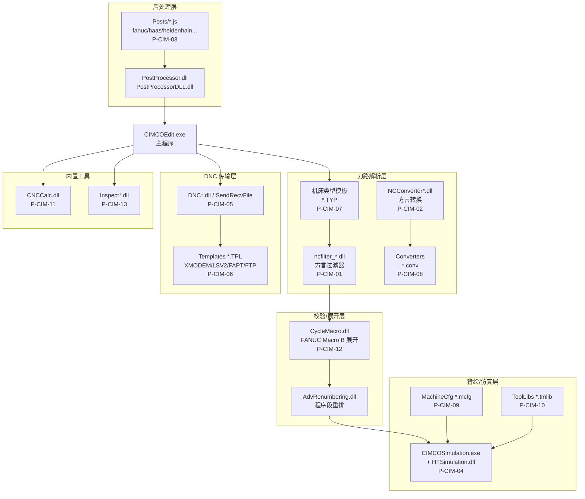

# CIMCO Edit 2026 — 插件 / 附加模块 / 模板集 文档化逆向

> 范围：仅覆盖「外挂/Add-in/独立工具/模板集/脚本后处理包/方言过滤器 DLL」。主程序的 G 代码编辑器、背绘、DNC 模块本身见 `modules.md`；自动化通道（无 COM，仅命令行拉起 + 外部 Python 校验）见 `automation_api.md`。
> 三态判定纪律沿用第一轮：`verified-working` = 历史实测跑通过；`confirmed-negative` = 明确探测为否；`documented-not-probed` = 本轮仅做文件系统勘察、未启动实测。
> **硬边界**：本文不分析 `License.dll` 的任何内部行为；仅登记其作为已存在组件名。所有插件均围绕编辑/校验/背绘/传输功能文档化，不涉及授权/激活机制。

---

## 1. 插件/附加模块总表

| # | 名称（中 / 英） | 类型 | 安装路径 | 可执行 / 库文件 | 与主程序集成方式 | 状态 | E-ID |
|---|---|---|---|---|---|---|---|
| P-CIM-01 | NC 方言过滤器 DLL 集 / NC Codec Filters (ncfilter_*.dll) | 内置 Add-in（DLL 插件） | `Dll\` | `ncfilter_fanuc.dll`、`ncfilter_siemens.dll`、`ncfilter_heidenhain.dll`、`ncfilter_heidiso.dll`、`ncfilter_universalheidenhain.dll`、`ncfilter_mazakiso.dll`、`ncfilter_MazakIntegrex.dll`、`ncfilter_okuma.dll`、`ncfilter_deckel.dll`、`ncfilter_fagor.dll`、`ncfilter_hurco.dll`、`ncfilter_roeders.dll`、`ncfilter_roedershh.dll`、`ncfilter_sodick.dll`、`ncfilter_emco.dll`、`ncfilter_mach3.dll`、`ncfilter_millplus.dll`、`ncfilter_OSAI.dll`、`ncfilter_NUM.dll`、`ncfilter_thermwood.dll`、`ncfilter_xilog.dll`、`ncfilter_iso.dll`、`ncfilter_APT.dll`、`ncfilter_nci.dll`、`ncfilter_robot.dll`、`ncfilter_wire.dll`、`ncfilter_simple.dll`、`ncfilter_centroid`（对应 TYP） | CIMCOEdit.exe 启动时按文件扩展名/机床类型动态加载对应 ncfilter 解析刀路为内部几何指令流，供背绘/语法检查用 | documented-not-probed | E-212 |
| P-CIM-02 | NC 转换器 / NCConverter（方言转换 DLL 族） | 内置工具 DLL | `Dll\` | `NCConverter.dll`、`NCConverterNCIReader.dll`、`NCConverterPost.dll`、`NCFunc.dll`、`NCFunc-transf.dll`、`InspectConvert.dll` | 编辑器菜单「NC Data / Convert」调用，把一种方言刀路翻译成另一种 | documented-not-probed | E-213 |
| P-CIM-03 | Post Processor JS 脚本后处理（铣/车） / CIMCO Post Processor | 脚本化后处理包（外挂式） | `Posts\Mill\`、`Posts\Lathe\` | Mill：`fanuc.js`、`haas.js`、`heidenhain.js`、`Siemens 840D.js`、`Deckel 4.js`、`Fadal.js`、`Fagor 8055i.js`、`Universal Iso.js`；Lathe：`IsoLathe_X_down_Z_left_Processor.js`、`IsoLathe_X_down_Z_right_Processor.js`、`IsoLathe_X_up_Z_left_Processor.js`、`IsoLathe_X_up_Z_right_Processor.js`、`Siemens Lathe.js`、`IsoStoneShaperProcessor.js`、`LathPostInfo.txt` | 由 `Dll\PostProcessor.dll` / `PostProcessorDLL.dll` 在 .NET CLR 内执行 JS，把刀路转成目标机床格式；`.pdf` 手册在安装根 `Post Processor Manual.pdf` | documented-not-probed | E-214 |
| P-CIM-04 | 背绘 / 3D 仿真渲染内核 / Backplot & Simulation Engine | 内置 Add-in（独立可执行 + DLL） | `Dll\`、`Drawings\` | `CIMCOSimulation.exe`、`HTSimulation.dll`、`SimulationWindow.dll`、`HTKernel.dll`、`GroovingKernel.dll`、`GroovingKernelWrapper.exe`、`ReversePost.dll`；渲染：`OpenTK.dll`/`OpenTK.GLControl.dll`/`OpenTK.Compatibility.dll`、`glfw3.dll`、`osmesa.dll`、`libglapi.dll`、`zlib1.dll`；背绘图纸：`Drawings\*.cdd` | 主程序「Backplot」标签页内嵌 SimulationWindow；G00/G01 轨迹经 ncfilter → HTKernel 生成 3D 点云/体素供 OpenGL 绘制；G00 快速段做碰撞哨兵（项目公理） | documented-not-probed（存在性 Glob 实测；G00 扎料检测逻辑由外部 `cimco_bridge.py` 复现 verified-working） | E-215 |
| P-CIM-05 | DNC 传输协议插件 / DNC Communication Suite | 内置 Add-in（DLL + 模板） | `Dll\`、`Templates\` | DLL：`DNCServerConfig.dll`、`DNCAdmin.dll`、`NCBaseClient.dll`、`NCBaseUpgrade.dll`、`SendRecvFile.dll`、`BrowseServers.dll`、`ProtocolConfig.dll`、`SimDownloader.dll`、`CimcoAD.dll`、`LoginModuleAD.dll`、`LoginModuleApi.dll`、`LoginModuleCSV.dll`、`LogonDialog.dll`；协议模板见 P-CIM-06 | DNC Server 模式下串口/网口收发；AD/CSV/Api 三种登录模块可插拔 | documented-not-probed | E-216 |
| P-CIM-06 | DNC 协议模板 / DNC Communication Templates (.TPL/.epl/.TPM/.TPH) | 模板集 | `Templates\` | 串口/串行：`XMODEM.TPL`、`NETWORK.TPL`、`GENERICS.TPL`、`GENERIC-PERCENT.TPL`、`GENERIC-MONMACROS.TPL`、`BINARY.TPL`、`TEXTFILE.TYP`；Heidenhain：`LSV2-D11.TPL`、`LSV2-D4.TPL`、`LSV2-HH.TPL`、`HEIDENHAIN.TPL`、`MONITORTNC.TPL`；FANUC：`FANUC-FAPT.TPL`、`FANUC-FAPT-BUBBLE.TPL`、`FANUC-FAPT-OLD-BUBBLE.TPL`、`FANUC-FILEMATE.TPL`、`FANUC-HANDYFILE.TPL`；Mazak：`MAZAK.TPL`、`MAZAKISO.TPL`、`MAZAKT1.TPL`、`MONITORMAZAK.TPL`、`MDCPORT.TPL`；Okuma：`OKUMA.TPL`、`OKUMAB.TPL`、`Okuma.epl`；其他机床：`BRIDGEPORT.TPL`、`BROTHERQD2.TPL`、`BROTHERQD3.TPL`、`FAGOR.TPL`、`FAGOR8050.TPL`、`FAGOR8055T.TPL`、`HURCOCONV.TPL`、`OSAI.TPL`、`PARAGON.TPL`、`SIEMENSDIRMON.TPL`、`WOYDA.TPL`、`FARLEY.TPL`、`MESSER.TPL`、`ANDON.TPL`；等离子/火焰：`PLASMAESAB*.TPL`、`PLASMAPHOENIX.TPL`、`PLASMASHAPE.TPL`、`PLASMAAMC4.TPL`；AGIE 线切割：`AGIECLASSIC.TPL`、`AGIECUT.TPL`；条码/终端：`BARCODE.TPH`、`QTERMII-40.TPH`、`I7000.TPM`；FTP：`FTPSERVER.TPL`、`FtpClient.epl`；`Generics.epl` | DNC 配置对话框按机床品牌加载 .TPL 决定帧格式/握手协议/收发路径 | documented-not-probed | E-217 |
| P-CIM-07 | 机床文件类型语法模板 / Machine File Type Templates (.TYP) | 模板集 | `Templates\` | ISO：`ISO_G-Code.TYP`、`ISO Milling.TYP`、`ISO Turning.TYP`；Fanuc：`Fanuc_30i-31i-32i_M.TYP`、`Fanuc_30i-31i-32i_T.TYP`、`Fanuc_MX1600-2100-2600-3100.TYP`；Heidenhain：`Heidenhain_Conversational.TYP`、`Heidenhain Milling.TYP`、`Heidenhain Milling with Turning.TYP`、`Heidenhain ISO Milling.TYP`；Siemens：`Siemens Milling.TYP`、`Siemens Turning.TYP`；Mazak/Mazatrol：`MAZATROL.TYP`、`Mazak Milling.TYP`、`Mazak Turning.TYP`、`Mazak_Mazatrol_Fusion_640_T.TYP`、`Mazak_Mazatrol_Matrix_MC.TYP`、`Mazak_Mazatrol_Integrex_EI.TYP`、`Mazak_Mazatrol_SmoothAi.TYP`、`Mazak_Mazatrol_SmoothAi_T.TYP`；Mitsubishi：`Mitsubishi_M700-70_L.TYP`、`Mitsubishi_M800-80_MC.TYP`；Okuma：`Okuma Milling.TYP`、`Okuma Turning.TYP`；Haas：`Haas_Mill_VR_96-8300J.TYP`、`Haas NGC Milling.TYP`、`Haas UMC Milling.TYP`、`Haas Turning.TYP`；其他：`FAGOR MILLING.TYP`、`Fagor Turning.TYP`、`Hurco_Winmax_M.TYP`、`Brother_D00_M.TYP`、`Centroid_Milling.TYP`、`Centroid_Turning.TYP`、`Roeders_RMS-6.TYP`、`NumeriPath_8000_M.TYP`、`NumeriPath_8000_T.TYP`、`OSAI_Mill_10_Series.TYP`、`Delectron_Z32_M.TYP`、`Fidia Milling.TYP`、`Flexium_M00040EN-00_NUM.TYP`、`TEMPLATE_APT.TYP`、`Formulas.TYP`、`MultiChannelSystemTemplates.json` | 打开 .nc 时按 .TYP 决定语法高亮/自动缩进/代码折叠/宏循环识别规则 | documented-not-probed | E-218 |
| P-CIM-08 | 方言转换器（Converters） / NC Dialect Converters (.conv) | 外挂式转换规则 | `Converters\` | `fanuc.conv`、`heidenhain.conv`、`SinumerikTurning.conv`、`NumeripathTurning.conv` | 菜单「Convert / NC Data」按 .conv 规则在方言间整文件互转 | documented-not-probed | E-219 |
| P-CIM-09 | 机床配置库 / Machine Configurations (*.mcfg) | 配置模板库 | `MachineCfg\` | `DMG MORI.DMC.mcfg`、`Doosan.mcfg`、`Haas.mcfg`、`Hermle.mcfg`、`Quaser.mcfg`、`Roeders.mcfg`、`Cimco 3 Axis.mcfg`、`Cimco 5 Axis.mcfg`（+ 每机 .mcfg 同名 STL 夹具/模型与 config.json） | 背绘/仿真时选机床 → 加载 .mcfg 决定行程/干涉体/换刀位 | documented-not-probed | E-220 |
| P-CIM-10 | 刀具库 / Tool Libraries (*.tmlib) | 模板库 | `ToolLibs\Predefined\` | 通用 ISO：`ISO Drills.tmlib`、`ISO Mills MM.tmlib`、`ISO Taps.tmlib`、`ISO Spot drills.tmlib`、`ISO Counter sinks.tmlib`；英制：`Inch Drills.tmlib`、`Inch Mills.tmlib`、`Inch Taps.tmlib`、`Inch Spot drills.tmlib`、`Inch Counter sinks.tmlib`；刀柄：`Holders.tmlib`、`ISCAR Holders Metric.tmlib`、`Secotools Holders Inch.tmlib`、`Secotools Holders Metric.tmlib`；运行时：`ToolList.dll`、`ToolManager.dll` | 编辑器「Tool Manager」面板从 .tmlib 选刀 → 背绘显示刀具形状 | documented-not-probed | E-221 |
| P-CIM-11 | CNC-Calc 计算器 / CNC-Calc | 独立内置工具（DLL + CHM 帮助） | `Dll\CNCCalc.dll`、`Help\cnc-calc_*.chm` | 由 `CNCCalc.dll` 承载；文档 `Help\` 下 chm | 菜单「CNC-Calc」弹出计算器（钻孔/车削/角度/进给换算） | documented-not-probed | E-222 |
| P-CIM-12 | 宏循环处理器 / Cycle Macro Processor | 内置 Add-in | `Dll\CycleMacro.dll`、`Dll\AdvRenumbering.dll` | FANUC Macro B 循环展开（#100/#500/WHILE/DO）+ 高级程序段重排序 | 编辑器语法检查时按机床 .TYP 调用 CycleMacro.dll 展开自定义宏后做背绘；外部 `cimco_bridge.py` 已在 Python 侧复现 Macro B 校验 | documented-not-probed（DLL 本身）；verified-working（外部 Python 等价校验，第一轮 bridges/cimco_bridge.py） | E-223 |
| P-CIM-13 | 测量/检验接口 / Inspect | 内置 Add-in | `Dll\Inspect.dll`、`InspectDll.dll`、`InspectConvert.dll` | 与 CMM/测量机数据互通；.MDF 测头文件（`X8/X16/X24/X32/X48.MDF`） | 主菜单「Inspect」导入测头测量结果并与刀路比对 | documented-not-probed | E-224 |
| P-CIM-14 | 编辑器/UI 基础设施 / Editor & WPF UI Infrastructure | 内置 Add-in | `Dll\` | `EditorConfig.dll`、`Bindings.dll`、`FileDialogs.dll`、`Fileselector.dll`、`FileDirSelector.dll`、`Localization.dll`、`MiscDialogs.dll`、`ToolList.dll`、`MachineSetup.dll`、`MachineConfigurationEditorDll.dll`、`NewMachineConfigurationEditor.dll`、`WebView2Loader.dll`、`Office2016.dll`、`Microsoft.Xaml.Behaviors.dll`、`Xceed.Wpf.Toolkit.dll`、`Newtonsoft.Json.dll`、`System.ValueTuple.dll`、`libxml2.dll`、`iconv-2.dll` | WPF/.NET 主程序基础库；WebView2 内嵌帮助/HTML 报表 | documented-not-probed | E-225 |
| P-CIM-15 | Oracle DB 驱动（Teamcenter/MES 集成） | 第三方运行时（随附） | `Dll\` | `oci.dll`、`oraociicus.dll` | CIMCO DNC/MES 直连 Oracle 用 OCI | documented-not-probed | E-226 |

---

## 2. 每插件一节

### P-CIM-01 NC 方言过滤器（ncfilter_*.dll）
- **功能域**：把具体控制器方言刀路解析成 CIMCO 内部指令流。按 DLL 命名覆盖：Fanuc / Siemens / Heidenhain(ISO+对话+Universal) / Mazak(ISO+Integrex) / Okuma / Deckel / Fagor / Hurco / Roeders(含 HH 变体) / Sodick / Emco / Mach3 / MillPlus / OSAI / NUM / Thermwood / Xilog / Centroid / ISO / APT / NCI / Robot / Wire / Simple。
- **启动方式**：CIMCOEdit.exe 打开 .nc 时，按用户选的机床类型（对应 .TYP）LoadLibrary 对应 ncfilter_*.dll；无需用户手动激活。
- **自动化接口**：无公开 COM/SDK；外部自动化走「命令行拉起 CIMCOEdit.exe file.nc」+ 外部 Python 解析（见 bridges/cimco_bridge.py）。
- **文件格式**：`.dll`（原生/混合模式）。
- **关键操作**：G00/G01 行解析 → 输出内部运动记录供背绘与 G00 扎料哨兵检测。

### P-CIM-02 NCConverter 方言转换
- **功能域**：把一种刀路整文件翻译成另一种。`NCConverter.dll` 主入口；`NCConverterNCIReader.dll` 读 Mastercam .nci；`NCConverterPost.dll` 后置输出；`NCFunc.dll`/`NCFunc-transf.dll` 函数级变换。
- **启动方式**：菜单「File → Convert」或 DNC 自动转换后处理。
- **自动化接口**：无；外部脚本不改 CIMCO 内部，直接生成标准 G-code。
- **文件格式**：输入/输出都是 `.nc`/`.cnc`/`.ptp` 文本。

### P-CIM-03 Post Processor JS 脚本后处理
- **功能域**：CIMCO 自带的脚本化后处理（与 NX 的 UGPOST 不同体系，是 .NET 内嵌 JS）。Mill 覆盖 Fanuc/Haas/Heidenhain/Siemens 840D/Deckel/Fadal/Fagor/Universal ISO；Lathe 按 X 上下/Z 左右象限分 4 个 IsoLathe 变体 + Siemens Lathe + Stone Shaper。
- **启动方式**：菜单「Post Process」选 .js；由 `PostProcessor.dll`/`PostProcessorDLL.dll` 在进程内执行。
- **自动化接口**：JS 脚本可读/写刀路、定义输出格式；用户可手写新 .js 扩展控制器。
- **文件格式**：`.js`（ECMAScript）、`LathPostInfo.txt`（说明）。
- **关键操作**：定义 `PreProcess()`/`ProcessBlock()`/`PostProcess()` 钩子。

### P-CIM-04 背绘 / 3D 仿真内核
- **功能域**：把刀路渲染成 3D 机床动画。`CIMCOSimulation.exe` 独立仿真进程；`HTSimulation.dll`/`HTKernel.dll` 运动学内核；`SimulationWindow.dll` WPF 宿主；`GroovingKernel.dll` 切槽/仿真切削体；`ReversePost.dll` 从刀路反算；OpenTK+glfw3+osmesa 提供 OpenGL。
- **启动方式**：主程序「Backplot」标签；或 `CIMCOSimulation.exe` 独立拉起。
- **自动化接口**：无公开 API；外部通过 `cimco_bridge.py` 做 G 代码文本解析（G00 段提取、F 值、坐标段）复现「G00 快速扎入毛坯」哨兵。
- **文件格式**：输入 `.nc`；机床模型 `.mcfg` + STL；背绘结果 `Drawings\*.cdd`（CIMCO Drawing）。
- **关键操作**：项目公理要求——检查背绘中 G00 快速段是否越过毛坯边界；若高速扎入立即报警。

### P-CIM-05/06 DNC 传输套件
- **功能域**：DNC Server 串口/网口收发。DLL 侧 `DNCServerConfig/DNCAdmin/NCBaseClient/SendRecvFile/BrowseServers/ProtocolConfig/SimDownloader`；登录模块 `CimcoAD/LoginModuleAD/LoginModuleApi/LoginModuleCSV/LogonDialog`。模板侧 .TPL 决定帧格式：XMODEM/网络/Heidenhain LSV2（D4/D11/HH）/FANUC FAPT（含 Bubble/FileMate/HandyFile）/Mazak（含 T1/ISO/MONITOR）/Okuma/Bridgeport/Brother QD2/QD3/Fagor 8050/8055T/Hurco Conversational/OSAI/Paragon/Siemens Dirmon/Woyda/Farley/Messer/Andon/AGIE 线切割（CLASSIC/CUT）/等离子（Esab/Phoenix/Shape/AMC4）/FTP（FTPServer/FtpClient.epl）/条码 BARCODE.TPH/QTERMII-40.TPH/I7000.TPM。
- **启动方式**：DNC Server 服务模式；CIMCOEdit.exe 菜单「Send/Receive」。
- **自动化接口**：无 COM；外部脚本改走 `brzo`/`python-xmodem` 直连串口。
- **文件格式**：`.TPL`（传输协议模板）、`.epl`（扩展协议脚本）、`.TPM`/`.TPH`。
- **关键操作**：握手/帧定界/校验和/重发。

### P-CIM-07 机床文件类型模板（.TYP）
- **功能域**：决定编辑器对某类刀路的语法高亮、自动缩进、宏识别、行号/字地址大写规则。覆盖 ISO/Fanuc 30i-31i-32i(M/T)/Fanuc MX/Heidenhain(对话+ISO+车铣)/Siemens(M/T)/Mazak 全系列(M/T/Fusion 640/Matrix/Integrex/SmoothAi)/Mitsubishi M70/M80/Okuma(M/T)/Haas(VR/NGC/UMC/T)/Fagor/Hurco/Brother D00/Centroid/Roeders RMS-6/Numeripath 8000/OSAI 10/Delectron Z32/Fidia/Flexium NUM/APT/Formulas/多通道 `MultiChannelSystemTemplates.json`。
- **启动方式**：打开文件时按扩展名/用户机床选择加载。
- **文件格式**：`.TYP`（CIMCO 私有二进制/XML 混合模板）。

### P-CIM-08 Converters 方言转换规则
- **功能域**：`fanuc.conv`、`heidenhain.conv`、`SinumerikTurning.conv`、`NumeripathTurning.conv`。
- **启动方式**：菜单 NC Data → Convert，选源/目标 .conv。
- **文件格式**：`.conv`（规则脚本）。

### P-CIM-09 机床配置（.mcfg）
- **功能域**：背绘/仿真的机床 3D 定义。DMG MORI DMC / Doosan / Haas / Hermle / Quaser / Roeders / Cimco 3 轴 / Cimco 5 轴。
- **文件格式**：`.mcfg` + 配套 STL + `config.json`。
- **关键操作**：行程软限位、换刀点、夹具干涉体、RTCP 配置。

### P-CIM-10 刀具库（.tmlib）
- **功能域**：ISO/英制钻头/铣刀/丝锥/中心钻/锪孔 + ISCAR/Secotools 公制英制刀柄。
- **启动方式**：Tool Manager 面板。
- **文件格式**：`.tmlib`（CIMCO 私有刀具库 XML/二进制）。

### P-CIM-11 CNC-Calc
- **功能域**：车铣计算、钻孔循环参数换算、角度/进给/转速换算。
- **文件格式**：DLL + `Help\cnc-calc_*.chm`。

### P-CIM-12 宏循环处理器（CycleMacro.dll）
- **功能域**：展开 FANUC 自定义宏 B 循环（#100/#500/#1000 局部/公共变量，WHILE/DO-END），让背绘能把宏展开后的真实运动画出来；`AdvRenumbering.dll` 负责高级程序段号重排/O 号调整。
- **自动化接口**：无；外部 `cimco_bridge.py` 在 Python 侧复现 Macro B 静态校验（#100/#500 变量表、WHILE/DO 配对、END 计数），已 verified-working。
- **文件格式**：作用对象 `.nc` 文本。

### P-CIM-13 Inspect 测量接口
- **功能域**：导入 CMM 测头数据，与刀路比对。`X8/X16/X24/X32/X48.MDF` 是测头测量数据格式。
- **文件格式**：`.MDF`、`.dll`。

### P-CIM-14 UI/Editor 基础设施
- **功能域**：WPF/.NET 主程序底座。`EditorConfig/Bindings/FileDialogs/Fileselector/FileDirSelector/Localization/MiscDialogs/ToolList/MachineSetup/MachineConfigurationEditorDll/NewMachineConfigurationEditor/WebView2Loader/Office2016/Microsoft.Xaml.Behaviors/Xceed.Wpf.Toolkit/Newtonsoft.Json/System.ValueTuple/libxml2/iconv-2`。
- **文件格式**：.NET DLL、XML/JSON 配置。

### P-CIM-15 Oracle OCI 运行时
- **功能域**：Teamcenter/MES 集成时连 Oracle。`oci.dll` + `oraociicus.dll`。
- **文件格式**：Oracle 客户端 DLL。

> **说明**：`Dll\License.dll` 在磁盘存在，但按硬边界本文不对其功能做任何分析。

---

## 3. 插件关系图

---

## 4. 证据链（指向 evidence.md 的 E-ID）

- E-212 = `Dll\ncfilter_*.dll` 全量 Glob（30+ 方言过滤器）
- E-213 = `Dll\NCConverter*.dll` / `NCFunc*.dll` / `InspectConvert.dll` Glob
- E-214 = `Posts\Mill\*.js`（8 铣）+ `Posts\Lathe\*.js`（4 IsoLathe + Siemens Lathe + StoneShaper + LathPostInfo.txt）Glob；`Dll\PostProcessor.dll/PostProcessorDLL.dll/ReversePost.dll`
- E-215 = `Dll\CIMCOSimulation.exe/HTSimulation.dll/SimulationWindow.dll/HTKernel.dll/GroovingKernel.dll` + OpenTK/glfw3/osmesa 渲染栈；`Drawings\*.cdd`（第一轮）；外部 `bridges/cimco_bridge.py` G00 哨兵与 Macro B 校验 verified-working
- E-216 = `Dll\DNCServerConfig.dll/DNCAdmin.dll/NCBaseClient.dll/SendRecvFile.dll/BrowseServers.dll/ProtocolConfig.dll/SimDownloader.dll/CimcoAD.dll/LoginModule*.dll/LogonDialog.dll`
- E-217 = `Templates\*.TPL` 全量 Glob（串口/Heidenhain LSV2/FANUC FAPT/Mazak/Okuma/Fagor/等离子/AGIE/条码/FTP 等 60+）
- E-218 = `Templates\*.TYP` 全量 Glob（Fanuc/Heidenhain/Siemens/Mazak/Mitsubishi/Okuma/Haas/Fagor/Hurco/Brother/Centroid/Roeders/Numeripath/OSAI/Delectron/Fidia/Flexium/ISO/APT/Formulas/多通道 JSON）
- E-219 = `Converters\{fanuc,heidenhain,SinumerikTurning,NumeripathTurning}.conv`
- E-220 = `MachineCfg\*.mcfg`（DMG MORI/Doosan/Haas/Hermle/Quaser/Roeders/Cimco 3/5 轴）
- E-221 = `ToolLibs\Predefined\*.tmlib` 14 个（ISO/Inch 刀具 + ISCAR/Secotools 刀柄）；`Dll\ToolList.dll/ToolManager.dll`
- E-222 = `Dll\CNCCalc.dll` + `Help\cnc-calc_*.chm`
- E-223 = `Dll\CycleMacro.dll/AdvRenumbering.dll`；外部 `bridges/cimco_bridge.py` FANUC Macro B 校验 verified-working（第一轮）
- E-224 = `Dll\Inspect.dll/InspectDll.dll/InspectConvert.dll` + `X8/X16/X24/X32/X48.MDF`
- E-225 = `Dll\EditorConfig.dll/Bindings.dll/FileDialogs.dll/WebView2Loader.dll/Office2016.dll/Microsoft.Xaml.Behaviors.dll/Xceed.Wpf.Toolkit.dll/Newtonsoft.Json.dll/libxml2.dll/iconv-2.dll`
- E-226 = `Dll\oci.dll/oraociicus.dll`
