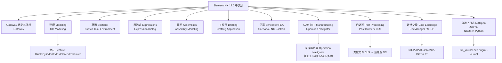

# Siemens NX 12.0 功能模块树

> 按**应用领域分块**。每块含：菜单条目（中文名/英文原名）、Ribbon/工具栏面板、模块→命令映射（命令 ID 指向 `commands.md`）。
> 证据：安装目录 `UGII\*.dpx` 定制文件清单（E-105）、`nx-automation` 领域技能（E-106）、`nx_bridge.py`（E-107）、官方 NXOpen 文档（E-108）。

## 模块树总览（mermaid）

## 分块明细

### 1. Gateway 启动与环境（category: config_admin）
- 菜单：`文件|新建`(File|New)、`文件|打开`(File|Open)、`开始|NX 环境`(Start|Gateway)、`首选项|用户界面`(Preferences|User Interface)
- Ribbon：**主页（Home）** 选项卡 → 新建/打开/保存组
- 定制文件：`UGII\ug_gateway.dpx`（E-105）
- 模块→命令：`nx_new_part`、`nx_open_part`、`nx_save_part`、`nx_run_journal`

### 2. 建模 Modeling（category: part_modeling）
- 菜单：`插入|设计特征`(Insert|Design Feature) → 长方体 Block / 圆柱体 Cylinder / 拉伸 Extrude / 回转 Revolve；`插入|细节特征`(Insert|Detail Feature) → 边 Edge Blend 圆角 / 倒角 Chamfer
- Ribbon：**特征（Feature）** 组、**同步建模（Synchronous Modeling）** 组
- 定制文件：`UGII\ug_modeling.dpx`、`UGII\ug_extras.dpx`（E-105）
- 模块→命令：`nx_block`、`nx_cylinder`、`nx_extrude`、`nx_revolve`、`nx_blend`、`nx_chamfer`、`nx_text`、`nx_massprop`、`nx_check_part`

### 3. 草图 Sketcher（category: part_modeling）
- 菜单：`插入|草图`(Insert|Sketch) → 草图任务环境；曲线/约束/尺寸
- 定制文件：`UGII\ug_sketcher.dpx`、`UGII\ug_curves.dpx`（E-105）
- 模块→命令：`nx_sketch`、`nx_create_line`、`nx_section_build`

### 4. 表达式 Expressions（category: part_modeling）
- 菜单：`工具|表达式`(Tools|Expressions)
- 作用：参数化尺寸驱动（如 `D_OUTER=160`、`LENGTH=40`），单位 mm
- 模块→命令：`nx_expression`、`nx_new_part`（FileNew 绑定表达式）

### 5. 装配 Assemblies（category: assembly）
- 菜单：`装配|组件`(Assemblies|Components) → 添加组件 Add Component / 配对约束 Assembly Constraints
- 定制文件：`UGII\ug_assemblies.dpx`（E-105）
- 模块→命令：`nx_assembly_add_component`、`nx_assembly_constraint`、`nx_assy_build`、`nx_clearance`

### 6. 工程图 Drafting（category: drafting）
- 菜单：`插入|视图`(Insert|View) → 基本视图 Base View / 投影视图；`插入|尺寸`(Insert|Dimension)
- 定制文件：`UGII\ug_drafting.dpx`、`UGII\ug_drafting_standards.dpx`、`UGII\ug_gdt.dpx`（E-105）
- 模块→命令：`nx_drafting_view`、`nx_drafting_dimension`

### 7. 仿真 Simcenter / FEA（category: fea_simulation）
- 菜单：`开始|高级仿真`(Start|Advanced Simulation) → 模型材料/约束/载荷/求解
- 批处理网格：`NXBIN\ugnx_batchmesher.exe`（E-103）
- 定制文件：`UGII\ug_analysis.dpx`、`UGII\ug_structures.dpx`（E-105）
- 模块→命令：`nx_fea_mesh`、`nx_fea_solve`、`nx_massprop`

### 8. CAM 加工 Manufacturing（category: cam_toolpath）
- 菜单：`开始|加工`(Start|Manufacturing) → **操作导航器 Operation Navigator** → 创建操作 Create Operation（型腔铣 Cavity Mill / 平面铣 Planar Mill / 轮廓铣 Contour Mill / 钻孔 Drill / 多轴 Multi-Axis）
- 定制文件：`UGII\ug_cam.dpx`；启动脚本 `UGII\se_nxcam.bat`（E-105/E-103）
- **公理强制：导出刀路前必须检查 Operation Navigator CAM 树的感叹号(!)警告**（AGENTS.md §2.C）
- 模块→命令：`nx_cam_create_operation`、`nx_cam_generate`、`nx_cam_operation_check`、`nx_cam_postprocess`

### 9. 后处理 Post Processing（category: post_processing）
- 菜单：`加工|输出|后处理`(Manufacturing|Operation|Output|Post Process)；刀位源文件 CLS
- 批处理：`NXBIN\jtpostprocessor.exe`（E-103）
- 模块→命令：`nx_cam_postprocess`、`nx_cls_output`、`nx_jt_postprocessor`

### 10. 数据交换 Data Exchange（category: data_exchange）
- 菜单：`文件|导出|STEP`(File|Export|STEP)、`文件|导出|IGES`、`文件|导出|JT`；DexManager 向导
- 批处理：`NXBIN\step214ug.exe`、`step203ug.exe`、`step242.exe`；配置 `STEP214UG\ugstep214.def`（E-109）
- 模块→命令：`nx_step_export`、`nx_iges_export`、`nx_jt_export`

### 11. 自动化日志 NXOpen Journal（category: collaboration）
- 通道：NXOpen Python（Python 3.6 随 NX 自带）、NXOpen for .NET（C#/VB.NET）、GRIP（`UGII\gripbatch.bat`）
- 入口：`NXBIN\run_journal.exe <script.py>` 无头；`ugraf.exe -journal <script.py>` 带界面（E-107/E-110）
- 模块→命令：`nx_run_journal`、`nx_new_part`、`nx_expression`、`nx_step_export`
