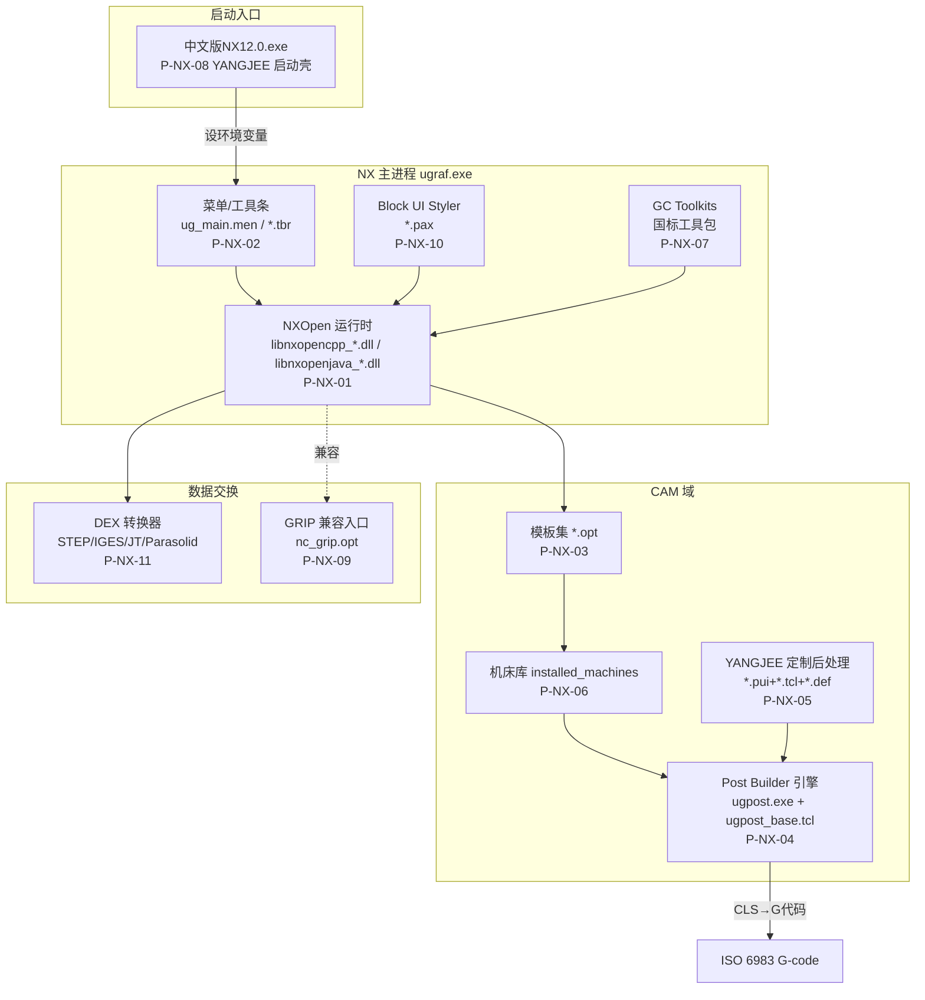

# Siemens NX 12.0.2.9 — 插件 / 外挂 / Add-in / 模板集 文档化逆向

> 范围：仅覆盖「插件/附加模块/二次开发承载物/模板集/后处理包」。主程序本身的建模/CAM/出图模块见 `modules.md`；自动化通道（run_journal / NXOpen Python）见 `automation_api.md`。
> 三态判定纪律沿用第一轮：`verified-working` = 历史实测跑通过；`confirmed-negative` = 明确探测为否；`documented-not-probed` = 本轮仅做文件系统勘察、未启动实测。
> 硬边界：本文不含任何许可证/授权/激活机制内容。`waigua`（杨杰 YANGJEE 汉化/定制 repack）仅做目录与功能命名层面的文档化，不涉及任何破解机制。

---

## 1. 插件/附加模块总表

| # | 名称（中 / 英） | 类型 | 安装路径 | 可执行 / 库文件 | 与主程序集成方式 | 状态 | E-ID |
|---|---|---|---|---|---|---|---|
| P-NX-01 | NXOpen C++/Java 绑定库集 / NXOpen C++ & Java Binding DLLs | 二次开发 SDK（运行时 DLL） | `NX\NXBIN\` | `libnxopencpp_*.dll`、`libnxopenjava_*.dll`、`libnxopenufjava.dll`、`libnxopenufuijava.dll`、`libnxopenuicpp.dll`、`libnxopenuijava.dll`、`libnxopenxml.dll`、`libnxopencore.dll` | 由 `ugraf.exe`/`run_journal.exe` 进程内加载，按功能域拆分 | documented-not-probed（存在性 Glob 已实测，运行时符号未dump） | E-116 |
| P-NX-02 | NX 菜单/工具条定制系统 / Menu & Toolbar Customization | 外挂承载（菜单脚本） | `NX\UGII\menus\` | `ug_main.men`、`ug_gateway.men`、`ug_modeling.men`、`ug_sketcher.men`、`ug_cam_actions.tbr`、`ug_cam_create.tbr`、`ug_struc_*.tbr`、`ug_motion_*.tbr`、`ug_drafting_*.tbr`、`ug_ship_*.tbr`、`ug_subdiv_*.tbr`、`ug_inspection_*.tbr`、`custom_dirs.dat`、`styler_blocks*.pax` | ugraf 启动时解析 .men/.tbr/.rtb/.grb 重建 UI；custom_dirs.dat 注册用户 Startup/Application 目录 | documented-not-probed | E-117 |
| P-NX-03 | CAM 模板集 / CAM Template Sets (.opt) | 模板集 | `NX\MACH\resource\template_set\` | `cam_general.opt`、`mill_planar.opt`、`mill_contour.opt`、`mill_multi-axis.opt`、`mill_multi-axis_hsm.opt`、`hole_making.opt`、`lathe.opt`、`lathe_mill.opt`、`prismatic.opt`、`feature_machining.opt`、`wire_edm.opt`、`nc_grip.opt`、`cam_teamcenter_general.opt` | NX CAM 启动时按模板集加载 Operation 对话框里的可用操作类型子集 | documented-not-probed | E-118 |
| P-NX-04 | Post Builder 后处理体系（UGPOST/TCL） / Post Builder Postprocessor Library | 独立工具 + 模板/脚本集 | `NX\MACH\resource\postprocessor\`、`NX\MACH\resource\post_configurator\post_template\template\template.pui` | `ugpost_base.tcl`（基类）、`ugpost_base_clsf/group/math/ys.tcl`、`mill3ax.tcl/.pui`、`m4bh.tcl`、`m5actt.tcl`、`m5abtt.tcl`、`millturn_*.tcl/.pui`、`wedm*.tcl/.def`、`lathe_tool_tip.tcl`、`probing_cycles_fanuc/siemens.tcl`、`mill_3/5axis_Sinumerik_840D_{in,mm}.tcl`、`sim_*.tcl` | NX CAM 生成 CLS → ugpost.exe 调 TCL 脚本 → ISO G-code；.pui 为 Post Builder 对话框工程文件 | documented-not-probed | E-119 |
| P-NX-05 | YANGJEE（杨杰）外挂定制后处理包 / YANGJEE Custom Posts | 第三方后处理包（外挂） | `NX\MACH\resource\postprocessor\`（同目录） | `yangje_post*.tcl/.def/.pui`、`YANGJEE.tcl/.def/.pui`、`YANGJEE_4B_axis.tcl/.def`、`YANGJEE_5axis.tcl/.def`、`YS5_*_{Fanuc,Mitsubishi,M70_BC,KD_RTCP,XD_RTCP}.tcl/.def`、`YSUG3/4/5/5a.tcl/.def`、`wtc_ptff*.tcl/.def`、`FANUCLG.tcl/.def`、`MORI.tcl/.def`、`Mikron_VCP600.tcl/.def`、`MITSUBISHI.tcl/.def`、`roeders.tcl/.def`、`electrode_cu/gr*.tcl/.def`、`MS_NL1500Y_{mill,turn_master}_{in,mm}.tcl/.def`、`deckel_maho_dmcxxu.tcl/.def`、`JTGK-3axis_nx{3,4}.tcl/.def`、`JTFA_3_Axis-V2.tcl/.def`、`FANUC-G05.1/G05P10000.tcl/.def`、`HAN-4Z-X-ZG.tcl/.def`、`KIR-A3.tcl/.def`、`FV56-A/A14.tcl/.def`、`nuoxin.tcl/.def`、`xmz.tcl/.def`、`steel.tcl/.def`、`Deep.tcl/.def`、`4B_axis.tcl/.def`、`TPCC*.tcl/.def`、`656.tcl/.def`、`jtjk.tcl/.def`、`cnc3.0.tcl/.def` | 与 P-NX-04 共用 ugpost TCL 引擎，作为自定义机床后置被 NX CAM「后处理」对话框枚举 | documented-not-probed | E-120 |
| P-NX-06 | 机床/机器人仿真库 / Machine & Robot Library (installed_machines) | 模板库 | `NX\MACH\resource\library\machine\installed_machines\` | `Fanuc_R_2000iB\`、`kuka_kr300\`、`ABB_IRB_6640\`、`ABB_IRB_7600\`、`sim01\…\sim18\`（每机带子目录 postprocessor 下 fanuc/heidenhainTNC/sinumerik/okuma/millplus 的 .pui） | NX CAM 机床构建器（Machine Builder）加载为 3D 机床模型，供刀路仿真与碰撞检查 | documented-not-probed | E-121 |
| P-NX-07 | GC Toolkits 国标工具包 / GC (GB) Toolkits | 中国本地化官方 Add-in（GB 国标建模/出图/CAM 工具集） | `NX\LOCALIZATION\prc\documents\`（文档）；实际二进制随 NX 主程序安装 | `GC_Toolkits_UserManual.pdf`、`GC_Toolkits_GearModeling.pdf`、`GC_Toolkits_CAM_UserManual.pdf` | 中文 GB 标准件库/齿轮建模/CAM 国标工艺；文档路径由 conf.ini 第 126-143 项登记 | documented-not-probed（文档存在性实测；菜单项未点验） | E-122 |
| P-NX-08 | YANGJEE 启动/补丁壳 / YANGJEE Repack Launcher & Thumbnail Fix | 外挂启动器（repack 壳） | 安装根 `E:\…\NX12.2.9waigua\NX12.2.9\` | `中文版NX12.0.exe`、`英文版NX12.0.exe`、`tupcd.exe`、`conf.ini`、`autorun.inf`、`创建中英文快捷到桌面.exe`、`NX\NX缩略图修复.exe`、`NX\YANGJEE\jdk-19_windows-x64_bin.exe` | 不注入 NX 主进程，仅设环境变量 UGII_BASE_DIR/ROOT_DIR 后拉起 ugraf.exe；缩略图修复注册 Windows 资源管理器 .prt 预览处理器 | documented-not-probed | E-123 |
| P-NX-09 | NX Open GRIP / GRIP 编程语言 | 历史宏语言外挂 | （模板集 `nc_grip.opt` 间接存在） | `ugrip.exe`/`gripbatch.bat` 在 NX 12 中已不再随装（本轮 Glob `NXBIN\*grip*` 无命中） | GRIP 是 NX 前代参数化宏语言；NX 12 仅在 CAM 模板集 `nc_grip.opt` 保留兼容入口 | confirmed-negative（无 grip 可执行）；存在兼容入口 documented-not-probed | E-124 |
| P-NX-10 | Block UI Styler / NX 自定义对话框构造器 | 二次开发 UI 框架 | `NX\UGII\menus\`、`NX\NXBIN\` | `styler_blocks*.pax`（含 `simpl_chinese\`/`trad_chinese\` 本地化子目录） | NX Open 二次开发用 .pax XML 定义 Block 对话框，编译进 user dll | documented-not-probed | E-125 |
| P-NX-11 | 数据转换 DEX 插件（STEP/IGES/JT/Parasolid） | 内置转换器 Add-in | `NX\STEP214UG\ugstep214.def` 等 | StepCreator / IgesCreator（NXOpen `DexManager` 入口，对应 `libnxopencpp_*.dll` 内 dex 模块） | NXOpen Python `theSession.DexManager.CreateStepCreator()`；已在第一轮实测通过（`run_nx_journal.py` STEP 导出） | verified-working（历史实测 STEP 导出） | E-126 |

---

## 2. 每插件一节

### P-NX-01 NXOpen C++/Java Binding DLLs
- **功能域**：NX 全领域二次开发语言绑定。按命名后缀分域：`_cam`（加工）、`_cae`（仿真）、`_drafting`（出图）、`_assemblies`（装配）、`_features`（特征）、`_gateway`（Gateway）、`_sheetmetal`（钣金）、`_routing`/`_mechanicalrouting`（布线）、`_die`（模具）、`_shipdesign`（船舶）、`_mechatronics`（机电）、`_motion`（运动）、`_sim`（仿真）、`_validation`（检查）、`_weld`（焊接）、`_formboard`（线束）、`_diagramming*`（原理图）、`_report`/`_visualreporting`（报表）、`_geometricanalysis`（几何分析）、`_facet`（小平面）、`_pdm`（Teamcenter）、`_tooling`（工装）、`_bodydes`（车身）、`_layout2d`（2D 布局）、`_shapesearch`（形状搜索）、`_partfamily`（族表）、`_modldirect`（MoldWizard Direct）。
- **启动方式**：`run_journal.exe journal.py` 时由 NX 运行时按 journal `import NXOpen` 隐式加载；C++ 开发链需链接对应 `libnxopencpp_*.lib`。
- **自动化接口**：NXOpen Python（首选，已实测）/ NXOpen .NET / NXOpen C++ / NXOpen Java。UF 层另有 `libnxopenufjava.dll`、`libnxopenufuijava.dll`。
- **文件格式**：`*.dll`（原生）；Python 侧为 `*.py` journal。
- **关键操作**：`Session.Parts.NewBase/Save`、`Features.CreateExtrudeBuilder/CreateBlockFeatureBuilder/CreateCylinderBuilder`、`UF.ModlFeatures.CreateBlend`、`UF.Modeling.CreateChamfer`、`DexManager.CreateStepCreator`。

### P-NX-02 Menu & Toolbar Customization (.men/.tbr/.rtb/.grb/.pax)
- **功能域**：UI 定制。`ug_main.men` 主菜单；`ug_gateway.men`/`ug_modeling.men`/`ug_sketcher.men` 按模块拆分；`ug_cam_actions/create/data_preparation/geometry/mfn/objects/robotics/selection/tpanimation/tpdebug/tpdisplay/views/workpiece.tbr` 是 CAM 模块工具条；`ug_struc_*` 结构仿真、`ug_motion_*` 运动仿真、`ug_drafting_*` 出图、`ug_ship_*` 船舶、`ug_subdiv_*` 细分曲面、`ug_inspection_*` 测量。
- **启动方式**：ugraf 启动时按 `UGII_BASE_DIR\UGII\menus\` 自动加载；`custom_dirs.dat` 追加用户 Startup/Application 目录以注册第三方菜单。
- **自动化接口**：无脚本 API；改 .men/.tbr 文本后重启 NX 生效。Block UI Styler 用 `.pax`（XML）定义对话框。
- **文件格式**：`.men`（菜单文本脚本）、`.tbr`（工具条文本脚本）、`.rtb`/`.grb`（Ribbon 二进制/资源）、`.pax`（Block 对话框 XML）。
- **关键操作**：菜单项 `VERSION 120`、`EDIT UG_GATEWAY_MAIN_MENUBAR`、`CASCADE_BUTTON`/`PUSH_BUTTON`、`HELP_BUTTON`。

### P-NX-03 CAM Template Sets (.opt)
- **功能域**：限定 CAM 环境中 Operation Navigator 里可见的操作模板集合。`cam_general.opt` 是默认全集；`mill_planar.opt` 面铣/平面铣；`mill_contour.opt` 轮廓铣；`mill_multi-axis.opt`/`_hsm.opt` 多轴/HSM；`hole_making.opt` 钻孔；`lathe.opt`/`lathe_mill.opt` 车/车铣；`prismatic.opt` 棱柱件；`feature_machining.opt` 特征加工；`wire_edm.opt` 线切割；`nc_grip.opt` GRIP 兼容；`cam_teamcenter_general.opt` TC 集成。
- **启动方式**：新建 CAM 时「加工环境」对话框按 .opt 清单加载。
- **自动化接口**：NXOpen `CAM.NCGroup/Operation` 类在 .opt 选定模板集中操作。
- **文件格式**：`.opt`（ASCII 模板清单）。
- **关键操作**：每 .opt 内列 `TEMPLATE_OPERATION`、`TEMPLATE_GROUP`、`TEMPLATE_POST`。

### P-NX-04 Post Builder 后处理体系（UGPOST/TCL）
- **功能域**：把 CAM CLS 刀位文件翻译成具体机床的 ISO G-code。基类 `ugpost_base.tcl`、`ugpost_base_clsf.tcl`（CLS 解析）、`ugpost_base_group.tcl`（程序组）、`ugpost_base_math.tcl`（数学/坐标变换）、`ugpost_base_ys.tcl`（YANGJEE 扩展数学）。通用机床：`mill3ax(.tcl/.pui)`、`mill3ax_turbo.tcl`（高速）、`mill3ax_preloaded.tcl`、`m4bh.tcl`、`m5actt.tcl`、`m5abtt.tcl`、`millturn_3axis_mill/4axis_mill/baxis_5axis/side_spindle.tcl`、`lathe_tool_tip.tcl`/`lathe_turret_ref.tcl`、`wedm.tcl/wedm_2Axis/wedm_4Axis/wedm_4axis_iso.tcl`、`probing_cycles_fanuc.tcl`/`probing_cycles_siemens.tcl`。西门子系：`mill_3axis_Sinumerik_840D_{in,mm}.tcl`、`mill_5axis_Sinumerik_840D_{in,mm}.tcl`、`mill_5axis_actt_Sinumerik_840D_{in,mm}.tcl`。仿真辅助：`sim_calc_cutcom.tcl`（刀补计算）、`sim_high_level_sv_commands.tcl`、`sim_math.tcl`、`sim_mtd_kinematics.tcl`、`simulation_ini.tcl`。
- **启动方式**：NX CAM「后处理」对话框选 .pui；后台 `ugpost.exe` 加载同名 `.tcl`+`.def`。
- **自动化接口**：NXOpen `CAM.CAMSetup.PostProcess`；.tcl 脚本本身是 UG/Open GRIP/Tcl 方言，可手改。
- **文件格式**：`.pui`（Post Builder 对话框工程，二进制/XML 混合）、`.tcl`（后处理脚本）、`.def`（机床/后处理定义，ASCII）、`*.cls`（CLS 刀位输入）。
- **关键操作**：`PB_CMD_*` 自定义命令、`MOM_*` 加工对象数据访问、`&mom_*` 变量。

### P-NX-05 YANGJEE 外挂定制后处理包
- **功能域**：杨杰（yangjee-ugs-nx4.lofter.com）汉化 repack 作者按国内机床厂定制的后置。覆盖：FANUC 系（`FANUCLG`、`FANUC-G05.1`、`FANUC-G05P10000`、`fanuc30imACTT`、`YS5_Fanuc_BA_-30+90`）、三菱（`MITSUBISHI`、`YS3_Mitsubishi_Auto`、`YS5_M70_BC_0+120`、`YS5_Mitsubishi_BC_-30+110`、`yangje_sanling`）、发格 Fagor（`YS3_Fagor_Manu`）、RTCP/五轴（`YS5_KD_RTCP_-110+10`、`YS5_XD_RTCP_AC_-125+30`、`YS5_XD_noRTCP_AC_-125+30`、`YANGJEE_5axis`、`YANGJEE_4B_axis`、`4B_axis`）、车铣复合（`MS_NL1500Y_{mill,turn_master}_{in,mm}`、`millturn_*`）、石墨/铜电极（`electrode_gr/gr_YUJIANG/gr_AutoTool/gr_single/cu/cu_single`）、其他国产机床（`JTGK-3axis_nx3/nx4`、`JTFA_3_Axis-V2`、`FV56-A/A14`、`KIR-A3`、`HAN-4Z-X-ZG`、`nuoxin`、`xmz`、`steel`、`Deep`、`TPCC`、`jtjk`、`cnc3.0`、`656`、`wtc_ptff*`）、德玛吉/米克朗/罗德斯（`deckel_maho_dmcxxu`、`Mikron_VCP600`、`roeders`）、MORI（森精机）。
- **启动方式**：与 P-NX-04 共用 ugpost；在 NX 后处理对话框按文件名选择。
- **自动化接口**：同 P-NX-04。
- **文件格式**：`.tcl` + `.def` + `.pui` 三件套。
- **关键操作**：RTCP 开关、刀长补偿 G43.4、程序头/尾定制。
- **合规说明**：仅文档化其文件名与机床映射，不分析其 repack 的授权机制。

### P-NX-06 installed_machines 机床/机器人库
- **功能域**：机床构建器（Machine Builder）3D 模型库。机器人：FANUC R-2000iB、KUKA KR300、ABB IRB 6640/7600。仿真机床 sim01~sim18 覆盖 3 轴/4 轴/5 轴/车铣复合/立磨双主轴，每台带 fanuc/heidenhainTNC/sinumerik/okuma/millplus 子后处理目录。
- **启动方式**：NX CAM 导航器右键「机床」→ 从库中调用。
- **自动化接口**：NXOpen CAM Machine Builder API。
- **文件格式**：机床 .prt + `kinematics.xml` + 子目录 `postprocessor\*.pui`。
- **关键操作**：定义旋转轴运动学（A/B/C 轴行程、RTCP 配置）。

### P-NX-07 GC Toolkits 国标工具包
- **功能域**：Siemens 官方为中国 GB 标准做的本地化工具集：国标建模（GB 标准件库）、齿轮参数化建模（`GC_Toolkits_GearModeling.pdf`）、CAM 国标工艺（`GC_Toolkits_CAM_UserManual.pdf`）、总用户手册（`GC_Toolkits_UserManual.pdf`）。
- **启动方式**：装主程序时随 `LOCALIZATION\prc\` 一并安装；在 NX 菜单「GC 工具箱」入口。
- **自动化接口**：无独立 Python 接口；通过 NX Open 调用其底层特征。
- **文件格式**：文档为 PDF；菜单项注册在 `ug_main.men`。
- **关键操作**：GB 紧固件/键/齿轮一键调用、国标标注（直径/粗糙度/形位公差）自动符合 GB/T。

### P-NX-08 YANGJEE Repack 启动/补丁壳
- **功能域**：repack 层的环境启动器与 .prt 缩略图修复。
- **启动方式**：桌面快捷方式 `中文版NX12.0.exe` → 设 `UGII_BASE_DIR`/`UGII_ROOT_DIR` → 拉起 `UGII\ugraf.exe`。`tupcd.exe` 是光盘自动播放壳（conf.ini 即它读取）。`NX缩略图修复.exe` 注册 Windows Explorer 的 .prt 预览处理器。`YANGJEE\jdk-19_windows-x64_bin.exe` 是自带 JDK 安装包（Post Builder/后处理图形界面需要 JRE）。
- **自动化接口**：无。
- **文件格式**：`.exe`、`conf.ini`（GBK 编码光盘目录）、`autorun.inf`。
- **关键操作**：仅作为入口；不注入 NX 进程。
- **合规说明**：本文不分析其授权/绕过机制，仅记录其作为启动器的存在与文件清单。

### P-NX-09 GRIP
- **功能域**：NX 前代宏语言（Graphics Interactive Programming）。NX 12 已把 GRIP 编译器/链接器从 NXBIN 移除（Glob `NXBIN\*grip*.exe` 无命中），仅在 `MACH\resource\template_set\nc_grip.opt` 保留 CAM 兼容入口。
- **状态**：`confirmed-negative`（无可执行）；`nc_grip.opt` 模板存在 `documented-not-probed`。
- **迁移路径**：GRIP → NXOpen Python（`run_journal.exe`）。

### P-NX-10 Block UI Styler
- **功能域**：NX Open 二次开发的 Block 风格对话框。`.pax` 文件是 XML，编译进用户 NXOpen 项目；`styler_blocks*.pax` 含简体/繁体中文资源子目录。
- **启动方式**：`theSession.Styler.Create<DialogClass>()` 在 NXOpen Python/C++ 里弹出。
- **文件格式**：`.pax`（XML）。
- **关键操作**：`.Create()`、`.Show()`、`.AddApplyHandler()`。

### P-NX-11 DEX 数据转换插件
- **功能域**：STEP AP214 导出（配置 `NX\STEP214UG\ugstep214.def`）、IGES、JT、Parasolid 导入导出。已在第一轮由 `run_nx_journal.py` 实测 STEP 导出为 `.stp`。
- **启动方式**：GUI「文件→导出→STEP214」；或 NXOpen `DexManager.CreateStepCreator()`。
- **文件格式**：`.stp/.step`（ISO 10303）、`.igs`（IGES）、`.jt`（Siemens JT）、`.x_t/.x_b`（Parasolid）。
- **关键操作**：`StepCreator.ExportAs = Ap214`、`ObjectTypes.Solids/Surfaces`、`LayerMask = "1-256"`、`Commit()`。

---

## 3. 插件关系图

---

## 4. NXBIN 可执行文件功能域归类（摘要）

> 完整 60+ exe 清单见 `commands.md`。按功能域粗分：
> - **主程序/批处理**：`ugraf.exe`（交互）、`run_journal.exe`（无头 journal）、`ugii_*.exe`。
> - **建模/装配/出图**：随 `ugraf.exe` 一体，不独立。
> - **CAM/后处理**：`ugpost.exe`（UGPOST TCL 后处理执行器）、`ugii_exec_dialog.exe`、`cam_*.exe`。
> - **数据转换**：`ugii2step*.exe`、`ugstep214.exe`、`read_iges*.exe`、`jt_*.exe`（由 `DexManager` 调度）。
> - **工具/许可外**：`ug_convert_part.exe`（批量版本转换）、`ug_mom*.exe`（MOM）。
> - 本 exe 表的精确逐文件名级证据见 `commands.md`（第一轮已落盘）；本轮不重复列。

---

## 5. 证据链（指向 evidence.md 的 E-ID）

- E-116 = NXBIN `libnxopen*.dll` 全量 Glob 清单（C++/Java/UF/UI 绑定按域拆分）
- E-117 = `UGII\menus\*.men/*.tbr/*.pax/custom_dirs.dat` 全量 Glob
- E-118 = `MACH\resource\template_set\*.opt` 全量 Glob
- E-119 = `MACH\resource\postprocessor\*.tcl` + `*.def` 全量 Glob（基础 TCL 库 + Sinumerik 840D + probing cycles）
- E-120 = YANGJEE 定制后处理文件名清单（`yangje_post*`、`YANGJEE_*`、`YS5_*`、`MS_NL1500Y_*` 等）
- E-121 = `installed_machines\` 机器人（FANUC/KUKA/ABB）+ sim01~sim18 目录清单
- E-122 = `LOCALIZATION\prc\documents\GC_Toolkits_*.pdf` 三件套 Glob
- E-123 = 安装根 `conf.ini`（GBK）+ `tupcd.exe`/`中文版NX12.0.exe`/`NX缩略图修复.exe`/`YANGJEE\jdk-19*.exe` 存在性
- E-124 = Glob `NXBIN\*grip*.exe` 无命中（confirmed-negative）+ `nc_grip.opt` 存在
- E-125 = `styler_blocks*.pax` 与 `simpl_chinese/trad_chinese` 子目录
- E-126 = 第一轮 `run_nx_journal.py` 实测 STEP 导出（verified-working）
