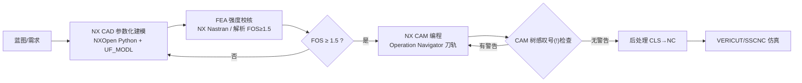

# Siemens NX 12.0 端到端工作流

> 覆盖项目级闭环（按 NX 角色裁剪）：**蓝图 → CAD 参数化建模 → FEA 强度校核(FOS≥1.5) → CAM 编程 → 后处理 → 虚拟加工仿真（VERICUT / SSCNC）**。
> 与 AGENTS.md §2.C 公理对齐：**经 NXOpen Python journals 与 UF_MODL API 执行；检查 Operation Navigator CAM 树感叹号警告后再导出刀路**。

## 闭环总图（mermaid）

## 工作流明细

### wf_blueprint_to_cad（蓝图→NX 建模）
| 步 | 操作 | 命令 | 关键参数 | 检查点 |
|---|---|---|---|---|
| 1 | 环境就绪 | `nx_run_journal` | `UGII_BASE_DIR/UGII_ROOT_DIR/UGII_LANG=simpl_chinese` | 日志进程拉起 |
| 2 | 新建毫米制零件 | `nx_new_part` | `Units.Millimeters`，模板 model-plain-1-mm-template.prt | ΔV 初值 |
| 3 | 表达式绑定 | `nx_expression` | `D_OUTER=160, LENGTH=40`（mm） | 单位=MilliMeter |
| 4 | 特征建模 | `nx_block`/`nx_cylinder`/`nx_extrude` | 拉伸 Limits 0~长度，布尔 Create/Subtract | **体积守恒 ΔV≠0**（拉伸>0/切除<0） |
| 5 | 细节特征 | `nx_blend`/`nx_chamfer` | 圆角先大后小 R4→R1；倒角 0.2/0.2/45 | 不出现 `Unable to apply blend` |
| 6 | 保存 | `nx_save_part` | `SaveComponents.TrueValue` | 写盘成功 |

### wf_cad_to_fea（NX 建模→FEA）
| 步 | 操作 | 命令 | 关键参数 | 检查点 |
|---|---|---|---|---|
| 1 | 几何确认 | `nx_massprop` | 体积/质心 | 体积与理论值偏差 ≤1% |
| 2 | 网格划分 | `nx_fea_mesh` | `ugnx_batchmesher.exe` | 无负体积单元 |
| 3 | 材料/约束/载荷 | `nx_fea_solve` | 45 钢/304/Q235，内压/力/扭矩 | — |
| 4 | 校核 | 解析 FEA | von Mises → FOS=屈服/最大应力 | **FOS≥1.5**，否则回 wf_blueprint_to_cad 改壁厚 |

### wf_cam_to_post（NX CAM→后处理）
| 步 | 操作 | 命令 | 关键参数 | 检查点 |
|---|---|---|---|---|
| 1 | 进入加工环境 | 菜单 开始\|加工 | `se_nxcam.bat` 环境 | Manufacturing 应用启动 |
| 2 | 创建操作 | `nx_cam_create_operation` | 型腔铣/平面铣/钻孔/多轴；安全高度、进给 | 刀具/几何体/方法指定 |
| 3 | 生成刀轨 | `nx_cam_generate` | 每层切深、余量 | 刀轨可视化 |
| 4 | **感叹号检查** | `nx_cam_operation_check` | 逐 Operation Navigator 节点 | **无(!)警告才可导出**（AGENTS.md §2.C） |
| 5 | 后处理 | `nx_cam_postprocess`/`nx_cls_output` | 选 FANUC/Siemens/Heidenhain 后处理 | 输出 .cls/.nc |
| 6 | 转交 CIMCO | — | 把 .nc 交给 CIMCO 做 Macro B 校验 + G00 碰撞哨兵 | 见 cimco 知识库 |

### wf_step_exchange（数据交换）
| 步 | 操作 | 命令 | 关键参数 | 检查点 |
|---|---|---|---|---|
| 1 | STEP 导出 | `nx_step_export` | ExportAs=Ap214，SettingsFile=ugstep214.def，LayerMask=1-256 | 实体+曲面全导 |
| 2 | 跨软件交付 | `nx_step214_batch` | `step214ug.exe` | 下游 SolidWorks/AutoCAD 可读 |

## 与 AGENTS.md 公理对齐声明
- §2.C（Siemens NX 12.0）：经 NXOpen Python journals 与 UF_MODL API 执行 ✅（wf 全部走 journal）
- §2.C：检查 Operation Navigator CAM 树感叹号警告后再导出刀路 ✅（wf_cam_to_post 第 4 步）
- §3 闭环：FOS≥1.5 不过则回建模 ✅（wf_cad_to_fea 回环）
