# SOLIDWORKS 2021 — 功能模块树（按应用领域分块）

> 模块清单依据：安装目录自带 CHM 帮助文档标题（`D:\SOLIDWORKS (2)\lang\chinese-simplified\*.chm`，E-SW-08）、桥接代码实际调用的 API（E-SW-02）、用户已装领域技能路由表（E-SW-09）。GUI 菜单/Ribbon 按钮名以中文界面为准，括注英文原名。

## 模块树（mermaid）

```mermaid
flowchart TD
    SW["SOLIDWORKS 2021<br/>(SLDWORKS.exe)"]
    SW --> M1["1 零件建模 Part Modeling"]
    SW --> M2["2 装配 Assembly"]
    SW --> M3["3 工程图 Drafting"]
    SW --> M4["4 仿真 Simulation / FEA"]
    SW --> M5["5 钣金与焊接件 SheetMetal/Weldments"]
    SW --> M6["6 数据交换 Data Exchange"]
    SW --> M7["7 配置与管理 Config Admin"]
    SW --> M8["8 可视化 Visualization"]

    M1 --> M1a["草图 SketchManager"]
    M1 --> M1b["特征 FeatureManager"]
    M1 --> M1c["方程式 EquationMgr"]
    M1 --> M1d["圆角/倒角 Fillet/Chamfer"]
    M1 --> M1e["异型孔向导 Hole Wizard"]
    M2 --> M2a["配合 Mates"]
    M2 --> M2b["干涉检查 Interference Check"]
    M3 --> M3a["视图 View"]
    M3 --> M3b["尺寸与公差 Dimensions/GTol"]
    M3 --> M3c["BOM 表"]
    M4 --> M4a["静应力 Simulation Static"]
    M4 --> M4b["运动算例 Motion Study"]
    M5 --> M5a["钣金展开 Sheet Metal"]
    M5 --> M5b["焊件轮廓 Weldment"]
    M6 --> M6a["STEP/IGES 导出"]
    M6 --> M6b["DXF/DWG 导出"]
    M7 --> M7a["材料 Materials"]
    M7 --> M7b["模板 Templates"]
```

---

## 1. 零件建模（Part Modeling）— category: `part_modeling`

| 模块（中文名/英文原名） | 菜单路径 | 模块→命令映射（→ commands.md） | 证据 |
|---|---|---|---|
| 草图绘制 Sketch | 插入(Insert) → 草图绘制(Sketch) | `SW_CMD_InsertSketch`、`SW_CMD_CornerRectangle`、`SW_CMD_CircleByRadius` | E-SW-02 |
| 拉伸凸台/基体 Extruded Boss/Base | 特征(Features) → 拉伸凸台 | `SW_CMD_FeatureExtrusion2` | E-SW-02, E-SW-10 |
| 拉伸切除 Extruded Cut | 特征 → 拉伸切除 | `SW_CMD_FeatureCut` | E-SW-02 |
| 旋转/扫描 Revolve/Sweep | 插入 → 凸台/基体 → 旋转/扫描 | `SW_CMD_Revolve`（文档化） | E-SW-08 |
| 放样 Loft | 插入 → 凸台/基体 → 放样 | `SW_CMD_Loft`（文档化，OTLoft.chm） | E-SW-08 |
| 圆角 Fillet | 特征 → 圆角 | `SW_CMD_Fillet`（可变半径/面圆角/全圆角） | E-SW-09 |
| 倒角 Chamfer | 特征 → 倒角 | `SW_CMD_Chamfer`（距离-距离/角度距离） | E-SW-09 |
| 异型孔向导 Hole Wizard | 特征 → 异型孔向导 | `SW_CMD_HoleWizard`（M3–M12 公制螺纹孔） | E-SW-09 |
| 线性/阵列 Pattern | 插入 → 阵列/镜像 | `SW_CMD_Pattern`（OTPatternFeatures.chm） | E-SW-08 |
| 方程式管理器 Equations | 工具(Tools) → 方程式(Equations) | `SW_CMD_EquationMgr_Add` | E-SW-02, E-SW-08(otequations.chm) |

## 2. 装配（Assembly）— category: `assembly`

| 模块 | 菜单路径 | 模块→命令映射 | 证据 |
|---|---|---|---|
| 配合 Mates | 装配体(Assembly) → 配合(Mate) | `SW_CMD_AddMate`（文档化，OTAssemblyMates.chm） | E-SW-08 |
| 干涉检查 Interference Detection | 评估(Evaluate) → 干涉检查 | `SW_CMD_InterferenceCheck`（文档化） | E-SW-08 |
| 爆炸视图 Exploded View | 装配体 → 爆炸视图 | `SW_CMD_Explode`（文档化） | E-SW-08 |

## 3. 工程图（Drafting）— category: `drafting`

| 模块 | 菜单路径 | 模块→命令映射 | 证据 |
|---|---|---|---|
| 模型视图/投影视图 View | 插入 → 工程图视图 → 模型视图/投影视图 | `SW_CMD_DrawView`（第一角画法 GB/T 17451） | E-SW-09, E-SW-08(OTAdvancedDrawings.chm) |
| 尺寸标注 Dimensions | 智能尺寸(Smart Dimension) | `SW_CMD_Dimension` | E-SW-09 |
| 形位公差 GD&T | 注解 → 形位公差 | `SW_CMD_GTol`（符号库 gtol97.sym） | E-SW-11 |
| 中心线 Center Mark | 注解 → 中心线 | `SW_CMD_CenterMark`（GB/T 4457.4） | E-SW-09 |
| 表面粗糙度 Surface Finish | 注解 → 表面粗糙度符号 | `SW_CMD_SurfaceFinish`（GB/T 131） | E-SW-09 |
| 孔表 Hole Table | 注解 → 孔表 | `SW_CMD_HoleTable`（模板 *.sldholtbt） | E-SW-11 |
| 材料明细表 BOM | 插入 → 表格 → 材料明细表 | `SW_CMD_BOM`（模板 *.sldbomtbt） | E-SW-11 |
| 标题栏 Title Block | 图纸格式 | `SW_CMD_TitleBlock`（title block.sldtbt） | E-SW-11 |

## 4. 仿真（Simulation / FEA）— category: `fea_simulation`

| 模块 | 菜单路径 | 模块→命令映射 | 证据 |
|---|---|---|---|
| 静应力分析 Static Study | Simulation 标签 → 静应力 | `SW_CMD_StaticStudy`（cworks.chm / simulation_theory_manual.pdf） | E-SW-08 |
| 设计检查 Design Checker | 评估 → 设计检查 | `SW_CMD_DesignChecker`（solidworks_design_checker.chm） | E-SW-08 |
| 运动算例 Motion Study | 运动算例标签 | `SW_CMD_MotionStudy`（swmotionstudy.tlb） | E-SW-12 |

> 注：本项目闭环中的 FEA 强度校核（von Mises、FOS≥1.5）当前由跨软件解析引擎 `cadcam_cae_stress_analysis` 承担（E-SW-13），SW 内置 Simulation 为 `documented-not-probed`（本轮未驱动其求解器）。

## 5. 钣金与焊接件（Sheet Metal / Weldments）— category: `part_modeling`

| 模块 | 菜单路径 | 模块→命令映射 | 证据 |
|---|---|---|---|
| 钣金基体/展开 Sheet Metal | 钣金标签 | `SW_CMD_SheetMetal`（OTSheetMetal.chm，折弯表 *.xls） | E-SW-08, E-SW-11 |
| 焊件结构构件 Weldment | 焊接件标签 | `SW_CMD_Weldment`（焊件轮廓 ANSI/*.sldlfp，OTweldments.chm） | E-SW-08, E-SW-11 |

## 6. 数据交换（Data Exchange）— category: `data_exchange`

| 模块 | 菜单路径 | 模块→命令映射 | 证据 |
|---|---|---|---|
| 另存为 STEP | 文件 → 另存为 → STEP AP203/214 | `SW_CMD_SaveAsSTEP` | E-SW-01(step_export), E-SW-14 |
| 另存为 DXF/DWG | 文件 → 另存为 → DXF/DWG | `SW_CMD_SaveAsDXF`（slddxf.chm） | E-SW-08 |
| 通用 SaveAs | 文件 → 另存为 | `SW_CMD_SaveAs3` | E-SW-02 |

## 7. 配置与管理（Config Admin）— category: `config_admin`

| 模块 | 菜单路径 | 模块→命令映射 | 证据 |
|---|---|---|---|
| 材料 Materials | 编辑材料 | `SW_CMD_Material`（solidworks materials.sldmat） | E-SW-11 |
| 零件/装配/工程图模板 | 选项 → 文件位置 → 模板 | `SW_CMD_Template`（零件.prtdot / assem.asmdot / draw.drwdot） | E-SW-15 |

## 8. 可视化（Visualization）— category: `visualization`

| 模块 | 菜单路径 | 模块→命令映射 | 证据 |
|---|---|---|---|
| 缩放至整屏 Zoom to Fit | 视图工具栏 | `SW_CMD_ViewZoomtofit2` | E-SW-02 |
| 重建 Rebuild | 编辑 → 重建模型 | `SW_CMD_EditRebuild3` / `SW_CMD_ForceRebuild3` | E-SW-02 |
