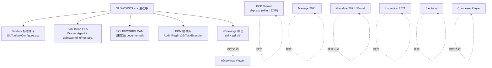

# SOLIDWORKS 2021 — 插件/附加模块

> 第 10 个知识库文件。三态判定纪律同主知识库：`verified-working`（文件/快捷方式已勘察存在）/ `confirmed-negative` / `documented-not-probed`。
> **硬边界**：本目录不记录任何许可证/激活工具（`lmutil.exe`/`swlmutil.exe`/`swlmwiz.exe` 等虽在 Common Files 勘察到，属 license server 范畴，按 scope 明确排除，不展开）。
> 通道限制：.lnk 为 utf-16-le 二进制，本机无 shell（PowerShell HISTORY_INVALID_PATH）无法跑 test_lnk.py 解码，故**桌面快捷方式只能以文件名确认存在，目标 exe 路径无法本轮解析**；能直接 Glob 到 exe 的标 verified-working。

## 1. 插件总表

| 名称（中/英） | 类型 | 安装路径 / 快捷方式 | 可执行文件 | 与主程序集成方式 | 状态 | 证据 |
|---|---|---|---|---|---|---|
| 工具箱 Toolbox（标准件库） | Add-in | `D:\SOLIDWORKS (2)\` | `SldToolboxConfigure.exe`、`sldtoolboxupdater.exe` | SW 插件标签/配置器 | verified-working（exe 在盘） | E-SW-P01 |
| 仿真 Simulation（FEA） | Add-in | `D:\SOLIDWORKS (2)\` + `Common Files\SOLIDWORKS Shared\Simulation Worker Agent\` | `SOLIDWORKS Simulation Worker Agent.exe`、`gabiswengine.exe`、`mg-tetra.exe`、`mpiexec.hydra.exe`、`pmi_proxy.exe` | Simulation 标签加载求解器 | verified-working（求解器/Worker 在盘；求解器本轮未跑） | E-SW-P02 |
| PCB 查看器 PCB Viewer | 独立程序 | `C:\Program Files\SOLIDWORKS Corp\SOLIDWORKS PCB Viewer\`；桌面 .lnk | `dxp.exe`、`AltiumMS.exe` | 独立启动（基于 Altium DXP 平台） | verified-working（exe 在盘） | E-SW-P03 |
| eDrawings 2021 轻量查看器 | 独立程序/共享组件 | 桌面 `eDrawings 2021 x64 Edition.lnk`；`Common Files\SOLIDWORKS Shared\sldrx\` | `sldrx.exe`、`sldrxET.exe`、`swcef\sldCefViewer.exe` | SW「另存为 eDrawings」导出 + 独立查看 | documented-not-probed（主 exe 未定位，共享运行时在盘） | E-SW-P04 |
| SOLIDWORKS PDM（数据管理） | Add-in/服务 | `C:\Program Files (x86)\SOLIDWORKS PDM\` | `AddInRegSrv32.exe`、`TaskExecutor.exe`、`InventorServer.exe` | SW 内嵌 PDM 插件库 | verified-working（安装在盘；未配置库） | E-SW-P05 |
| 管理 SOLIDWORKS Manage 2021 | 独立程序 | 桌面 `SOLIDWORKS Manage 2021.lnk` | 未本轮解析 | 项目/流程数据管理独立启动 | documented-not-probed（.lnk 在，exe 路径未能解码） | E-SW-P06 |
| 渲染 Visualize 2021 | 独立程序 | 桌面 `SOLIDWORKS Visualize 2021.lnk` | 未本轮解析 | 独立 CPU/GPU 渲染器 | documented-not-probed | E-SW-P06 |
| Visualize Boost 2021 | 独立程序/渲染节点 | 桌面 `SOLIDWORKS Visualize Boost 2021.lnk` | 未本轮解析 | 网络渲染分发节点 | documented-not-probed | E-SW-P06 |
| 检验 SOLIDWORKS Inspection 2021 | 独立程序 | 桌面 `SOLIDWORKS Inspection 2021.lnk` | 未本轮解析 | 首件检验/气泡图独立启动 | documented-not-probed | E-SW-P06 |
| 电气 SOLIDWORKS Electrical | 独立程序/套件 | 桌面 `SOLIDWORKS Electrical.lnk` | 未本轮解析 | 电气原理图独立套件 | documented-not-probed | E-SW-P06 |
| Composer Player 2021 | 独立查看器 | 桌面 `SOLIDWORKS Composer Player 2021.lnk` | 未本轮解析 | 交互式 3D 文档查看器 | documented-not-probed | E-SW-P06 |
| 加工 SOLIDWORKS CAM | Add-in | `D:\SOLIDWORKS (2)\` 根未发现独立 exe | — | CAM 标签（若安装） | documented-not-probed（本轮未在安装根定位 CAM 组件） | E-SW-P07 |

## 2. 插件关系图（mermaid）

## 3. 插件分节

### 3.1 Toolbox 标准件库
- **功能域**：GB/ANSI/ISO 紧固件、轴承、型材等标准件自动调用。
- **启动方式**：`SldToolboxConfigure.exe` 配置；SW 内「工具箱」标签插入零件。
- **自动化接口**：经 SW 主 COM API 插入 Toolbox 零件（`documented-not-probed`，本轮未驱动）。
- **文件格式**：零件库数据库/零件库文件。
- **关键操作**：配置标准件、插入到装配体。

### 3.2 Simulation（FEA 求解器）
- **功能域**：静应力/频率/屈曲/热力等有限元。
- **启动方式**：SW 内 Simulation 标签；求解时起 `SOLIDWORKS Simulation Worker Agent.exe`（并行求解用 `mpiexec.hydra`/`gabiswengine`/`mg-tetra`）。
- **自动化接口**：SW Simulation Add-in API（`SwSimulation` 类型库；本轮未驱动求解器，`documented-not-probed`）。
- **证据**：求解器可执行文件 + `simulation_theory_manual.pdf`/`vcwlinear.chm` 在盘（E-SW-P02）。
- **与闭环关系**：本项目 FOS≥1.5 校核当前由跨软件解析引擎承担；SW Simulation 为备选 native FEA。

### 3.3 PCB Viewer
- **功能域**：查看 PCB（Altium 工程）3D/原理图。
- **启动方式**：独立 `dxp.exe`（Altium DXP 平台）。
- **文件格式**：Altium 工程文档（`.PrjPcb` 等，本轮未枚举）。
- **集成**：独立程序，不与 SLDWORKS.exe 进程内集成。

### 3.4 eDrawings
- **功能域**：轻量 3D/2D 模型查看与交付。
- **共享运行时**：`Common Files\SOLIDWORKS Shared\sldrx\sldrx.exe`、`swcef\sldCefViewer.exe`（CEF 内嵌浏览器）。
- **集成**：SW「另存为」导出 eDrawings 文件；独立查看器打开。

### 3.5 PDM
- **功能域**：产品数据管理/库/任务。
- **组件**：`AddInRegSrv32.exe`（插件注册）、`TaskExecutor.exe`（任务调度）、`InventorServer.exe`。
- **集成**：SW 内嵌 PDM 插件；本轮未配置库/ vault。

### 3.6 独立套件（Manage / Visualize / Boost / Inspection / Electrical / Composer Player）
- 均有桌面 `.lnk`（已 Glob 确认存在于 `C:\Users\Public\Desktop\`），证明本机安装了启动器。
- 因 .lnk 为二进制且无 shell 解码，目标 exe 本轮未定位，统一标 `documented-not-probed`；功能域按官方产品定位记录（渲染/检验/电气/项目管理/交互查看）。

## 4. 缺口

- 6 个独立套件的真实 exe 路径需在有 shell 环境下用 `test_lnk.py` 解码 `.lnk` 补全。
- Simulation / CAM 的自动化 API 本轮未驱动求解器，仅文档化。
