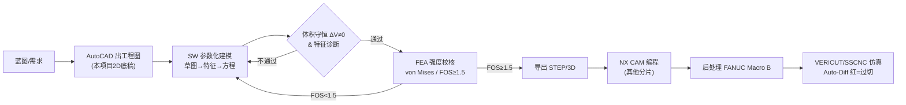

# SOLIDWORKS 2021 — 端到端工作流

> 对齐 `D:\Virtu模型\AGENTS.md` 第 3 节 CAD-CAE-CAM 闭环。SOLIDWORKS 在闭环中承担 **参数化 CAD 建模 + 工程图 + STEP 导出** 角色；FEA 强度校核当前由跨软件解析引擎 `cadcam_cae_stress_analysis` 完成，CAM/后处理/仿真由 NX/CIMCO/VERICUT/SSCNC 承担（见各自分片知识库）。

## 闭环总览（mermaid）

## WF-SW-1 参数化零件建模（桥接实测范式）

步骤序列（来自 `SolidWorksBridge.model_flange` / `create_parametric_part`，E-SW-02）：
1. `sw.NewPart()` 新建零件（默认模板）。
2. **写方程**：`eq=part.GetEquationMgr(); eq.Add(idx,'"D_Outer" = 0.160')` —— 所有关键尺寸入 EquationMgr，便于改参重生成。
3. **选基准面**：`part.SelectByID("前视基准面","PLANE",0,0,0)`（世界 Y 向上公理；前视=XY 平面）。
4. **草图**：`InsertSketch(True)` → `CreateCircleByRadius(...)` 画内外圆 → `InsertSketch(True)` 退出。
5. **拉伸凸台**：`FeatureManager.FeatureExtrusion2(...)` 出圆盘。
6. **拉伸切除**：`FeatureCut(...)` 出螺栓孔。
7. **重建**：`ForceRebuild3(True)` + `ViewZoomtofit2()`。
8. **保存**：`SaveAs3(path,0,1)` → `.SLDPRT`。

**关键参数与检查点**：
- 单位：API 内部米；20 mm = 0.02 m。
- **体积守恒断言**：拉伸凸台后 `mp.Volume` 应增大 `ΔV>0`；切除后 `ΔV<0`；圆角/倒角后 `ΔV≠0`（AGENTS.md A 节）。
- **特征诊断**：重建告警/报错时读 `feature_errors`，禁止凭截图猜测（AGENTS.md A 节）。
- 法兰实例默认参数：D_Outer=160, D_Bore=50, Thk=20, D_Boss=90, H_Boss=15, PCD=125, N_Bolts=6, D_Bolt=14（mm）。

## WF-SW-2 FEA 强度校核回环（FOS≥1.5）

- SW 建模完成后，调用 `cadcam_cae_stress_analysis`（E-SW-13）：按工况（轴向拉伸/法兰内压 Lamé 厚壁圆筒/平板弯曲/螺栓剪切拉拔）算 von Mises 与安全系数。
- **检查点**：`FOS = σ_屈服 / σ_vonMises`，下限默认 `target_fos=1.5`。
- **回环**：`FOS < 1.5` → 自动反向修尺寸（最小安全壁厚/截面）→ 回 WF-SW-1 重生成 → 再校核，直到 FOS≥1.5 或触熔断（AGENTS.md 第 6 节）。
- SW 内置 Simulation（静应力）为 `documented-not-probed`（本轮未驱动求解器），见 modules.md §4。

## WF-SW-3 工程图与 GB 标注（对齐国标）

- 基于零件生成 `.SLDDRW`：第一角投影（GB/T 17451）、中心线（GB/T 4457.4）、表面结构（GB/T 131）、公差带（GB/T 4458.5 / GB/T 1800）、未注公差（GB/T 1804）、比例（GB/T 14690）。
- BOM/孔表用安装目录模板（`*.sldbomtbt` / `*.sldholtbt`）；标题栏用 `title block.sldtbt`。
- 等轴测视图不标尺寸；交付前目视复核预览图，漏标/重叠/压线先返工（E-SW-09）。

## WF-SW-4 数据交换到下游 CAM

- 通过 `SaveAs3` 导出 **STEP AP203/214** 给 NX CAM（其他分片）做多轴刀路；可同时导出 DXF 给 AutoCAD 做 2D 底稿。
- 体积守恒在 STEP 交换后由 `MassProperty.Volume` 复算复核，`|V_cad - V_theory|/V_theory ≤ 1%`（AGENTS.md 第 7 节）。

## 检查点速查

| 检查点 | 判定 | 不通过动作 |
|---|---|---|
| 拉伸后体积 | ΔV>0 | 检查草图是否封闭 |
| 切除后体积 | ΔV<0 | 检查切除范围 |
| 圆角/倒角 | ΔV≠0 | 检查是否零几何 |
| FOS | ≥1.5 | 反向加厚回环 W-F-SW-1 |
| 特征树 | 无红色报错 | diagnose_document 读 feature_errors |
