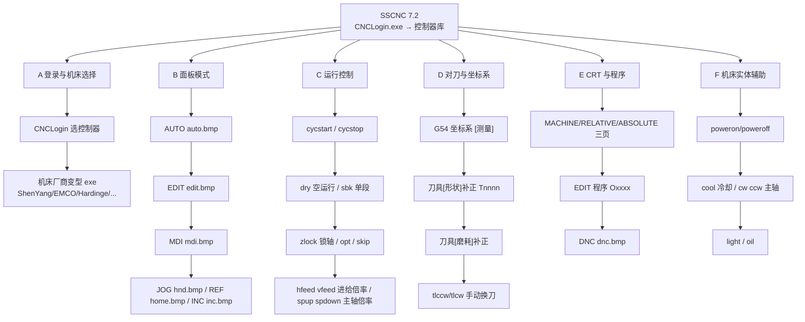

# SSCNC 7.2 功能模块树（虚拟面板 + 控制器库）

> 证据来源：安装目录 Glob 实测（E-S01/E-S02）、按钮位图符号目录（E-S03）、config.ini/spec.ini 逐行读取（E-S04）、sscnc_bridge.py（E-S05）、斯沃官方说明书（E-S06）。
> 界面为**仿真物理面板**（非 Ribbon）：左侧机床 3D 视窗 + 右侧 FANUC 0i 面板（CRT + 实体按键位图）。

## 领域分块 A：登录与机床选择（Login & Machine Select）

| 模块 | 元素 | 说明 | 模块→命令 |
| :-- | :-- | :-- | :-- |
| 登录器 | `CNCLogin.exe` | 启动后选择控制器厂商与机床型号（E-S01 实测进程） | SS-01 |
| 机床库 | 每控制器目录下机床厂商变型 exe | 如 FANUC0iT 下：ShenYangTC/TD、EMCO、Hardinge、Goodway、YunnanTd、JinanTC、NanTong0iTD、Quazar、njck6140Tc 等（E-S02） | SS-02 |

## 领域分块 B：控制面板模式（Panel Mode Select）

按钮位图证据（`JNC\JNC_BTN_Symbol\*.bmp`，E-S03）：

| 模块 | 按键（位图文件名） | FANUC 0i 模式 | 说明 | 模块→命令 |
| :-- | :-- | :-- | :-- | :-- |
| 自动运行 | `auto.bmp` | AUTO | 自动循环加工 | SS-03 |
| 程序编辑 | `edit.bmp` | EDIT | 编辑/调入 NC 程序 | SS-04 |
| 手动数据输入 | `mdi.bmp` | MDI | 单段指令输入 | SS-05 |
| 手动进给 | `hnd.bmp` | JOG（手动） | 手摇/手动移动 | SS-06 |
| 回参考点 | `home.bmp` | REF（回零） | 回参考点 | SS-07 |
| 增量进给 | `inc.bmp` | INC | 增量进给 | SS-08 |

## 领域分块 C：运行控制（Cycle & Feed Control）

| 模块 | 按键（位图） | 说明 | 模块→命令 |
| :-- | :-- | :-- | :-- |
| 循环启动 | `cycstart.bmp` | Cycle Start（绿灯） | SS-09 |
| 循环停止 | `cycstop.bmp` / `stop.bmp` | Feed Hold / Cycle Stop | SS-10 |
| 空运行 | `dry.bmp` | DRY RUN 校验 | SS-11 |
| 单段 | `sbk.bmp` | SINGLE BLOCK 逐段执行 | SS-12 |
| 可选停 | `opt.bmp` | OPTIONAL STOP（M01 生效） | SS-13 |
| 跳段 | `skip.bmp` | BLOCK DELETE（"/"段跳过） | SS-14 |
| 机床锁定 | `zlock.bmp` / `MLock.bmp` | MACHINE LOCK（只走坐标不动刀） | SS-15 |
| 进给倍率 | `hfeed.bmp` / `vfeed.bmp` | FEED OVERRIDE 旋钮模拟 | SS-16 |
| 主轴倍率 | `spup.bmp` / `spdown.bmp` / `sp100.bmp` | SPINDLE OVERRIDE | SS-17 |

## 领域分块 D：对刀与坐标系（WCS & Tool Offset）

| 模块 | 面板操作 | 说明 | 模块→命令 |
| :-- | :-- | :-- | :-- |
| G54 工件坐标系 | OFFSET SETTING → [坐标系] 软键 → G54 番号 → X0/Y0/Z0 + [测量] | 试切对刀（E-S06 官方说明书） | SS-18 |
| 刀具形状补偿 | OFFSET → [补正] → [形状] → 输入直径/Z + [测量] | Tnnnn 几何补正（E-S06） | SS-19 |
| 刀具磨耗补偿 | [补正] → [磨耗] | 微调 | SS-20 |
| 换刀 | `tlccw.bmp` / `tlcw.bmp` / `chngtl.bmp` / `loosen.bmp` | 手动换刀/松刀 | SS-21 |

## 领域分块 E：CRT 显示与程序（CRT & Program）

| 模块 | 元素 | 说明 | 模块→命令 |
| :-- | :-- | :-- | :-- |
| 坐标三页 | CRT：MACHINE / RELATIVE / ABSOLUTE(G54) | 循环启动前核对（AGENTS.md §2.F） | SS-22 |
| 程序显示 | EDIT 模式 Oxxxx 程序号 | `.cnc` 程序列表/编辑 | SS-23 |
| DNC | `dnc.bmp` | 边传边加工 | SS-24 |
| 超程警示 | `OverTravel.bmp` | 硬限位报警 | SS-25 |

## 领域分块 F：机床实体与辅助（Machine Body & Aux）

| 模块 | 按键（位图） | 说明 | 模块→命令 |
| :-- | :-- | :-- | :-- |
| 电源 | `poweron.bmp` / `poweroff.bmp` | 机床通电/断电 | SS-26 |
| 冷却 | `cool.bmp` | 冷却液 M08/M09 | SS-27 |
| 主轴正反转 | `cw.bmp` / `ccw.bmp` / `mst.bmp` | M03/M04/M05 | SS-28 |
| 照明/润滑 | `light.bmp` / `oil.bmp` | 辅助 | SS-29 |

## 模块树（mermaid）

> category 枚举（与 module_inventory.json 对齐）：`config_admin / virtual_machine / nc_editor / visualization / data_exchange`。
