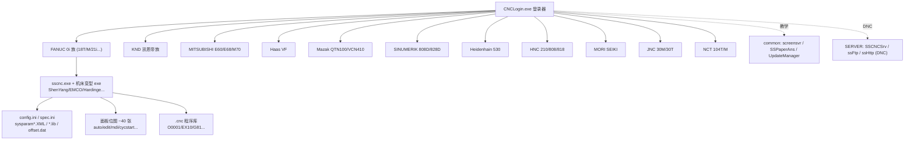

# SSCNC 7.2 插件 / 附加模块（控制器库 & 面板组件）

> 阶段一插件级深度逆向（2026-11-04）。证据来源：安装目录 Glob（E-S01/E-S02）、按钮位图目录（E-S03）、sysparam0.XML 逐行解析（E-S08 本轮新增）、offset.dat 二进制探测（E-S09）。
> SSCNC 的「插件」本质 = **11 厂商控制器仿真器（每控制器一个 sscnc.exe + 机床厂商变型）+ 公共/服务组件**。

## 1. 插件总表

### 1.1 控制器仿真器库（每厂商目录 = 一个独立插件）

| 名称（中/英） | 类型 | 安装路径 | 可执行文件 | 配置/库 | 状态 | 证据 |
| :-- | :-- | :-- | :-- | :-- | :-- | :-- |
| FANUC 0i 车/铣族 | 控制器插件 | `...\SSCNC\FANUC\` | `FANUC0iT\sscnc.exe`、`FANUC0iM\sscnc.exe`、`0iTF\0iMF\0MD\0MD2.5\0TD\18T\18M\18iT\18iM\21iT\21iM\sscnc.exe` | sysparam0-3.XML、offset.dat、register/prglib/params/graph.lib、alarm.lib | documented-not-probed（文件存在已核验） | E-S02/E-S08 |
| FANUC 机床厂商变型 | 机床变型 | `...\FANUC\FANUC0iT\` 等 | ShenYangTC/TD/TC2.exe、EMCO.exe、Hardinge.exe、Goodway.exe、YunnanTd.exe、JinanTC.exe、NanTong0iTD.exe、Quazar_SE-4610.exe、njck6140Tc.exe、TORNIO_SPIN_TRAIN.exe（0iM 侧：HS1276/HS955、BJVMC650L、BuffaloMicrocut、KVC650F、Hardford） | 同控制器配置 | documented-not-probed | E-S02 |
| KND 凯恩帝族 | 控制器插件 | `...\SSCNC\KND\` | KND10M / KND100M / KND1000M / KND100T / KND1000T / KND100Ti / KND100TB（各 sscnc） | config.ini、spec.ini、offset.dat、*.lib | documented-not-probed | E-S01 |
| MITSUBISHI 三菱族 | 控制器插件 | `...\SSCNC\MITSUBISHI\` | E60M / E60T / E68M / E68T / M70M / M70T | M70Panel.exe、M70Sys.exe、FV580.exe、Hartford.exe、M70MHartfordLG500.exe | documented-not-probed | E-S01 |
| Haas 哈斯 | 控制器插件 | `...\SSCNC\Haas\VF\` | `Haas.exe` | config.ini、spec.ini、offset.dat、*.lib | documented-not-probed | E-S01 |
| Mazak 山崎 | 控制器插件 | `...\SSCNC\Mazak\` | `QTN100.exe`、`VCN410.exe` | — | documented-not-probed | E-S01 |
| SINUMERIK 西门子 | 控制器插件 | `...\SSCNC\SINUMERIK\` | `808D.exe`、`828D.exe`、`EMCO.exe` | — | documented-not-probed | E-S01 |
| Heidenhain 海德汉 | 控制器插件 | `...\SSCNC\Heidenhain\` | `530.exe` | — | documented-not-probed | E-S01 |
| HNC 华中数控 | 控制器插件 | `...\SSCNC\HNC\` | `HNC210.exe`、`HNC808.exe`、`HNC818.exe` | — | documented-not-probed | E-S01 |
| MORI SEIKI 森精机 | 控制器插件 | `...\SSCNC\MORI SEIKI\` | `Mori.exe` | — | documented-not-probed | E-S01 |
| JNC 秦川 | 控制器插件 | `...\SSCNC\JNC\` | JNC30M / JNC30T | config.ini、spec.ini、NC\*.cnc、offset.dat、*.lib | documented-not-probed | E-S01/E-S04 |
| NCT | 控制器插件 | `...\SSCNC\NCT\` | `NCT104T.exe`、`NCT104M.exe` | — | documented-not-probed | E-S01 |

### 1.2 公共与服务组件

| 名称 | 类型 | 路径 | 可执行文件 | 状态 | 证据 |
| :-- | :-- | :-- | :-- | :-- | :-- |
| 登录器 | 启动器 | `...\SSCNC\CNCLogin.exe` | CNCLogin.exe | verified-working（历史桥接 launch） | E-S05 |
| 屏幕转播（教学） | 公共组件 | `common\screensvr.exe` / `screenviewer.exe` | 教师端/学生端 | documented-not-probed | E-S01 |
| 试卷答题 | 公共组件 | `common\SSPaperAns.exe` | 教学考核 | documented-not-probed | E-S01 |
| 升级管理器 | 公共组件 | `common\UpdateManager.exe` / `UpdateInfor.exe` | — | documented-not-probed | E-S01 |
| DNC/网络服务 | 服务插件 | `SERVER\SSCNCSrv.exe` / `ssFtp.exe` / `ssHttp.exe` | + Lacewing/sqlite3/zlib/sssd/VcncDll | documented-not-probed | E-S01 |

## 2. 面板按钮位图区域映射（JNC\JNC_BTN_Symbol\*.bmp，E-S03）

| 面板区域 | 位图文件 | FANUC 0i 对应按键 |
| :-- | :-- | :-- |
| 模式区 | `auto.bmp` `edit.bmp` `mdi.bmp` `hnd.bmp` `inc.bmp` `home.bmp` | AUTO / EDIT / MDI / JOG / INC / REF(回零) |
| 运行控制区 | `cycstart.bmp` `cycstop.bmp` `stop.bmp` `dry.bmp` `sbk.bmp` `opt.bmp` `skip.bmp` `zlock.bmp` `MLock.bmp` `restart.bmp` `OverTravel.bmp` `dnc.bmp` | Cycle Start / Feed Hold / Stop / Dry Run / Single Block / Optional Stop / Block Delete / Machine Lock / Restart / 超程 / DNC |
| 倍率区 | `hfeed.bmp` `vfeed.bmp` `spup.bmp` `spdown.bmp` `sp100.bmp` `25p.bmp` `50p.bmp` `100p.bmp` | Feed Override / Spindle Override |
| 换刀区 | `tlccw.bmp` `tlcw.bmp` `tlkome.bmp` `chngtl.bmp` `loosen.bmp` | Tool Change CW/CCW / 松刀 |
| 主轴/辅助 | `cw.bmp` `ccw.bmp` `cw1.bmp` `chipcw.bmp` `chipccw.bmp` `mst.bmp` `cool.bmp` `oil.bmp` `light.bmp` `poweron.bmp` `poweroff.bmp` `rob.bmp` | M03/M04/M05 / 排屑 / 冷却 / 润滑 / 照明 / 电源 |

> 约 40 张位图全部已 Glob 核验存在；「点击这些位图对应的面板按键」的自动化通道 = documented-not-probed（无 COM、无脚本 API，见 automation_api.md）。

## 3. 面板按键触发通道评估（三态）

| 通道 | 状态 | 说明 |
| :-- | :-- | :-- |
| COM 自动化 | **confirmed-negative** | 无注册 ProgID（software_registry com_prog_id=None） |
| 进程拉起 | **verified-working（历史桥接）** | `SSCNCBridge.launch()`（CNCLogin.exe） |
| 窗口枚举 | **verified-working（历史桥接）** | `find_window()` win32gui 标题匹配 |
| 对刀量离线计算 | **verified-working（纯计算）** | `calculate_tool_offsets()` 输出 Tnnnn + R + 象限 |
| 面板模式键触发（auto/edit/mdi/hnd） | **documented-not-probed** | 无实测；需桌面键鼠坐标化 |
| 对刀软键录入（[坐标系][测量]/[补正][形状]） | **documented-not-probed** | 官方说明书给手工步骤，无脚本通道 |
| cycstart 循环启动触发 | **documented-not-probed** | 同上 |
| DNC 服务（ssFtp/ssHttp） | **documented-not-probed** | 服务文件存在，未运行 |

## 4. 配置结构解析进展（E-S08/E-S09）

### 4.1 sysparam0.XML（FANUC0iT，本轮逐行解析成功）
- XML 结构：`<Info personReginfo="swansoft">` → `<R0000>/<R0001>/<R0002>/<R0012>...` 参数组节点。
- 每组字段：`<parapartname>SETTING</parapartname>`、`<isxzyornot>`、`<indexofparmpart>`、`<sumoflines>`、`<sumofpara>`。
- 参数明细：`<paradetailinfoT1..T8>` = `#` 分隔串，首字段为参数名（`empty`/`INI`/`ISO`/`TVC`/`FCV`/`RDG`/`MIR`/`RMV` 等），后续为数值位（含 `-1.000000` 占位）。
- 用途：FANUC 系统参数镜像（SETTING 类），供仿真面板参数页显示。
- 局限：字段语义未完全对照 FANUC 0i 参数手册（documented-not-probed 级）。

### 4.2 offset.dat（FANUC0iT/JNC30M）
- Read 探测：**二进制文件，Read 拒绝读取**（E-S09）。
- 结论：几何/磨耗补正以二进制存储；本轮不解码，标注 documented-not-probed。对刀补正的 Agent 侧替代 = 离线计算 + 面板录入。

## 5. 插件关系图（mermaid）

