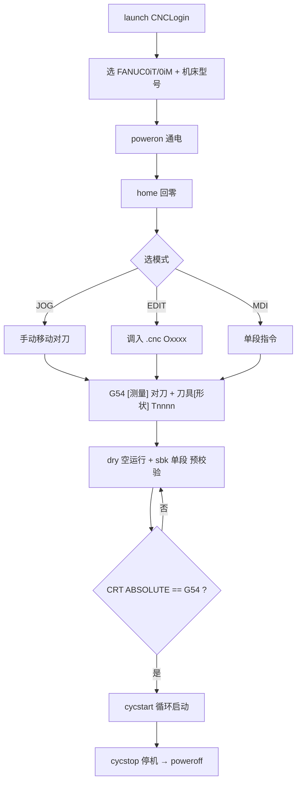

# SSCNC 7.2 端到端工作流（对齐 AGENTS.md §2.F 公理）

> AGENTS.md §2.F 公理：SSCNC 须验证虚拟 FANUC 0i 面板模式（AUTO/EDIT/MDI/JOG）、CRT 坐标读数（MACHINE/RELATIVE/ABSOLUTE/G54）、对刀火花对准、循环启动前检查。

## WF-S1：SSCNC 单机操作主流程（FANUC 0i 车/铣）

| 步 | 动作 | 模块/命令 | 关键参数 | 检查点 |
| :-- | :-- | :-- | :-- | :-- |
| 1 | 启动 | SS-01 `launch()` → 登录器 | cwd=安装目录 | 进程 CNCLogin.exe 存在 |
| 2 | 选机床 | SS-02 选控制器(FANUC0iT/0iM) + 型号(ShenYangTD 等) | — | 进入 FANUC 0i 面板 |
| 3 | 通电 | SS-26 `poweron.bmp` | — | CRT 点亮 |
| 4 | 回零 | SS-07 `home.bmp`（REF 模式） | — | 三轴回参考点完成 |
| 5 | 选模式 | SS-06 JOG / SS-04 EDIT / SS-05 MDI / SS-03 AUTO | 按用途切 | 面板模式灯正确 |
| 6 | 对刀 G54 | SS-18 OFFSET→[坐标系]→G54→X0/Y0/Z0→[测量] | G54 原点 = 试切点 | 坐标读数回显 G54 设定值 |
| 7 | 刀具补正 | SS-19 [补正]→[形状]→Tnnnn 输入直径/X/Z/R | T=3(外圆)/2(内孔)/8(螺纹) | 补正值与 calculate_tool_offsets 一致 |
| 8 | 调入程序 | SS-23 EDIT 模式选 Oxxxx（`.cnc`） | — | 程序号与代码显示正确 |
| 9 | 预校验 | SS-11 空运行 `dry.bmp` + SS-12 单段 `sbk.bmp` + SS-15 锁轴 `zlock.bmp` | 进给倍率 SS-16 降档 | CRT ABSOLUTE 坐标走刀路径合理 |
| 10 | 坐标核对 | SS-22 POS 切 MACHINE/RELATIVE/ABSOLUTE | 启动前 | **ABSOLUTE 与 G54 工件坐标一致（AGENTS §2.F）** |
| 11 | 循环启动 | SS-09 `cycstart.bmp`（绿灯） | — | cycstop 可随时 Feed Hold |
| 12 | 停机 | SS-10 `cycstop` / `stop` / SS-26 `poweroff` | — | — |

## WF-S2：闭环上下游衔接（按 SSCNC 角色裁剪）

| 上游环节 | 交接物 | SSCNC 消费方式 |
| :-- | :-- | :-- |
| 蓝图/2D | 工程图 | 不直接读；工件尺寸在对刀时手工设定 |
| CAD（SolidWorks/NX） | 3D 模型 | 不导入；SSCNC 用内置机床毛坯模型 |
| FEA | FOS≥1.5 | 不进 SSCNC；仅通过则毛坯/材料已确定 |
| CAM（NX/SW CAM） | 刀路 | 经后处理出 G 代码 `.cnc` |
| 后处理 | FANUC G 代码 `.nc/.cnc` | SS-23 EDIT 模式载入 Oxxxx |
| CIMCO Edit | NC 编辑 | 编辑后同 `.cnc` 回灌 |
| **VERICUT** | is_safe 报告（无碰撞/无过切） | **VERICUT 判安全后**，SSCNC 做面板级操作演练（对刀/循环启动），验证操作工顺序 |

## WF-S3：Agent 可离线完成 vs 必须面板操作

| 可离线（桥接已覆盖） | 必须 GUI 面板（documented-not-probed） |
| :-- | :-- |
| 启动进程 launch() | 选机床型号 |
| 找窗口 find_window() | 按模式键 auto/edit/mdi/hnd |
| 对刀量计算 calculate_tool_offsets() | [坐标系]/[补正] 软键录入 |
| `.cnc` 程序静态阅读 | cycstart/cycstop 实际触发 |

> 遗留：面板级键鼠自动化（坐标点击 cycstart/软键）本轮无实测证据，未来需在有桌面自动化的会话补测。
