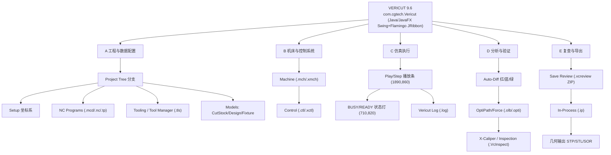

# VERICUT 9.6 功能模块树（GUI 模块 / Ribbon / Project Tree）

> 证据来源：安装目录 `commands/` 转换器与启动 bat 清单（E-V04）、`KeyBinding.java` javap 反编译（E-V05，确认 Swing/Flamingo JRibbon 框架）、官方帮助站（E-V09）、2026-10-30 GUI 实测（E-V02/E-V03）。
> 说明：本机 Swing/Flamingo 深树不暴露给 UIA（E-V03 confirmed-negative），故菜单条目名为「官方文档 + 实测 ribbon 按钮」可确认项，未实测的细项标注 `documented-not-probed`。

## 领域分块 A：工程与数据配置（Project Setup & Data）

| 模块 | 菜单/面板 | 说明 | 模块→命令 |
| :-- | :-- | :-- | :-- |
| 工程文件（Project File） | File 选项卡 → Open Project / Save Project | `.vcproject` XML，含单位/颜色/路径/NC 程序引用 [高] | VC-01 |
| 坐标系/Setup（G54 对齐） | Project Tree → Setup 分支 | 工件坐标系配置，`Configure Coordinate System` [高] | VC-02 |
| NC 程序（NC Programs） | Project Tree → NC Programs 分支 | G-Code(.mcd/.nc) 或 APT-CLS(.tp)，设 NC Program Type=G-Code Data [高] | VC-03 |
| 刀具库（Tool Manager） | Tool Manager 窗口 / Project 选项卡 | `.tls` ASCII 刀具库，按 Tool ID 存取 [高] | VC-04 |
| 模型（Models：Cut Stock / Design / Fixture） | Project Tree → Models；Configure Model 菜单 | 毛坯/设计件/夹具；支持 STL/.vct/.sor/.swp/.stp/.sat [高] | VC-05 |

## 领域分块 B：机床与控制系统（Machine & Control）

| 模块 | 菜单/面板 | 说明 | 模块→命令 |
| :-- | :-- | :-- | :-- |
| 机床文件（Machine File） | Machine/Control 选项卡 → Save As (Machine) | `.mch` XML / `.xmch` 加密 X-File（运动学构造） [高] | VC-06 |
| 控制系统（Control File） | Machine/Control → Control | `.ctl`/`.xctl` XML，G 代码解释规则（模态/宏/表格） [高] | VC-07 |
| 机床配置开关 | 环境变量 `CGTECH_MACHINE_CONFIG=FALSE` 可隐藏该菜单（bat 注释区） | documented-not-probed | VC-08 |

## 领域分块 C：仿真执行（Simulation Playback）

| 模块 | 菜单/面板 | 说明 | 模块→命令 |
| :-- | :-- | :-- | :-- |
| 播放/步进（Play/Step/Speed） | 底部播放条；绿色播放三角按钮 | GUI 坐标 (1890,860)；**无键盘快捷键**（KeyBinding 反编译确认无播放绑定）[高]（历史实测） | VC-09 |
| 状态灯（BUSY/READY） | 播放条左侧状态灯 | (710,820) 绿色像素检测 BUSY/READY 交替 [高] | VC-10 |
| 仿真日志（Vericut Log） | Info 选项卡 → Vericut Log | `.log` ASCII：刀具摘要/去除体积/碰撞/总时间 [高] | VC-11 |

## 领域分块 D：分析与验证（Analysis & Verification）

| 模块 | 菜单/面板 | 说明 | 模块→命令 |
| :-- | :-- | :-- | :-- |
| Auto-Diff（自动偏差对比） | Analysis 选项卡 → AUTO-DIFF | 加工件 vs Design 对比：**红=过切(gouge)、蓝=残料(excess)、绿=合格**（对齐 AGENTS.md 公理）[高] | VC-12 |
| 优化库（OptiPath/Force） | Analysis 选项卡 → OptiPath/Force；`.olb` 优化库 | 进给率优化；`.opti/.mco/.tpo` 输出 [高] | VC-13 |
| X-Caliper / Inspection | Analysis → X-Caliper / Inspection | 测量与 `.VcInspect` 检验序列文件 documented-not-probed | VC-14 |

## 领域分块 E：复查与导出（Review & Export）

| 模块 | 菜单/面板 | 说明 | 模块→命令 |
| :-- | :-- | :-- | :-- |
| 保存复查文件（Save Review） | ribbon 按钮 (830,108) | `.vcreview` = Reviewer 9.6 ZIP 容器（NC/STL/ip/日志 25 条目，实测 227MB）[高] | VC-15 |
| 过程文件（In-Process .ip） | File → Save As (In-Process) | 会话快照，可命令行 `ip=` 加载 [高] | VC-16 |
| 实体输出（STP/STL/SOR） | 输出面板 → 应用 (1576,451) | 几何导出；本项目实测路径曾误置 F:\ 未 [高]（历史） | VC-17 |

## 模块树（mermaid）

> category 枚举（与 module_inventory.json 对齐）：`config_admin / virtual_machine / simulation_verification / cam_toolpath / visualization / data_exchange`。
