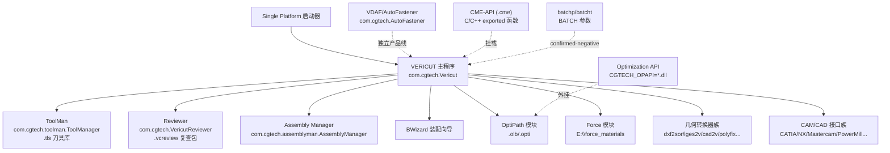

# VERICUT 9.6 插件 / 附加模块（Plugins & Add-ons）

> 阶段一插件级深度逆向（2026-11-04）。证据来源：桌面快捷方式 Glob（E-V11）、commands/*.bat 逐主类提取（E-V12 Grep `com.cgtech.*`）、官方帮助站（E-V13）。
> 三态判定纪律同前：verified-working（历史实测）/ confirmed-negative / documented-not-probed（本轮未运行）。

## 1. 插件总表

| 名称（中/英） | 类型 | 安装路径 / 快捷方式 | 可执行/主类 | 集成方式 | 状态 | 证据 |
| :-- | :-- | :-- | :-- | :-- | :-- | :-- |
| 主程序 VERICUT | 独立程序 | `C:\Users\Public\Desktop\Vericut 9.6.lnk` | `vericut.bat` → `com.cgtech.Vericut` | — | verified-working（历史实测） | E-V01/E-V02 |
| 单平台启动器 Single Platform | 独立启动器 | `C:\Users\Public\Desktop\Vericut Single Platform 9.6.lnk` | lnk 指向 bat（目标未解码） | 简化版启动入口 | documented-not-probed | E-V11 |
| 刀具管理器 ToolMan | 独立程序 | `Vericut ToolMan 9.6.lnk` + `toolman.bat` | `com.cgtech.toolman.ToolManager`（splash=`toolman/startup.png`） | 独立 javaw 进程，读写 `.tls` 刀具库 | documented-not-probed | E-V12 |
| 复查器 Reviewer | 独立程序 | `Vericut Reviewer 9.6.lnk` + `reviewer.bat` | `com.cgtech.VericutReviewer`（splash=`reviewer/...`） | 打开 `.vcreview` ZIP 复查包（本项目 227MB 实测） | verified-working（历史产物） | E-V12/E-V02 |
| 装配管理器 Assembly Manager | 独立程序 | `Vericut Assembly Manager 9.6.lnk` + `assembly_manager.bat` | `com.cgtech.assemblyman.AssemblyManager`（splash=`assembly_manager/...`） | 机床/附件装配组件管理 | documented-not-probed | E-V12 |
| 钻铆仿真 VDAF (AutoFastener) | 独立程序 | `vdaf.bat` | `com.cgtech.AutoFastener`（splash=`vdaf/...`，样本=`vdaf_samples_list.csv`） | VERICUT Drill & Fastener Simulation；工程不互通（帮助站） | documented-not-probed | E-V12/E-V13 |
| 装配向导 BWizard | 独立程序 | `bwizard.bat` | `com.cgtech.BWizard`（splash 存在） | 装配创建向导 | documented-not-probed | E-V12 |
| 控制台版 VERICUT | 独立程序 | `vericut_console.bat` | `java`（非 javaw）→ `com.cgtech.Vericut` | 控制台运行（stdout 可见，便于日志采集） | documented-not-probed | E-V12 |
| 偏好清理 WipePrefs | 工具 | `delprefs.bat` | `com.cgtech.WipePrefs` | 删除用户 prefs 重置 | documented-not-probed | E-V12 |
| OptiPath 进给优化 | 主程序内模块 | 主程序 Analysis 选项卡 | 优化库 `.olb` / 输出 `.opti/.mco/.tpo` | 进给率优化 | documented-not-probed | E-V09/E-V13 |
| Force 切削力分析 | 主程序内模块 | `E:\force_materials`（CGTECH_FORCE_MATERIALS） | Force 模块（材料库） | 切削力/功率/温度分析 | documented-not-probed | E-V01/E-V13 |
| CME-API（C 宏扩展） | 官方编程接口 | `.cme` 文件 + Control 高级选项 | C/C++ 调用 VERICUT exported 函数（`cmeapi_register_modify_output_str`） | 自定义 G 代码处理/模态 | documented-not-probed | E-V13 |
| Optimization API（OptiPath 外挂） | 官方编程接口 | 环境变量 `CGTECH_OPAPI=<优化库 DLL>` | Windows 平台 DLL 接口 | 连接自定义刀路优化程序 | documented-not-probed | E-V13 |
| 批处理 batchp/batcht | 命令行 | `vericut.bat BATCH` 参数透传 | `com.cgtech.Vericut` + `BATCH` 关键字（`/wait`） | 无人值守 | **confirmed-negative（不可靠）** | E-V02 |
| 几何转换器族 | 控制台工具 | `commands\*.bat`（见 §3） | DxfSorConverter/DxfConverter/AcisConv/Iges2v/Sur2stk/Bincl2v/PolyFix/Vda | 几何格式转换 | documented-not-probed | E-V12 |
| CAM/CAD 接口族 | 启动器 | `commands\catv*.bat / nx*.bat / mastercam*.bat / powermill.bat / proev.bat / gibbsv.bat / esprit.bat / edgecam.bat / cgt_teamcenter.bat / cgt_zoller.bat` | 各系统接口 | 读各 CAM 刀路/模型 | documented-not-probed | E-V04 |

## 2. 关键插件分述

### 2.1 ToolMan（刀具管理器）
- 功能域：刀具/刀柄/夹头全生命周期管理，独立窗口（不占主程序）。
- 启动：双击 `Vericut ToolMan 9.6.lnk` 或 `E:\windows64\commands\toolman.bat`。
- 自动化接口：无 COM（同主程序 confirmed-negative）；读写对象 = `.tls` ASCII 刀具库（Tool ID 键）；`CGTECH_TOOL_LIB_LOCK=FALSE` 可关文件锁（bat 注释区）。
- 文件格式：`.tls`、`.rpt`（Tool Manager Report）。
- 关键操作：Tool Manager → Project → Tools → Save As `.tls`。

### 2.2 Reviewer（复查器）
- 功能域：回放已保存的仿真复查包，供离线复盘/评审。
- 启动：`reviewer.bat` → `com.cgtech.VericutReviewer`。
- 自动化接口：`vericut_link.read_vcreview()` 已 verified-working（ZIP 解压 25 条目）。
- 文件格式：`.vcreview`（Reviewer 9.6 ZIP：NC/STL/ip/日志）。
- 关键操作：ribbon「保存复查文件」(830,108) 产出 → Reviewer 打开回放。

### 2.3 VDAF / AutoFastener（钻铆仿真）
- 功能域：复合材料钻孔/紧固钉仿真（独立产品线）。
- 启动：`vdaf.bat` → `com.cgtech.AutoFastener`；样本 `vdaf_samples_list.csv`。
- 注意：VDAF 工程与 VERICUT 主工程不互通（帮助站明确警告）。
- 官方文档：`https://help.vericut.com/vdaf_help/`（帮助站存在）。

### 2.4 CME-API（编程接口）
- 功能域：用标准 C/C++ 写宏，调用 VERICUT exported 函数自定义 G 代码处理/输出。
- 官方文档：`https://help.vericut.com/vericut_development_tools/05_cme_api_help`（真实 URL，本轮搜索返回）。
- 关键 API 样例（帮助站原文）：`void cmeapi_register_modify_output_str(ccFunc fptr);` 注册自定义输出串修改函数。
- 集成：`.cme` 文件经 Control Advanced Option → CME/API 选项卡挂载。

### 2.5 Optimization API（OptiPath 外挂）
- 功能域：连接用户自研刀路优化插件（仅 Windows）。
- 官方文档：`https://help.vericut.com/vericut_development_tools/06_optimization_api`。
- 触发：设环境变量 `CGTECH_OPAPI=<优化库 DLL>` → VERICUT 自动切 API 模式并连接（此时内置优化停用）。

## 3. 几何转换器族归类（commands/，E-V12）

| bat | 主类 | 输入→输出 |
| :-- | :-- | :-- |
| dxf2sor.bat | `com.cgtech.DxfSorConverter`（java 控制台） | DXF → SOR 回转体 |
| dxf2sweep.bat | `com.cgtech.DxfConverter`（java 控制台） | DXF → Sweep |
| cad2v.bat | `com.cgtech.AcisConv` | ACIS/SAT → VERICUT |
| iges2v.bat | `com.cgtech.Iges2v` | IGES → VERICUT |
| sur2stk.bat | `com.cgtech.Sur2stk` | 曲面 → 毛坯 |
| bincl2v.bat | `com.cgtech.Bincl2v` | Binary CL → VERICUT |
| polyfix.bat | `com.cgtech.PolyFix` | 多边形模型修复（Auto-Diff 设计一致性） |
| vda.bat | `com.cgtech.Vda` | VDA 接口 |
| bwizard.bat | `com.cgtech.BWizard` | 装配向导 GUI |
| delprefs.bat | `com.cgtech.WipePrefs` | 偏好清理 |

CAM/CAD 接口（启动器，E-V04）：CATIA V5/V6（`catv5.bat`、`catv6_3dx*.bat` 2019-2025、`catv6_3dxml*.bat`）、UG/NX（`nx12_2vdaf.bat`、`nx_cr_*.bat` 至 2412、`nx_export.bat`）、Mastercam（2023/2024/2025）、PowerMill、Pro/E（proev.bat）、Gibbs（gibbsv.bat）、Esprit、Edgecam、Teamcenter（cgt_teamcenter.bat）、Zoller 对刀仪（cgt_zoller.bat）。

## 4. 插件关系图（mermaid）

