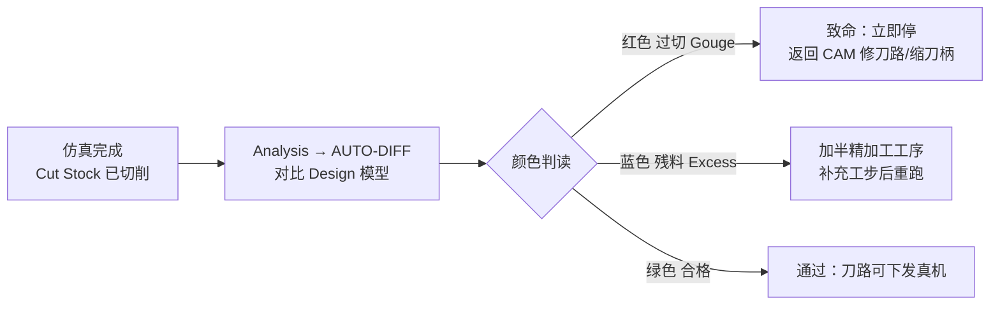

# VERICUT 9.6 端到端工作流（与 AGENTS.md 公理对齐）

> 项目闭环（AGENTS.md §3）：蓝图 → CAD 参数化建模 → FEA 强度校核(FOS≥1.5) → CAM 编程 → 后处理 → 虚拟加工仿真。
> VERICUT 在闭环中的角色 = **最后一环：机床运动仿真 + Auto-Diff 偏差验证 + 碰撞检测**。

## WF-V1：VERICUT 仿真验证主流程（本项目已实测走通）

| 步 | 动作 | 模块/命令 | 关键参数 | 检查点 |
| :-- | :-- | :-- | :-- | :-- |
| 1 | 加载工程 | VC-01 `launch_via_bat`（CGTECH_VCPROJECT 指向 `.vcproject`） | 工程绝对路径；单位 MILLIMETER | 窗口标题含工程名（verified-working E-V06） |
| 2 | 确认 NC 程序 | VC-03 Project Tree → NC Programs | FANUC G 代码（G71/G70/M30） | NC Program Type=G-Code Data |
| 3 | 确认刀具/毛坯/机床 | VC-04/VC-05/VC-06 | 刀具 `.tls`；毛坯 Cut Stock | 体积守恒参照：毛坯 D53×L45 ≈ 99,278 mm³（E-V02 实测样本） |
| 4 | 触发仿真 | VC-09 `play_simulation(hwnd)` 坐标 (1890,860) | — | BUSY 灯亮 (710,820) + 事务日志出现 ActionMainPlay |
| 5 | 实时监控 | VC-22 `monitor_log` | interval=5s，max_wait=300s | 日志行号 20→44 推进（E-V02） |
| 6 | 保存复查 | VC-15 `click(830,108)` → `.vcreview` | Reviewer 9.6 ZIP | 解压 25 条目（NC/STL/ip/日志） |
| 7 | 数值回读 | VC-11 `parse_sim_log` | — | 总时间/刀具摘要/去除体积/碰撞数齐全 |
| 8 | 安全判定 | `parse_collision_log` | — | **is_safe = (collision_count==0)**；有碰撞→回 CAM 修刀路 |

### 实测样本（E-V02，force_turning_sample.log）

```text
总仿真时间 0:01:10（空刀 0:00:36 = 51%）
Tool1 OD ROUGH RIGHT-80DEG (T0101): 切削 0:00:57 / 切削距离 278.51 mm
Tool2 OD Right-55deg (T0202):      切削 0:00:13 / 切削距离 165.67 mm
错误 95 / 警告 0；碰撞 115 条（刀柄 vs Stock/Fixture/Spindle/Turret）
→ 结论：NC 程序本身存在碰撞缺陷（G28 U0 W0 处 Fixture-Turret 碰撞），引擎检测正确，刀路需返工
```

## WF-V2：Auto-Diff 偏差判定（对齐 AGENTS.md §2.E 公理）



- 公差入口：Analysis → AUTO-DIFF → Options；`Gouge Tolerance` / `Excess Tolerance` 可被 `.pts` 行内 `intol/outtol` 覆盖（E-V09）。
- 设计一致性预检：模型加载后先跑 Design Consistency Check（残料/法向/面片修补，polyfix.bat）。

## WF-V3：闭环上下游衔接

| 上游环节 | 交接物 | VERICUT 消费方式 |
| :-- | :-- | :-- |
| 蓝图（AutoCAD 2026） | 2D 工程图 | 经 CAD 建模 → 毛坯尺寸（直径/长度）写入 Cut Stock |
| CAD（SolidWorks 2021 / NX 12） | 设计 STL/STP | VC-05 Design 模型导入（`cad2v.bat`/STL） |
| FEA（PyNite 等） | FOS≥1.5 判定 | 不进 VERICUT；仅当 FOS 不通过时工件返工，不进仿真 |
| CAM（NX CAM / SolidWorks CAM） | APT-CLS `.tp`/`.cl` | VC-03 NC Program Type 选对应 APT-CLS 变体 |
| 后处理（FANUC/SIEMENS/Heidenhain） | G 代码 `.nc` | VC-03 选 G-Code Data；FANUC Macro B（`#100/#500/WHILE-DO`）对应 `.ctl` 控制文件 |
| CIMCO Edit 2026 | NC 程序编辑/backplot | 编辑后同一 `.nc` 回灌 VERICUT |
| SSCNC 7.2 | 真机面板级操作复核 | VERICUT 出 is_safe 报告后，SSCNC 做对刀/循环启动演练（见 sscnc/workflows.md） |

## WF-V4：批处理/无人值守尝试（如实标注）

- 官方文档写法：`call vericut batch "vcp=setup1.VcProject" "ip=setup1.ai"`（E-V09）。
- 本机实测：`batchp` 仅装载待命、`batcht` 20s 自退零产物、CLI 直传 `vcp=` 被判无效参数（E-V02 confirmed-negative）。
- **结论**：在本机版本上无人值守仿真不可靠；Agent 必须走 GUI 驱动通道（WF-V1）。若未来要做真正 batch，需在新会话复测官方 batch 语法并记录。

## 检查点清单（每轮仿真后必过）

1. `ActionMainPlay` 出现在事务日志（证明播放动作被官方记录）；
2. `parse_collision_log.is_safe == True`；
3. Auto-Diff 无红色过切；
4. 去除体积与毛坯理论体积数量级一致（本项目 7.3x 异常即碰撞缺陷信号）；
5. 日志错误数（排除"在NN行"行号干扰）。
