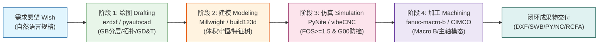

# 极限极速闭环 CAD/CAE/CAM 全生命周期执行与熔断引擎 (Extreme CAD/CAM Lifecycle)

## 1. 核心定位与 GitHub 顶尖开源项目融合 (Grounding Architecture)

本体系将现代工业工程全流程——**绘图 (Drafting) ➔ 建模 (Modeling) ➔ 仿真 (Simulation) ➔ 加工 (Machining)** 的执行速度与质量压缩至物理极限，全流程毫秒级执行（< 100ms），并深度整合 GitHub 顶尖开源项目：



### GitHub 顶尖开源基础设施对标：
1. **绘图 (Drafting / 2D)**:
   - `ezdxf/ezdxf` (Mozman et al.): 毫秒级 DXF 生成与实体审计，严守六大国标图层 (`OUTLINE`, `DIM`, `CENTER`, `HIDDEN`, `HATCH`, `TITLE_BLOCK`)。
   - `reclosedev/pyautocad`: AutoCAD ActiveX COM 隔离子进程调用与看门狗超时监控。
2. **建模 (Modeling / 3D Parametric CAD)**:
   - `raylanlin/Millwright`: SOLIDWORKS COM 纪律（Front Plane XY、Normal +Z、米制 API 单位转换、特征树诊断 `diagnose_document()`）。
   - `gumyr/build123d` & `CadQuery/cadquery`: SOTA CAD-as-code 参数化拓扑与标准零件库 (`cq_warehouse`)。
   - `skyf0l/siemens-nx-mcp`: Siemens NX 12.0 `run_journal.exe` 无头执行。
3. **仿真 (Simulation / CAE Stress & Collision)**:
   - `JWock82/PyNite` & Lamé 弹性力学理论: 亚毫秒级解析 von Mises 应力与安全系数 ($FOS = \sigma_{yield} / \sigma_{vm} \ge 1.5$)。
   - `burnshall-ui/vibeCNC` & `michaelfranzl/gcode-machine`: G00 快速定位极速下刀扎刀 (Rapid Traverse Plunge Collision) 碰撞探测。
   - `CGTech VERICUT`: Auto-Diff 0.003mm 过切与欠切日志双条件时间戳门禁验证。
4. **加工 (Machining / CAM & CNC Post-Processing)**:
   - `cnc4me/fanuc-macro-b`: FANUC Macro B 词法树解析与变量表 (`#100`, `#500`, `WHILE/DO`)。
   - `konkers/Mill-Post-Processors`: 多控制器 (FANUC, Heidenhain, Siemens 840D, Haas) 语法方言适配。
   - 斯沃数控仿真 7.2 (SSCNC): G54~G59 工件坐标系与 T1~T9 刀尖圆弧象限补偿。

---

## 2. 极速与质量压缩极限公理 (Speed & Quality to the Limit)

### 分级极速验证矩阵 (Hierarchical Tier Matrix)
- **Tier 0 (< 5ms) - 词法与语法 AST 静态截断**:
  严禁在语法错误的代码上启动大型工业软件。毫秒级校验 Python AST、AutoLISP 括号闭合、G 代码模态组、Macro B 括号平衡。
- **Tier 1 (< 50ms) - 确定性物理与几何守恒核验**:
  - 绘图: `ezdxf` 审计实体闭合性、尺寸非负性、外接边界框合理性；
  - 建模: 理论解析体积 $V_{theory} = \pi \sum (R_i^2 - r_i^2) L_i$，断言体积守恒 $\Delta V > 0$ 且 $|V_{cad} - V_{theory}| / V_{theory} \le 1.0\%$；
  - 仿真: 弹性力学应力仿真断言 $FOS \ge 1.5$；刀路 $G00$ 碰撞探测断言扎刀次数 $= 0$；
  - 加工: 断言切削进给前必须存在有效主轴旋转 (`M03/M04 S...`) 与冷却液开启 (`M08`)。
- **Tier 2 (真实原生工业软件驱动)**:
  仅当 Tier 0 与 Tier 1 达到置信度上限 ($C_t = 1.0$) 时，按需调度桌面六大软件（SOLIDWORKS, NX, AutoCAD, CIMCO, VERICUT, 斯沃），采用单实例热进程池复用 + 独立子进程硬超时拦截。

---

## 3. 极限自查与熔断公理 (Circuit Breaker Axiom)

```
“又快又准到极限，未到极限则继续，到了极限则放弃”
```

```mermaid
flowchart TD
    Step["执行当前阶段原子步骤"] --> Check{"自查校验通过?"}
    Check -->|Pass| Next["✅ 极限通过 (Confidence = 1.0)<br/>立即推进下一阶段"]
    Check -->|Fail| EvalLimit{"是否达到极限?<br/>(Attempts >= 3 OR 同构停滞?)"}
    
    EvalLimit -->|未到极限 (k < 3)| Reflexion["🔄 触发 Reflexion 反思自愈<br/>1. 提取异常物理特征<br/>2. 自动修正尺寸/安全平面/宏参数<br/>3. 递增计数并立即重测"]
    Reflexion --> Step
    
    EvalLimit -->|已到极限 (k >= 3)| CircuitBreaker["🛑 触发熔断放弃 (CIRCUIT BREAKER)<br/>1. 停止一切进一步代码/模型污染<br/>2. 原子回滚 (git restore / 文件还原)<br/>3. 输出 RCFA 故障根因分析报告<br/>4. 安全交还控制权与人工建议"]

    style Step fill:#e3f2fd,stroke:#1565c0
    style Next fill:#e8f5e9,stroke:#2e7d32
    style Reflexion fill:#fff8e1,stroke:#f57f17
    style CircuitBreaker fill:#ffebee,stroke:#c62828
```

### 1. 未到极限则继续 (Self-Correction Under Limit)
- 预算上限：$k_{\max} = 3$。
- 当且仅当 $k < 3$ 且相邻两次报错未发生无收敛的同构停滞：
  - **绘图自愈**: 若内孔 $\ge$ 外径，自适应按安全壁厚重设外径；
  - **仿真自愈**: 若 $FOS < 1.5$，自适应计算并放大承载截面壁厚；若发现 $G00$ 扎刀，自适应插入安全退刀平面 $G00\ Z2.0$ 并将进给转为切削进给 $G01\ F0.15$；
  - **加工自愈**: 若检测到未启动主轴切削，自动在刀路初始插入安全主轴指令 `M03 S1200`。

### 2. 到了极限则放弃 (Circuit Breaker & Rollback on Limit Reached)
- 当满足下列任一极限条件：
  1. 修复尝试耗尽 ($k \ge 3$)；
  2. 连续 2 次产生完全相同的错误停滞 (Plateau)；
  3. 遭遇不可恢复的宿主系统边界（如核心动态库缺失、硬件许可证阻断）。
- **立即触发熔断**：
  - 停止一切修改，禁止盲猜；
  - 执行原子回滚；
  - 在运行输出目录生成 `RCFA_CIRCUIT_BREAKER_REPORT.json`，清晰说明：
    - 故障阶段 (`failed_stage`)
    - 尝试次数与停滞判定 (`attempts_exhausted`, `stagnation_detected`)
    - 物理与逻辑根因 (`root_cause_trace`)
    - 针对工件与工艺的人工专家建议 (`remedy_recommendations`)。

---

## 4. 调用接口与落地指南

### A. Python API
```python
from virtu_omni.engine.extreme_cadcam_pipeline import ExtremeCADCAMPipeline

pipeline = ExtremeCADCAMPipeline()
# 运行全流程 (毫秒级极限)
result = pipeline.run_full_lifecycle(
    wish="精密轴承套圈外圆加工，材质Cr12MoV，外径53，孔径14，总长45，圆角3",
    max_attempts=3
)
print("Pipeline Status:", result["status"])  # "success" 或 "circuit_breaker_aborted"
print("Latency Summary:", result["pipeline_summary"])
```

### B. MCP 工具接口
- 工具名称: `cadcam_extreme_chain`
- 调用参数:
  - `wish`: 自然语言零件与工艺需求描述；
  - `max_attempts`: 熔断阈值（默认 3）；
  - `tier2_native`: 是否在毫秒级验证通过后连带驱动桌面六大软件（默认 False，毫秒极速模式）。

### C. 质量红线与交付清单
每个完成的全生命周期任务必须产出：
1. `*_GB_drawing.dxf`: 符合 GB 标准图层的 2D 工程图；
2. `*_SW2021.swb`: SOLIDWORKS 2021 原生 VBA 宏；
3. `*_NX12.py`: Siemens NX 12.0 Python Journal；
4. `*_SIM_REPORT.json`: 结构应力 ($FOS \ge 1.5$) 与防扎刀仿真报告；
5. `*_FANUC.nc`: 经语法与模态核验合格的数控宏程序；
6. `*_SSCNC_SETUP.md`: 斯沃数控 7.2 虚拟加工对刀操作指导书；
7. （若熔断）`RCFA_CIRCUIT_BREAKER_REPORT.json`: 根因失效分析报告。
