# 斯沃数控仿真软件（SSCNC 7.2.2.0）核心模块全覆盖教学

> 文档版本：v1.1　|　软件版本：SSCNC 7.2.2.0　|　修订日期：2026-11-19（新增附录 X 术语与判定补遗）
> 适用对象：数控技术教学、机床操作仿真实训、职业技能考证辅导

---

## 0. 依据来源声明（写作唯一依据）

本文档为斯沃数控仿真软件（SSCNC 7.2.2.0）教学体系的核心模块手册。**所有关于软件菜单、功能、参数、界面的描述，均严格且仅引用下列一手资料**；凡一手资料未明确记载的内容，一律标注"需以实测/官方帮助为准"，绝不虚构软件中不存在的菜单项或功能。

| 优先级 | 一手资料 | 路径 | 用途 |
| --- | --- | --- | --- |
| 1（最高） | 实测菜单结构（Win32 API 枚举） | `evidence/menu_structure_measured.json` | 9 大菜单、子窗口、工具栏的**真实存在性**判定 |
| 2 | 一手资料索引 | `SOURCE_INDEX.md` | 软件实体、系统清单、桥接边界、证据清单总纲 |
| 3 | 官方帮助知识库索引（253 主题） | `source/help_kb_md/_index.json` | 按 src/title 定位官方主题，再读具体 md |
| 4 | 官方帮助知识库主题 md | `source/help_kb_md/*.md` | 坐标系、G 代码、M 代码、系统/面板操作的一手描述 |
| 5 | 系统清单（general.ini） | 经 `SOURCE_INDEX.md` 记录（CNC=37） | 37 个 CNC 配置名称 |
| 6 | 桥接能力边界 | 经 `SOURCE_INDEX.md` 记录的 `bridges/sscnc_bridge.py` 实测结论 | 刀尖方位号换算、面板自绘画布限制 |
| 7 | 真实界面截图 | `evidence/sscnc_main.png`、`sscnc_main_crop.png`、`probe_launch_fullscreen.png` | 3D 视图、面板、菜单实测证据 |
| 8 | 官方帮助截图 | `source/chm_cn/<相对路径>` | 由 `_index.json` 的 `src` 推断，aturing 源图在同名 `Code/` 或 `pic/` 子目录 |

**引用约定**

- 实测菜单证据在正文中以 `【实测·菜单】`、`【实测·截图】` 标注，对应 `evidence/` 下文件。
- 官方帮助证据在正文中以 `【官方·主题名】` 标注，对应 `source/help_kb_md/` 下 md 文件。
- 官方截图引用格式：``。因 md 头部"关联官方截图"路径多写了一层 `chm_cn/`，本文按 `SOURCE_INDEX.md` 的校正说明，统一使用 `source/chm_cn/` + 从 htm 原始相对目录起的路径（例：md 中的 `source/chm_cn/chm_cn/fanuc/fanuc_MPRG/Code/G00.GIF` 在本文写为 `../source/chm_cn/fanuc/fanuc_MPRG/Code/G00.GIF`）。本文所引用的每一条官方截图路径均经文件存在性校验。
- 不确定确切文件名的官方截图，采用文字引用 `[官方帮助截图：xxx 主题]`。

**重要事实边界（先行声明，后文不再重复质疑）**

1. 实测 9 大菜单为：文件 / 视窗视图 / 显示模式 / 机床操作 / 工件操作 / 工件测量 / 习题与考试 / 查看 / 帮助（`【实测·menu_structure_measured.json】`）。其中**没有**独立的"碰撞检测"菜单项或按钮，也未出现"系统选择"菜单项。
2. 面板为自绘画布，无 Button/Static 键位子控件；键位自动化需坐标点击，不能用 PostMessage BM_CLICK（`【实测·menu_structure_measured.json】` notes + `SOURCE_INDEX.md` 桥接边界）。
3. 官方 `userguide/menu.md` 记载的"工件测量"子项为"特征点/特征线/粗糙度分布"且入口写作"测量进入"，而实测菜单为"刀路测量(调试)/特征点/特征线/距离/角度/测量退出"。**二者存在差异时以实测菜单为准**，并在第 7 章明确标注。

---

## 目录

- 第 1 章 主流机床系统选择与配置
- 第 2 章 工件坐标系标准化设定
- 第 3 章 刀具参数规范设置
- 第 4 章 数控程序导入与编辑
- 第 5 章 自动/手动加工仿真全流程
- 第 6 章 碰撞检测功能（基于实测能力的干涉观察法）
- 第 7 章 加工结果精度校验
- 本章节事实核查清单

---

## 第 1 章 主流机床系统选择与配置

### 1.1 本章目标

了解 SSCNC 7.2.2.0 内置的主流数控系统族谱，掌握铣削（M）与车削（T）系统的能力差异，能够根据教学或加工任务选定正确的系统配置，并完成进入仿真前的配置核查。

### 1.2 系统能力对照表

> 下列系统名称**全部来自** `SOURCE_INDEX.md` 记录的 `general.ini` 系统清单（CNC=37，共 37 个 CNC 配置）与官方帮助知识库主题；未列入其中的系统名称不予编造。

#### 1.2.1 FANUC 族

| 配置名（general.ini） | 类型 | 官方知识库对应主题 | 能力/用途说明（依据） |
| --- | --- | --- | --- |
| FANUC 0MD / 0MD2.5 | 铣削 M | `fanuc/fanuc0DM/*` 系列 htm（见 `_index.json`） | 早期 0M 系列铣床系统 |
| FANUC 0TD | 车削 T | `fanuc/fanuc0DT/*` 系列 htm（见 `_index.json`） | 早期 0T 系列车床系统 |
| FANUC 0iM | 铣削 M | `fanuc__fanuc0i_m__fanuc0i_m_sys.md`、`fanuc__fanuc0i_m__fanuc0i_m.md` | 0i-M 铣削，标准面板 + 多机床厂面板（南通/南京二机/汉川/沈阳/大连/台中精机等） |
| FANUC 0iMF | 铣削 M | 同 0iM 主题族 | 0i-MF，配置清单列出，具体面板差异需以实测为准 |
| FANUC 0iT | 车削 T | `fanuc__fanuc0i_t__fanuc0i_t_sys.md`、`fanuc__fanuc0i_t__fanuc0i_t.md` | 0i-T 车削，标准面板 + 多机床厂面板（沈阳/大连/重庆/济南/doosan 等） |
| FANUC 0iTF | 车削 T | 同 0iT 主题族 | 0i-TF，配置清单列出，具体面板差异需以实测为准 |
| FANUC 18M / 18iM | 铣削 M | `fanuc__fanuc0i_m__fanuc0i_m_youjia18m.md`（友嘉 FANUC 18M 面板） | 18/18i 系列铣削 |
| FANUC 18T / 18iT | 车削 T | `fanuc__fanuc0i_t__*` 主题族 | 18/18i 系列车削 |
| FANUC 21iM / 21iT | 铣 M / 车 T | 配置清单列出（无独立面板主题） | 21i 系列，具体面板需以实测为准 |
| Mazak VCN410 / QTN100 | 铣 M / 车 T | 配置清单列出 | 马扎克机床配置 |

#### 1.2.2 SIEMENS 族

| 配置名（general.ini） | 类型 | 官方知识库对应主题 | 能力/用途说明（依据） |
| --- | --- | --- | --- |
| SINUMERIK 801 | M/T | `siemens__siemens801__siemens801_sys.md` | 801 系统 |
| SINUMERIK 802S M / 802S T | 铣 M / 车 T | `siemens__siemens802s_m__*.md`、`siemens__siemens802s_t__*.md` | 802S 铣/车 |
| SINUMERIK 802C-802Se M / T | 铣 M / 车 T | `siemens__siemens802se_m__*.md`、`siemens__siemens802se_t__*.md` | 802C/802Se 铣/车 |
| SINUMERIK 802D M / T | 铣 M / 车 T | `siemens__siemens802d_m__*.md`、`siemens__siemens802d_t__*.md` | 802D 铣/车 |
| SINUMERIK 810D M / T | 铣 M / 车 T | `siemens__siemens810d_m__*.md`、`siemens__siemens810d_t__*.md` | 810D 铣/车 |
| SINUMERIK 840D M | 铣 M | `siemens__siemens810d_m__siemens840d_m.md` | 840D 铣削 |
| SINUMERIK 828D M / T | 铣 M / 车 T | `siemens__siemens828d_m__siemens828d_m_sys.md`、`siemens__siemens828d_t__siemens828d_t_sys.md` | 828D 铣/车，详细面板操作见第 5 章 |

> 828D 官方操作主题明确描述了 MDA / AUTO / JOG / REFPOT / VAR / SINGL 等运行方式，以及 CYCLESTAR（循环启动）/ CYCLESTOP（循环停止）/ 紧急停止旋钮 / 主轴速度调节旋钮 / 进给速度（F）调节旋钮（`【官方·siemens828d_m_sys】`）。

#### 1.2.3 华中 HNC 族

| 配置名（general.ini） | 类型 | 官方知识库对应主题 | 能力/用途说明（依据） |
| --- | --- | --- | --- |
| 华中 HNC-21M | 铣削 M | `hnc21__HNC21M__HNC21_m_sys.md`、`hnc21__HNC21_mprg__GCode.md` | 华中 21M 铣削 |
| 华中 HNC-21T | 车削 T | `hnc21__HNC21T__HNC21_t_sys.md`、`hnc21__hnc21_tprg__GCode.md` | 华中 21T 车削 |
| 华中 HNC-22T | 车削 T | `hnc21__HNC22T__HNC22_t_sys.md` | 华中 22T 车削 |

> 华中 HNC-21M 的坐标系统描述与 FANUC 铣削完全一致（机床/绝对/相对/剩余移动距离 4 类），见 `hnc21__HNC21_mprg__ref_frame.md`（`【官方·HNC21_mprg/ref_frame】`）。

#### 1.2.4 其他系统族

| 品牌/系列 | 配置名（general.ini / `_index.json` 前缀） | 类型 | 官方知识库主题示例 |
| --- | --- | --- | --- |
| 三菱 MITSUBISHI | E60（E60M/E60T）、E68（E68M/E68T） | 铣 M / 车 T | `mitsubishi__e60__*`、`mitsubishi__e68__*`；当前实测截图加载的是 MITSUBISHI M80（`menu_structure_measured.json` captured_system） |
| 发格 FAGOR | FAGOR8055（M/T） | 铣 M / 车 T | `fagor__fagor8055i_mprg__*`、`fagor__fagor8055i_tprg__*` |
| 海德汉 HEIDENHAIN | iTNC530 | 铣 M | `HEIDENHAIN530__HEIDENHAIN530__HEIDENHAIN530_m_sys.md` 等 9 个主题 |
| 广数 GSK | GSK990M、GSK983M、GSK928TA、GSK928TC、GSK980T | 铣 M / 车 T | `gsk__GSK990M_PRG__*`、`gsk__gsk980t_prg__*` 等 20 个主题 |
| 凯恩帝 KND | KND100M、KND100T、KND1TB | 铣 M / 车 T | `knd__knd100m__*`、`knd__knd100t__*`、`knd__knd1TB__*` |
| 大森 DASEN | DASEN3i M/T | 铣 M / 车 T | `dasen3i__DASEN3i__DASEN_m_sys.md` 等 |
| 北京凯恩帝（BJ 内核） | — | — | `SOURCE_INDEX.md` 记录 BJControlor.dll（北京凯恩帝） |
| 其他 | GREAT150i M/T、WA310M/T、RENHE32T、SKY2003N | 铣 M / 车 T | `great150i__*`、`wa__*`、`RENHE__*`、`SKY2003N__*` |

### 1.3 铣削（M）与车削（T）的核心区别

> 依据：FANUC 铣削编程主题 `fanuc__fanuc_MPRG__GCode.md` 与车削编程主题 `fanuc__fanuc_TPRG__GCode.md` 对照。

| 对比维度 | 铣削 M（以 FANUC MPRG 为例） | 车削 T（以 FANUC TPRG 为例） |
| --- | --- | --- |
| 主要坐标轴 | X / Y / Z 三轴（加工中心） | X / Z 两轴（车床），X 常取直径编程 |
| 坐标字 | 绝对用 X/Y/Z，增量用 X/Y/Z 配合 G90/G91 | 绝对用 X/Z，增量用 U/W，可混用（如 `G01 X50. Z75.`、`G01 U0.0 W-75.`） |
| 平面选择 | G17(XY)/G18(XZ)/G19(YZ) | 主要在 XZ 平面，无 XY/YZ 平面选择主题 |
| 圆弧编程 | I/J/K 或 R（G17 用 I、J；G18 用 I、K；G19 用 J、K） | I/K 或 R（`G02 X100. Z90. R50.`，R 最大 180°） |
| 刀具半径/刀尖补偿 | G41/G42 刀具直径左/右偏置，D 地址（01–32） | G41/G42 刀尖半径偏置，需输入刀尖方位号 T1–T9（假想刀尖 0–9） |
| 长度补偿 | G43/G44/G49，H 地址 | 无独立 G43/H 主题（车削以 X/Z 偏置与刀尖方位处理） |
| 固定循环 | G73/G74/G76/G81–G89 钻孔镗孔类 | G71/G72/G73/G74/G75/G76/G90/G92/G94 车削/螺纹/切槽类 |
| 螺纹加工 | G84 攻丝循环（右螺旋） | G32/G92 螺纹切削，G76 螺纹切削循环（刀尖角 80/60/55/30/29/0°） |
| 进给单位 | G98/G99 返回点平面（铣削主题中 G98/G99 为返回点平面） | G98 每分钟进给(mm/min)、G99 每转进给(mm/rev) |
| 主轴控制 | M03/M04/M05，S 转速 | G96 恒线速 / G97 取消恒线速（取消后按 RPM 控制） |

**铣车对照官方截图**

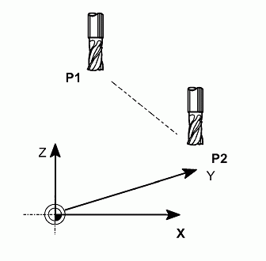

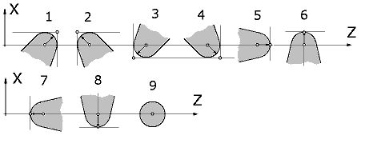

### 1.4 step-by-step：选定系统并进入配置

> **事实边界**：实测 9 大菜单（`【实测·menu_structure_measured.json】`）中**没有**"选择系统/切换系统"菜单项。系统的选定发生在软件启动登录环节（主程序 `CNCLogin.exe`）或通过打开既有项目/官方示例程序加载对应配置（官方示例含 `config.ini`、`Model/control.ini`、`spec.ini`，见 `SOURCE_INDEX.md`）。因此下列步骤中涉及启动对话框的部分标注"需以实测为准"。

1. **确认软件实体与版本**。核对安装路径下 `CNCLogin.exe` 存在，且 `general.ini` 中 `CNC=37`（`SOURCE_INDEX.md`）。校验节点：软件"帮助→关于..."（`【实测·菜单·帮助】`）显示版本为 7.2.2.0。
2. **在登录/新建项目环节选定系统族**。在启动登录界面选择目标系统（如 FANUC 0iM），具体对话框字段**需以实测为准**（实测菜单未覆盖该界面）。校验节点：进入主窗口后，面板样式与所选系统一致（如 FANUC 0iM 面板应出现 PROG/POS/OFS/SYSTM/GRAPH 等键，`【官方·fanuc0i_m_sys】`）。
3. **确认铣/车类型**。根据任务选择 M 或 T 配置：铣削选 0iM/0iMF/18iM/21iM/828D M 等；车削选 0iT/0iTF/18iT/21iT/828D T 等。校验节点：程序编辑页面中程序号以 `O` 开头且坐标字符合该系统（车削出现 U/W 或 X 直径编程，铣削出现 X/Y/Z）。
4. **核对面板按键齐全**。对照官方面板主题逐项确认（如 828D 应有 MDA、AUTO、JOG、REFPOT、SINGL、CYCLESTAR、CYCLESTOP、急停旋钮、主轴/进给倍率旋钮，`【官方·siemens828d_m_sys】`）。校验节点：在 JOG 方式下按方向键，坐标轴应动作。
5. **（可选）加载官方示例程序快速验证系统**。打开 `SOURCE_INDEX.md` 所列官方示例目录下的 `*.cnc`（如 EX10.cnc、G41.cnc 等）及其配套 config/offset/params 文件，快速确认系统能正确解析该系统的 G 代码。校验节点：程序能被读入且在图形视图中显示刀轨。
6. **记录配置快照**。记下所加载系统名、面板类型、加载的示例程序名，作为后续坐标系/刀具/程序设置的基线。

### 1.5 合法参数取值范围

| 参数项 | 取值/范围 | 依据 |
| --- | --- | --- |
| CNC 配置数量 | 37（`general.ini` 中 `CNC=37`） | `SOURCE_INDEX.md` |
| 系统族枚举 | 见 1.2 各表（FANUC/SIEMENS/HNC/三菱/发格/海德汉/GSK/KND 等） | `SOURCE_INDEX.md`、`_index.json` |
| 828D 新刀具号 | 铣刀 100–199；钻头 200–299；特种刀具 700–800 | `【官方·siemens828d_m_sys】` |
| 程序号 | `Oxxxx`（x 为数字，如 O0010、O7；删除全部用 O9999） | `【官方·fanuc0i_m_sys】`、`【官方·fanuc0i_t_sys】` |
| 其余系统/面板参数 | 以机床/系统参数为准 | — |

### 1.6 功能边界与限制条件

1. 系统切换**不在**实测菜单内；不要试图在"文件/机床操作"等菜单中寻找"系统选择"项（`【实测·menu_structure_measured.json】`）。
2. 面板为自绘画布，键位无 Button/Static 子控件；自动化只能坐标点击，不能 PostMessage BM_CLICK（`SOURCE_INDEX.md` 桥接边界）。
3. 部分系统（如 0iMF/0iTF/21i/802D T 等）在 `general.ini` 清单中有配置名，但知识库未必有独立面板主题；其面板细节**需以实测为准**。
4. 实测截图当前加载的是 MITSUBISHI M80（`menu_structure_measured.json` captured_system），说明同一软件可承载不同厂商系统，但不同系统的面板与 G 代码方言不同，教学时不可混用程序。

### 1.7 校验节点汇总

| 步骤 | 校验方式 |
| --- | --- |
| 版本确认 | 帮助→关于... 显示 7.2.2.0 |
| 系统选定 | 面板按键布局与官方主题截图一致 |
| 铣/车确认 | 程序坐标字符合该系统方言 |
| 面板齐全 | JOG 方式方向键可移动坐标轴 |
| 示例加载 | 图形视图出现刀轨 |

**官方截图引用**

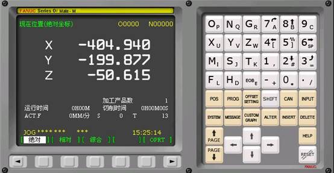

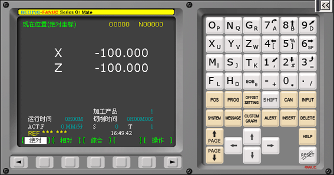

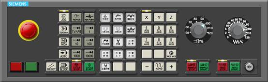

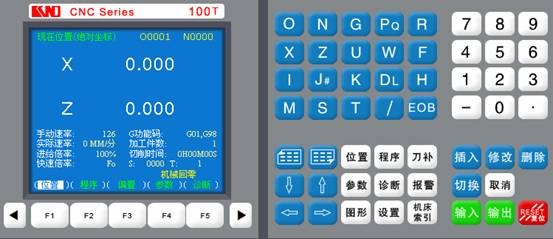

**实测证据引用**：`evidence/sscnc_main.png`（当前 MITSUBISHI M80 主界面）、`evidence/sscnc_main_crop.png`。

---

## 第 2 章 工件坐标系标准化设定

### 2.1 本章目标

掌握官方定义的 4 类坐标系统，能用 G54–G59 设定工件坐标系，能结合实测菜单"机床操作"中的对刀工具完成对刀，并逐项校验坐标设定结果。

### 2.2 四类坐标系统（官方 ref_frame）

> 依据：`【官方·fanuc_MPRG/ref_frame】`；华中 HNC-21M 同主题内容完全一致（`【官方·HNC21_mprg/ref_frame】`）。

编程坐标系采用**右手坐标系统**。在加工期间，由于机床对工件做反向运动，坐标系统通常被改变。共分 4 类：

| 序号 | 坐标系统 | 官方定义 |
| --- | --- | --- |
| 1 | 机床坐标系统 | 用一个固定的机床的点作为其原点；执行返回原点操作时，机床移动到此机床原点 |
| 2 | 绝对坐标系统 | 用户可建立此坐标系统；其原点可设置在任意位置，而原点以机床坐标值显示 |
| 3 | 相对坐标系统 | 把当前的机床位置当作原点；在需要以相对值指定机床位置时使用 |
| 4 | 剩余移动距离 | 不属于坐标系；仅显示移动命令发出后目的位置与当前机床位置之间的距离，仅当各轴剩余距离都为零时该移动命令才完成 |

FANUC 0iM/0iT 系统操作主题进一步说明位置显示的三种方式（`【官方·fanuc0i_m_sys】`、`【官方·fanuc0i_t_sys】`）：

- **零件坐标系（绝对坐标系）位置**：显示刀位点在当前零件坐标系中的位置。
- **相对坐标系位置**：显示操作者预先设定为零的相对位置。
- **综合显示**：同时显示 ABSOLUTE（零件坐标系）、RELATIVE（相对坐标系）、MACHINE（机床坐标系）、DISTANCE TO GO（当前运动指令剩余移动量）。

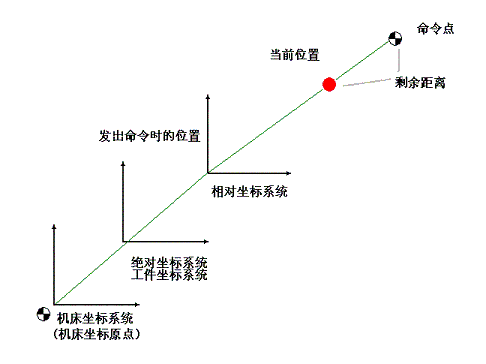

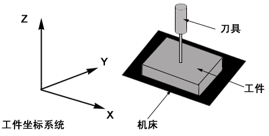

### 2.3 G54–G59 工件坐标系

> 依据：`【官方·fanuc_MPRG/GCode】`、`【官方·fanuc_TPRG/GCode】`。

**功能**：通过 G54–G59 命令，把机床坐标系中的一个任意点（工件原点偏移值）赋给参数 1221–1226，设置工件坐标系 1–6。

| G 代码 | 工件坐标系 | 对应参数（原点偏移值） |
| --- | --- | --- |
| G54 | 工件坐标系 1 | 参数 1221 |
| G55 | 工件坐标系 2 | 参数 1222 |
| G56 | 工件坐标系 3 | 参数 1223 |
| G57 | 工件坐标系 4 | 参数 1224 |
| G58 | 工件坐标系 5 | 参数 1225 |
| G59 | 工件坐标系 6 | 参数 1226 |

- 通电并完成原点返回后，系统**自动选择工件坐标系 1（G54）**；在被模态命令改变前保持有效。
- 参数 1220 可传递工件外部的原点偏置值（对全部 G54–G59 生效的公共偏移）。
- G54 格式示例：`G54 X_ Y_ Z_;`（铣削）、`G54 X_ Z_;`（车削）。

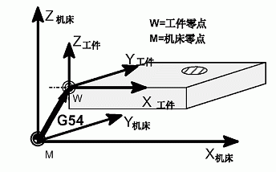

**G92 设定零件坐标系（其他系统）**：广数 GSK990M 官方主题记载用 `G92 IP__` 设定零件坐标系（如 `G92 X25.3 Z23.0;`），并说明自动设定坐标系由参数 №.012 的 APRS 选择、回参考点后自动设定（`【官方·GSK990M_PRG/ref_frame】`，截图 `refvalue.gif`）。不同系统的 G92 语义有差异，**以机床/系统参数为准**。

### 2.4 对刀流程（结合实测菜单"机床操作"）

> 对刀工具**来自实测菜单**：`机床操作 → 基准芯棒选择 / 寻边器选择 / Z向对刀仪选择(100mm) / 选择刀具`（`【实测·menu_structure_measured.json】`）。官方 `userguide/menu.md` 也记载了"基准芯棒选择"和"寻边器选择，在右边型号列表中选择所需的寻边器"（`【官方·userguide/menu】`）。

#### 2.4.1 step-by-step：X/Y 向对刀（寻边器/基准芯棒法）

1. **装夹工件与毛坯**。执行 `工件操作 → 选择毛坯`、`工件装夹`、`工件放置`（`【实测·菜单】`）。校验节点：3D 视图中毛坯位于工作台正确位置。
2. **选择对刀工具**。执行 `机床操作 → 寻边器选择`，在右侧型号列表中选择所需寻边器；或选择 `机床操作 → 基准芯棒选择`（`【实测·菜单】`+`【官方·userguide/menu】`）。校验节点：主轴上出现所选对刀工具。
3. **切换手动方式**。将面板 MODE SELECT 置于 JOG（FANUC，`【官方·fanuc0i_m_sys】`）或 JOG/手脉方式（KND，`【官方·knd100m_sys】`）。校验节点：JOG 指示灯亮。
4. **寻边**。按方向键使寻边器/芯棒缓慢靠近工件侧面，目测/观察接触状态。校验节点：寻边器触发（接触）后停止移动。
5. **读取机床坐标**。切到 POS 位置显示页面，读取当前 X（或 Y）机床坐标（`【官方·fanuc0i_m_sys】` 的 MACHINE 显示）。校验节点：机床坐标值稳定可读。
6. **计算并录入偏置**。按"对边"或"中心"算法算出工件原点相对机床原点的偏移值，录入 G54–G59 对应参数（见 2.3 的参数表）。录入方法：`OFS` 键进入参数设定页面 → 按"坐标系" → PAGE 切换到对应坐标系页 → CURSOR 选坐标系 → 输入地址字（X/Y/Z）和数值 → INPUT 键确认（`【官方·fanuc0i_m_sys】`）。校验节点：LCD 显示新偏置值。
7. **复测验证**。用寻边器再次靠近同一侧面，观察 POS 中该点是否显示预期的工件坐标值。校验节点：复测值与设定值一致（误差在机床精度内）。

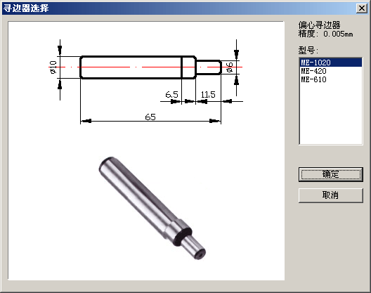

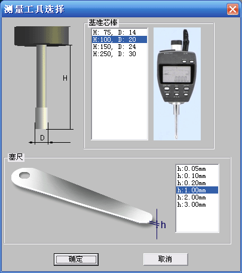

#### 2.4.2 step-by-step：Z 向对刀（Z 向对刀仪法）

1. **选择 Z 向对刀仪**。执行 `机床操作 → Z向对刀仪选择(100mm)`（`【实测·菜单】`）。校验节点：对刀仪（标准高度 100mm）出现在工作区。
2. **装刀**。执行 `机床操作 → 选择刀具`，选定基准刀（`【实测·菜单】`）。校验节点：主轴装入基准刀。
3. **Z 向接近**。JOG 方式下使刀具端面向下接近对刀仪顶面或工件上表面。校验节点：轻微接触。
4. **读取 Z 机床坐标**。POS 页面读取 MACHINE Z 值（`【官方·fanuc0i_m_sys】`）。
5. **录入 Z 偏置**。按 `OFS` → "坐标系" → 选 G54 → 输入 Z 值（常为对刀仪高度 100mm 换算后的工件零点偏置）→ INPUT 确认。校验节点：G54 的 Z 偏移值更新。
6. **抬刀验证**。G00 抬刀到安全高度，再 G01 下刀至 Z0，观察刀尖是否恰好位于工件上表面。校验节点：刀尖与工件上表面齐平（在仿真精度内）。

#### 2.4.3 长度补偿基准刀概念（官方依据）

`【官方·fanuc_MPRG/GCode】` 明确：先用一把铣刀作为基准刀，利用工件坐标系 Z 轴把它定位在工件表面，设为 Z0；把每把刀与基准刀的相对长度差输入刀具偏置内存，由 G43/G44 执行长度补偿。刀具短于基准刀时偏置值为负，长于基准刀时为正。

### 2.5 合法参数取值范围

| 参数项 | 取值/范围 | 依据 |
| --- | --- | --- |
| 工件坐标系选择 | G54–G59（6 组） | `【官方·fanuc_MPRG/GCode】` |
| 工件坐标系原点偏移参数 | 1221–1226（分别对应 G54–G59） | 同上 |
| 公共外部原点偏移参数 | 1220 | 同上 |
| 局部坐标系 | G52（官方主题提及"局部坐标系"，取消用 G52a0） | 同上 |
| G92 坐标设定 | 地址字 X/Y/Z（铣）、X/Z（车）后接数值，具体以系统为准 | `【官方·GSK990M_PRG/ref_frame】` |
| Z 向对刀仪标准高度 | 100mm（菜单名即标注"100mm"） | `【实测·menu_structure_measured.json】` |
| 其余对刀参数 | 以机床/系统参数为准 | — |

### 2.6 功能边界与限制条件

1. 4 类坐标系中"剩余移动距离"不是坐标系，仅为显示功能（`【官方·ref_frame】`）。
2. G53（机床坐标系选择）为"一般"G 代码，仅在本程序段有效，且仅在 G90 绝对命令下有效；执行前须手动或用 G28 返回原点（`【官方·fanuc_MPRG/GCode】`）。
3. 在刀具直径补偿方式下，可用 G52 临时取消该偏置；移动命令紧跟 G52 时通常采用绝对命令（同上）。
4. 对刀工具选项来自实测菜单；官方帮助仅图文说明"基准芯棒选择/寻边器选择"，**Z 向对刀仪(100mm)的具体对刀算法需以实测/官方帮助为准**。
5. 不同系统 G92 语义不同（如 GSK 与 FANUC），混用会导致坐标系错误，须按当前系统主题执行。

### 2.7 校验节点汇总

| 步骤 | 校验方式 |
| --- | --- |
| 毛坯装夹 | 3D 视图毛坯位置正确 |
| 对刀工具选择 | 主轴出现所选工具 |
| 侧面寻边 | 寻边器触发后位置稳定 |
| 偏置录入 | LCD 显示新偏置值 |
| 复测 | 工件坐标显示与设定一致 |
| Z 向对刀 | 刀尖在 Z0 与工件上表面齐平 |

---

## 第 3 章 刀具参数规范设置

### 3.1 本章目标

掌握刀具几何补偿/磨损补偿、刀尖方位号（T1–T9 象限）、直径/长度补偿 G41/G42/G43/G44/G49 的规范设置方法，明确合法取值范围与限制条件。

### 3.2 刀具补偿体系总览

| 补偿类别 | 相关代码/参数 | 用途 | 依据 |
| --- | --- | --- | --- |
| 刀具直径（半径）补偿 | G40（取消）/ G41（左）/ G42（右），D 地址（01–32） | 铣削按刀具半径自动偏移刀路 | `【官方·fanuc_MPRG/GCode】` |
| 刀具长度补偿 | G43（+）/ G44（−）/ G49（取消），H 地址 | 补偿各刀与基准刀的长度差 | `【官方·fanuc_MPRG/GCode】` |
| 刀尖半径/方位补偿 | G40/G41/G42 + 刀尖方位号 T1–T9（0–9 假想刀尖） | 车削按刀尖圆弧中心计算补偿 | `【官方·fanuc_TPRG/GCode】` + `SOURCE_INDEX.md` 桥接 |
| 几何补偿 / 磨损补偿 | 刀具形状（几何）补偿 + 刀具磨耗（磨损）补偿 | KND 系统等以独立页面设定 | `【官方·knd100m_sys】` |

> KND100M 官方主题明确："显示、设定刀具磨耗补正和刀具形状补正"（`【官方·knd100m_sys】`），并给出绝对值输入（`X`/`Z` 后输入补偿量）与增量值输入（`U`/`W` 后输入增量）两种方法，示例：原补偿 5.678 + 增量 1.5 = 新补偿 7.178。

### 3.3 刀尖方位号（T1–T9 象限）

> 依据：`SOURCE_INDEX.md` 桥接边界记录的实测结论——`calculate_tool_offsets()` 实现 FANUC T1–T9 刀尖象限换算，其中 **3 = 外圆、2 = 内孔、8 = 螺纹**。官方车削主题记载刀尖形式号为 0–9（`【官方·fanuc_TPRG/GCode】`）。

| 方位号 | 含义（桥接实测） | 官方依据 |
| --- | --- | --- |
| T3 | 外圆刀尖方位 | `SOURCE_INDEX.md` 桥接 `calculate_tool_offsets()` |
| T2 | 内孔刀尖方位 | 同上 |
| T8 | 螺纹刀尖方位 | 同上 |
| T1/T4/T5/T6/T7/T9 | 其余刀尖方位（象限） | 刀尖形式数 0–9（`【官方·fanuc_TPRG/GCode】`）；具体象限归属需以实测/机床参数为准 |
| T0 | 假想刀尖基准（官方"0–9"范围含 0） | `【官方·fanuc_TPRG/GCode】` |

**车削刀尖补偿要点（`【官方·fanuc_TPRG/GCode】`）**

- 真实刀刃由圆弧构成（刀尖半径），在圆弧插补和攻螺纹时带来误差，需用 G41/G42 补偿。
- 补偿基准点是**刀尖中心**；分别以 X、Z 基准点测量刀具长度、刀尖半径 R，以及假想刀尖半径补偿所需的刀尖形式数（0–9），事前输入刀具偏置文件。
- 刀尖半径偏置应在切削启动前用 G00/G01 命令或取消，否则刀会逐渐偏离路径、导致过切。
- 该主题中 G41/G42 的"右侧/左侧"描述为：G41=刀具从程序路径左侧移动（切削位置右侧），G42=刀具从程序路径右侧移动（切削位置左侧），与铣削主题的左右定义表述不同，**以当前系统主题为准**。

### 3.4 直径/长度补偿代码详解

#### 3.4.1 G40/G41/G42 刀具直径/半径补偿（铣削，`【官方·fanuc_MPRG/GCode】`）

- 格式：`G41 X_ Y_;` / `G42 X_ Y_;`
- 原理：系统由编程路径 A 和单独设置的刀具偏置值，自动计算出补偿后的路径 B（与工件距离至少为刀具半径）。
- 偏置方向：G40 取消、G41 刀具行进方向左侧、G42 刀具行进方向右侧。
- D 地址：从 **01 到 32** 的两位数字（官方原文：" D 后面是从 01 到 32 的两位数字"）。

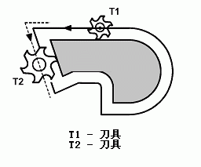

#### 3.4.2 G43/G44/G49 刀具长度补偿（铣削，`【官方·fanuc_MPRG/GCode】`）

- 格式：`G43 Z_ H_;` / `G44 Z_ H_;` / `G49 Z_;`
- G43 把偏置值加到 Z 坐标，G44 从 Z 坐标减去偏置值，G49 取消。
- 偏置值带正负号；短于基准刀为负，长于基准刀为正。
- G43/G44/G49 为模态命令，换刀后发出 G43/G44，刀具作业结束换刀前用 G49 取消。
- 取消长度补偿的等效方法：`G43/G44 H0`（H0 即无补偿）。
- 注意：G43/G44 H 或 G49 若省略 Z 移动，则按 `G00 G91 Z0` 执行（会带偏置移动），须谨慎。

### 3.5 step-by-step：设置刀具补偿（以 FANUC 0iM 几何/磨损补偿为例）

1. **进入补偿页面**。置模式开关在 EDIT 或 AUTO，按 `OFS` 键进入参数设定页面，再按"刀具补偿"软键（第一次进入坐标系设置，第二次进入刀具补偿参数页面，`【官方·fanuc0i_m_sys】`）。校验节点：显示刀具补偿参数表。
2. **选择补偿号**。用 PAGE 键翻页选择补偿号区间，用 CURSOR 键选择补偿参数编号（`【官方·fanuc0i_m_sys】`）。校验节点：光标停在目标补偿号。
3. **输入几何补偿值**。在长度 X 方向、Z 方向补偿、半径补偿栏输入数值（可含小数点）；车削还须输入刀位号（`【官方·fanuc0i_m_sys】`、`【官方·fanuc0i_t_sys】`）。校验节点：LCD 显示输入值。
4. **输入磨损补偿值**（如系统提供独立磨耗页）。KND 系统用 X/Z 绝对值输入或 U/W 增量值输入（`【官方·knd100m_sys】`）。校验节点：磨耗值与几何值分别显示。
5. **设定刀尖方位号**（车削）。在刀位号栏输入 T1–T9（外圆 3 / 内孔 2 / 螺纹 8，`SOURCE_INDEX.md` 桥接）。校验节点：刀位号显示为期望值。
6. **程序中调用补偿**。铣削：`G00 G43 Z0 H01;` 调用长度补偿，`G41/G42 ... D02;` 调用半径补偿；车削：`G41/G42 X_ Z_;` 并已在刀具偏置文件填入刀尖方位号。校验节点：程序含正确 H/D 或刀位号。
7. **仿真验证**。运行程序，观察刀轨是否按补偿后路径（路径 B）偏移、是否发生欠切/过切。校验节点：加工轮廓符合图纸，无过切。

> **数学依据**：FANUC 固定循环倒角长度按参数在 0.1L–12.7L 范围设置（`【官方·fanuc_TPRG/GCode】` G92），说明补偿量有系统参数上下限，具体以机床/系统参数为准。

### 3.6 合法参数取值范围

| 参数项 | 取值范围 | 依据 |
| --- | --- | --- |
| 半径补偿号 D | 01–32（两位数字） | `【官方·fanuc_MPRG/GCode】` |
| 长度补偿号 H | H01 起；H0 等效取消 | `【官方·fanuc_MPRG/GCode】` |
| 刀尖方位号 | 0–9（官方）；桥接实测 T1–T9，其中 3 外圆/2 内孔/8 螺纹 | `【官方·fanuc_TPRG/GCode】` + `SOURCE_INDEX.md` |
| 828D 新刀具号 | 铣刀 100–199；钻头 200–299；特种刀具 700–800 | `【官方·siemens828d_m_sys】` |
| 车削刀尖角（G76 参数 a） | 80°/60°/55°/30°/29°/0°（两位数指定） | `【官方·fanuc_TPRG/GCode】` |
| 补偿值正负号 | 几何/磨损补偿可正可负（长度差短为负、长为正） | `【官方·fanuc_MPRG/GCode】` |
| KND 增量输入 | U（X 增量）/ W（Z 增量），与现值相加 | `【官方·knd100m_sys】` |
| 其余补偿参数 | 以机床/系统参数为准（如倒角 0.1L–12.7L 等） | — |

### 3.7 功能边界与限制条件

1. G53 执行前必须取消刀具直径/长度/位置补偿，否则机床按偏置值移动（`【官方·fanuc_MPRG/GCode】`）。
2. 固定循环方式中刀具偏置被忽略；同段指定 01 组 G 代码与 G88 会取消 G88（同上）。
3. 补偿量在自动运转中变更时，新值不能立即生效，须待指定该补偿号的 T 代码再次执行后才生效（`【官方·knd100m_sys】`）。
4. 刀尖半径偏置必须用 G00/G01 命令或取消，若在圆弧中直接执行会导致刀路偏离（同上）。
5. 桥接 `calculate_tool_offsets()` 仅实测确认 T3/T2/T8 三种方位，其余方位号**需以实测/官方帮助为准**（`SOURCE_INDEX.md`）。
6. 面板为自绘画布，补偿页面的键位自动化需坐标点击（`SOURCE_INDEX.md` 桥接边界）。

### 3.8 校验节点汇总

| 步骤 | 校验方式 |
| --- | --- |
| 进入补偿页面 | 显示补偿参数表 |
| 补偿号选择 | 光标位于目标号 |
| 几何/磨损录入 | LCD 显示正确的 X/Z/半径/方位值 |
| 程序调用 | 程序含 H/D/T 代码 |
| 仿真验证 | 刀轨偏移正确、轮廓无过切 |

---

## 第 4 章 数控程序导入与编辑

### 4.1 本章目标

掌握"文件"菜单的程序导入/保存操作，了解 NC 程序编辑视图与 MDI 键盘输入方法，能按程序号规则创建、检索、编辑、删除程序，理解 `*.cnc` 格式。

### 4.2 "文件"菜单（实测）

> `【实测·menu_structure_measured.json】` 明确"文件"菜单子项为：

| 子项 | 功能说明 | 依据 |
| --- | --- | --- |
| 清空NC代码 | 清除当前 NC 代码区 | 实测菜单（功能细节需以实测为准） |
| 打开 | 打开既有 NC 程序文件 | 实测菜单 |
| 保存 | 保存当前程序 | 实测菜单 |
| 另存为... | 另存为新文件 | 实测菜单 |
| 退出(&X) | 退出程序 | 实测菜单 |

**NC 程序编辑视图（实测子窗口）**：`AfxFrameOrView100s (NC程序编辑视图)`，与 `MDIClient`、`msctls_statusbar32 (状态栏)` 并列（`【实测·menu_structure_measured.json】` child_windows_measured）。

**工具栏（实测）**：标准 / 录制 / 广播 / 工具(顶部) / 工具(左侧竖排)（`【实测·menu_structure_measured.json】` toolbars_measured）。

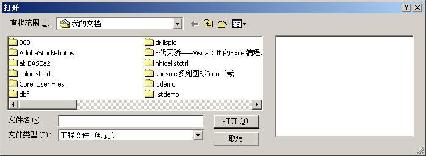

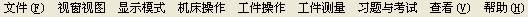

### 4.3 MDI 键盘输入与编辑键（官方）

> 依据：`【官方·fanuc0i_m_sys】`、`【官方·fanuc0i_t_sys】`。在"视图"下拉菜单或浮动菜单选择"控制面板切换"后，数控系统操作键盘出现在视窗右上角，左侧为显示屏。

#### 4.3.1 编辑键

| 键名 | 功能（官方原文） |
| --- | --- |
| ALTER | 替代键：用输入的数据替代光标所在的数据 |
| DELETE | 删除键：删除光标所在数据；或删除一个数控程序/全部程序 |
| INSERT | 插入键：把输入域数据插入到当前光标之后的位置 |
| CAN | 修改键（取消键）：消除输入域内的数据 |
| EOB | 回撤换行键：结束一行程序的输入并换行 |
| SHIFT | 上档键 |

#### 4.3.2 页面切换键

| 键名 | 功能（官方原文） |
| --- | --- |
| PROG | 数控程序显示与编辑页面 |
| POS | 位置显示页面（三种方式，PAGE 按钮选择） |
| OFS | 参数输入页面（第一次进坐标系设置，第二次进刀具补偿参数） |
| SYSTM | 系统参数页面 |
| HELP | 系统帮助页面 |
| GRAPH | 图形参数设置页面 |
| MESAGE | 信息页面（如"报警"） |
| RESET | 复位键 |
| PAGE UP / PAGE DOWN | 向上/向下翻页 |
| CURSOR（↑↓←→） | 光标移动 |
| INPUT | 输入键：把输入域数据输入参数页面，或读入外部数控程序 |

### 4.4 程序号 Oxxxx 规则（官方）

| 操作 | 步骤摘要（官方） | 校验节点 |
| --- | --- | --- |
| 按编号搜索程序 | EDIT 方式 → 输入 O7 → CURSOR 搜索 → "O7"显示在右上角、程序显示在屏幕 | 程序号与程序内容显示 |
| 删除一个程序 | EDIT → 输入 O7 → DELETE → O7 被删除 | 程序列表中消失 |
| 删除全部程序 | EDIT → 输入 O9999 → DELETE → 全部删除 | 程序列表为空 |
| 检索指定代码 | AUTO/EDIT → 选程序 → 输入 M/F/G03 等 → CURSOR 搜索 | 光标定位到代码 |
| 手工输入程序 | EDIT → PROG → 输入 O7（不可与已有重名）→ INPUT → 逐代码输入 → EOB 换行 | 程序录入且可编辑 |
| MDI 输入 | MDI 方式 → 输入 N10 G0X50 → 程序被输入 → 循环启动执行 | 程段执行 |
| DNC 输入 | DNC 方式 → 232 电缆连接 PC → PROGRAM 页面 → 输入 Oxxxx → INPUT 读入 | 外部程序读入 |

> 程序名规则："键入程序名，但不可以与已有程序名的重复"（`【官方·fanuc0i_m_sys】`）。

### 4.5 step-by-step：完成一次程序导入→编辑→保存

#### 4.5.1 导入外部程序

1. 准备符合系统方言的 NC 程序（官方示例为 `*.cnc`，见 `SOURCE_INDEX.md`；程序以 `O` + 4 位数字开头，如 O0002、O0010）。
2. 执行 `文件 → 打开`（`【实测·菜单】`），在对话框中选择 `*.cnc` 文件。校验节点：NC 代码出现在 `AfxFrameOrView100s` 编辑视图。
3. 切换 PROG 页面查看程序号（`【官方·fanuc0i_m_sys】`）。校验节点：程序号显示正确。
4. 若需清空当前代码，执行 `文件 → 清空NC代码`（`【实测·菜单】`）。校验节点：代码区被清空。

#### 4.5.2 手工输入/编辑程序

5. 置 MODE SELECT 于 EDIT，按 PROG 键进入程序页面（`【官方·fanuc0i_m_sys】`）。
6. 输入程序名 `Oxxxx`（不可重名），按 INPUT 开始输入。
7. 用数字/字母键逐个输入代码，CAN 消除输入域错误数据，EOB 结束一行并换行（`【官方·fanuc0i_m_sys】`）。
8. 用 CURSOR/PAGE 移动光标；用 ALTER（替代）、INSERT（插入）、DELETE（删除）编辑（`【官方·fanuc0i_m_sys】`）。
9. 校验节点：程序内容符合预期，无语法错误提示（如有报警查 MESAGE 页面）。

#### 4.5.3 保存程序

10. 执行 `文件 → 保存` 或 `另存为...`（`【实测·菜单】`），保存为 `*.cnc` 文件。校验节点：文件在磁盘生成且可重新打开。

### 4.6 合法参数取值范围

| 参数项 | 取值/范围 | 依据 |
| --- | --- | --- |
| 程序号 | `Oxxxx`（数字，如 O7、O0010、O9999） | `【官方·fanuc0i_m_sys】` |
| 删除全部程序专用号 | O9999 | 同上 |
| 程序文件扩展名 | `*.cnc` | `SOURCE_INDEX.md` 官方示例程序 |
| 程序段号 | `N` + 数字（如 N10、N30） | `【官方·fanuc0i_m_sys】` |
| 代码检索字 | 字母或完整代码（N0010/M/F/G03 等） | 同上 |
| 其余文件/格式参数 | 以实测/系统参数为准 | — |

### 4.7 功能边界与限制条件

1. "文件"菜单子项以实测为准；官方 `userguide/menu.md` 未逐一说明"清空NC代码/另存为"的具体对话框行为，**需以实测为准**。
2. 程序名不可重复（`【官方·fanuc0i_m_sys】`）。
3. DNC 方式依赖 232 电缆连接与 PC 端传输软件（`【官方·fanuc0i_m_sys】`）；在当前仿真环境中的实际连通性**需以实测为准**。
4. 面板键位为自绘画布，编辑键的自动化触发需坐标点击（`SOURCE_INDEX.md` 桥接边界）。
5. 不同系统程序号/子程序调用规则可能不同（如 SIEMENS 用 MPF/SPF 主子程序命名，`【官方·siemens828d_m_sys】`），不可套用 FANUC 规则。

### 4.8 校验节点汇总

| 步骤 | 校验方式 |
| --- | --- |
| 文件打开 | 代码出现在编辑视图 |
| 程序号确认 | PROG 页面显示 O 号 |
| 编辑 | ALTER/INSERT/DELETE 后代码正确 |
| MDI | 段执行无报警 |
| 保存 | 文件生成可重开 |

---

## 第 5 章 自动/手动加工仿真全流程

### 5.1 本章目标

掌握 MODE SELECT 各运行方式（AUTO/EDIT/MDI/JOG/HANDLE 等）、循环启动/进给保持/急停的操作，理解主轴/快速/进给倍率旋钮的作用，能完整走通一次手动→自动的加工仿真流程。

### 5.2 MODE SELECT 运行方式

> FANUC 0iM/0iT 官方主题明确出现的运行方式（`【官方·fanuc0i_m_sys】`、`【官方·fanuc0i_t_sys】`）：

| 方式 | 官方名称/描述 | 用途 |
| --- | --- | --- |
| AUTO | 置模式旋钮在"AUTO"位置，选择程序后按循环启动，启动程序加工 | 自动加工 |
| EDIT | 程序编辑、检索、删除、输入 | 程序管理 |
| MDI | 手动数据输入，如输入 `G0X50` 后按循环启动执行 | 单段手动输入执行 |
| JOG | 连续移动（较长距离台面移动）；开/关主轴也需在 JOG 下 | 手动连续进给 |
| 增量/点动（步长选择） | 增量点动（FANUC 铣削称"增量点称动"）用于微量调整、对基准 | 步进微调 |
| HANDLE（手脉） | 操纵"手脉"微量调整 | 手轮进给 |
| DNC | 从计算机读入程序（232 连接） | 外部程序传输 |
| 机床锁 | 置在机床锁位置，试运行程序（机床和刀具不切削零件，仅运行程序） | 空运行校验 |
| 单步（单程序段） | 单步开关置 ON，每按一次执行一条指令 | 逐段调试 |

> SIEMENS 828D 官方主题的运行方式（`【官方·siemens828d_m_sys】`）：MDA（直接输入程序段）、AUTO（自动加工）、JOG（手动连续）、REFPOT（手动回参考点）、VAR（增量选择）、SINGL（单步）。828D 采用绝对式编码器，**可以不进行回参考点操作**。

> 华中/KND 等系统也具有类似的手动/自动/手轮方式，具体键位以各系统主题为准。

### 5.3 循环启动 / 进给保持 / 急停

> 依据：FANUC 系统主题 + KND100M 官方主题（`【官方·knd100m_sys】`）+ 828D 面板主题（`【官方·siemens828d_m_sys】`）。

| 控制项 | 官方描述 | 依据 |
| --- | --- | --- |
| 循环启动（CYCLESTAR） | 按数控程序运行控制开关中的按钮启动程序；自动运转中程序可执行 | FANUC 系统主题 / 828D 面板 |
| 进给保持（CYCLESTOP / 进给保持键） | 自动运转中按进给保持键暂时停止：移动时进给减速停止、暂停中休止、执行 M/S/T 后停止；再按循环启动继续执行 | `【官方·knd100m_sys】` |
| 急停（EMERGENCY STOP） | 按下使机床移动立即停止，主轴/冷却液/润滑/换刀输出全部关闭；解除后所有输出需重新起动；解除方法是旋转后释放 | `【官方·knd100m_sys】` |
| 复位（RESET） | 使自动运转结束、变复位状态；运动中复位则机械减速停止 | `【官方·knd100m_sys】` |
| 程序停（M00） | 含 M00 段执行后停止自动运转，模态信息保存，再按 CNC 启动可继续 | `【官方·knd100m_sys】` |
| 程序结束（M30） | 主程序结束，停止自动运转变复位状态，返回程序起点 | `【官方·fanuc_MPRG/assistant】`、`【官方·knd100m_sys】` |

> 828D 面板明确列出"紧急停止旋钮、主轴速度调节旋钮、进给速度（F）调节旋钮"（`【官方·siemens828d_m_sys】`）。KND 明确"进给速度倍率 0～150%"、"快速进给倍率 F0/25%/50%/100% 四挡"（`【官方·knd100m_sys】`）。

### 5.4 倍率旋钮（OVERRIDE）

| 倍率项 | 取值范围/挡位 | 依据 |
| --- | --- | --- |
| 进给速度倍率（FEEDRATE OVERRIDE） | 0–150%（KND）；828D 有进给速度（F）调节旋钮 | `【官方·knd100m_sys】`、`【官方·siemens828d_m_sys】` |
| 快速进给倍率（RAPID OVERRIDE） | F0 / 25% / 50% / 100% 四挡（KND）；作用于 G00、固定循环快速段、G28、手动快速、手动回参考点快速 | `【官方·knd100m_sys】` |
| 主轴速度调节（SPINDLE SPEED OVERRIDE） | 828D 有主轴速度调节旋钮；具体百分比以机床/系统参数为准 | `【官方·siemens828d_m_sys】` |
| G96/G97 | G96 恒线速控制（按工件直径变化维持切削速度），G97 取消恒线速仅控制 RPM | `【官方·fanuc_TPRG/GCode】` |

> 快速进给倍率示例：快速进给速度 10 m/min、倍率 50% 时实际为 5 m/min（`【官方·knd100m_sys】`）。

### 5.5 step-by-step：手动→自动完整仿真流程

1. **开机与回参考点**。打开电源、释放急停，打开主轴/进给启动（828D，`【官方·siemens828d_m_sys】`）。FANUC 置模式旋钮于回零位置，选择各轴按住按钮回参考点（`【官方·fanuc0i_m_sys】`）。校验节点：坐标显示回到机床原点。
2. **JOG 手动移动**。MODE SELECT 置 JOG，选择轴按方向键，按住移动、松开停止（`【官方·fanuc0i_m_sys】`）。校验节点：3D 视图中工作台/刀具按预期移动。
3. **增量/手脉微调**。MODE SELECT 置增量方式选步进量，或操纵手脉；每按一次移动一步（`【官方·fanuc0i_m_sys】`）。校验节点：微量位移准确。
4. **开/关主轴**。JOG 方式下按主轴正转/停止键（FANUC，`【官方·fanuc0i_m_sys】`）。校验节点：主轴旋转状态正确。
5. **装夹/对刀**（见第 2 章）。校验节点：工件坐标系已设定。
6. **选择程序**。EDIT 方式按编号搜索 `Oxxxx`，或 AUTO 方式输入程序号（`【官方·fanuc0i_m_sys】`）。校验节点：程序号显示在屏幕右上角。
7. **空运行/机床锁校验**（可选但推荐）。置机床锁、单步 ON，循环启动，观察刀轨而不切削（`【官方·fanuc0i_m_sys】`）。校验节点：刀轨正确、无异常干涉（见第 6 章）。
8. **自动加工**。MODE SELECT 置 AUTO，按循环启动；需要时用进给保持暂停、必要时急停（`【官方·fanuc0i_m_sys】`、`【官方·knd100m_sys】`）。校验节点：程序正常执行直至 M30。
9. **倍率调节**。加工中按需调节进给/快速/主轴倍率（KND 0–150% 等，`【官方·knd100m_sys】`）。校验节点：进给速度变化符合挡位。
10. **加工完成**。程序结束（M30）后复位、取下工件，进入第 7 章测量。校验节点：工件加工完成。

### 5.6 合法参数取值范围

| 参数项 | 范围 | 依据 |
| --- | --- | --- |
| 进给速度倍率 | 0–150% | `【官方·knd100m_sys】` |
| 快速进给倍率 | F0 / 25% / 50% / 100% | 同上 |
| 手摇脉冲发生器速度 | < 5 转/秒（KND 注） | 同上 |
| 主轴/进给倍率（828D） | 有旋钮，具体值以机床/系统参数为准 | `【官方·siemens828d_m_sys】` |
| 其余运行参数 | 以机床/系统参数为准 | — |

### 5.7 功能边界与限制条件

1. 试运行（空运行）时机床和刀具不切削零件，仅运行程序（`【官方·fanuc0i_m_sys】`）。
2. 手摇脉冲发生器速度 > 5 转/秒时，即使停止转动也可能出现刻度与移动量不符（`【官方·knd100m_sys】`）。
3. 急停后所有输出（主轴/冷却/润滑/换刀）需重新起动；解除前须消除机床异常（同上）。
4. 面板键位为自绘画布，MODE 旋钮/按钮的自动化需坐标点击（`SOURCE_INDEX.md` 桥接边界）。
5. 不同系统运行方式名称不同（FANUC 的 HANDLE 对应其他系统的手轮；828D 无独立 HANDLE 键而有 VAR 增量选择），按当前系统主题操作。

### 5.8 校验节点汇总

| 步骤 | 校验方式 |
| --- | --- |
| 回参考点 | 坐标回到机床原点 |
| JOG 移动 | 3D 视图位移正确 |
| 主轴开关 | 主轴状态正确 |
| 程序选择 | 程序号显示 |
| 空运行 | 刀轨正确无干涉 |
| 自动加工 | 执行至 M30 |
| 倍率调节 | 速度变化符合挡位 |

**实测证据引用**：`evidence/sscnc_main.png`、`evidence/sscnc_main_crop.png`、`evidence/probe_launch_fullscreen.png`（真实软件界面含 MODE SELECT 面板、循环启动/进给保持/急停、倍率旋钮区域）。

**官方截图引用**

---

## 第 6 章 碰撞检测功能（基于实测能力的干涉观察法）

### 6.1 本章目标与重要事实声明

**实事求是声明**：经核对一手资料——

- 实测 9 大菜单（`【实测·menu_structure_measured.json】`）的"显示模式"子项为：床身显示模式、加工声效、显示坐标、显示铁屑、显示冷却液、显示毛坯、显示工件、**透明显示**、刀具交换装置(ACT)显示、显示刀位号、显示刀具、显示透明刀具、**显示刀轨**。
- 官方帮助知识库 253 主题中，**未发现名为"碰撞检测"的独立功能或按钮**。

因此，**本文不虚构一个不存在的"碰撞检测"按钮**。软件中与干涉/碰撞观察相关的能力是：**透明显示 + 显示刀轨 + 单段执行 + 3D 视图观察**。本章据此给出"干涉观察的实际做法"。

> 若后续实测或官方帮助明确出现"碰撞检测"独立功能，则应更新本章；在此之前标注"需以实测/官方帮助为准"。

### 6.2 "显示刀轨"与仿真观察的关系

> 依据：`【实测·menu_structure_measured.json】` 显示模式菜单含"显示刀轨"和"透明显示"。

| 显示模式项（实测） | 与干涉观察的关系 |
| --- | --- |
| 显示刀轨 | 把刀具运动轨迹可视化；观察刀轨是否穿过工件/夹具区域 |
| 透明显示 / 显示透明刀具 | 把毛坯/工件或刀具设为透明，便于看到内部切削与相对位置 |
| 显示毛坯 / 显示工件 | 控制毛坯、工件的显示与否，对比加工前后状态 |
| 显示刀具 / 显示刀位号 | 显示刀具实体与刀位编号，确认当前刀具 |
| 床身显示模式 | 切换机床床身显示，观察机床部件与刀具的空间关系 |
| 刀具交换装置(ACT)显示 | 观察换刀装置，避免换刀路径干涉 |
| 显示坐标 | 在视图中显示坐标，辅助定位干涉点 |

### 6.3 实测截图中的 3D 加工视图与碰撞观察要点

**实测证据**：`evidence/sscnc_main.png`、`evidence/sscnc_main_crop.png`（真实 3D 加工视图）、`evidence/probe_launch_fullscreen.png`。

**碰撞观察要点（基于可见的 3D 视图与显示模式，非虚构按钮）**

1. 刀具与毛坯/工件的相对位置：观察刀尖是否在预期切削区域。
2. 换刀动作：用"刀具交换装置(ACT)显示"观察换刀路径是否经过工件。
3. 快速定位（G00）：重点观察 G00 段，因其为多轴独立快速移动、刀路非直线，最易发生碰撞（`【官方·fanuc_MPRG/GCode】` 明确指出 G00 非直线定位及 G28 需设中间点避免与工件碰撞）。
4. 原点返回（G28/G30）：官方明确"要求对每一个轴设置中间点，以免机床在原点返回时与工件碰撞"（同上）。
5. 固定循环退刀：观察 G81–G89 等循环的 R 点平面与退刀路径。

### 6.4 step-by-step：用现有能力做干涉观察

> 前提：软件未实测到独立碰撞检测功能，故采用"显示 + 单段 + 人工判读"流程。

1. **开启辅助显示**。执行 `显示模式 → 显示刀轨`、`显示模式 → 透明显示`（或"显示透明刀具"）（`【实测·菜单】`）。校验节点：3D 视图中出现刀轨、工件/刀具呈半透明。
2. **显示必要要素**。按需开启"显示毛坯、显示工件、显示刀具、显示坐标、刀具交换装置(ACT)显示"（`【实测·菜单】`）。校验节点：视图中包含判断干涉所需的全部对象。
3. **切换合适视角**。用 `视窗视图 → 正视 / 俯视 / 侧视 / 旋转 / 缩放 / 平移`（`【实测·菜单】`）调整到能看清刀具—工件相对位置的视角。校验节点：潜在干涉区可见。
4. **单段/空运行预演**。置单步 ON + 机床锁（FANUC，`【官方·fanuc0i_m_sys】`）或 SINGL（828D，`【官方·siemens828d_m_sys】`），循环启动逐段执行。校验节点：每段刀轨可单独观察。
5. **重点判读 G00/G28 段**。按第 6.3 节要点观察快速定位与原点返回路径。校验节点：确认无穿模、无异常接近。
6. **换刀段观察**。开启 ACT 显示，执行换刀段，观察换刀装置路径。校验节点：换刀不与工件/夹具干涉。
7. **全速仿真复核**。关闭单段/机床锁，按正常倍率完整运行。校验节点：加工过程无可见碰撞。
8. **记录异常**。若发现干涉，定位到对应程序段与坐标，记录并修正程序或补偿（回到第 2/3 章）。校验节点：干涉点被消除后复测通过。

### 6.5 合法参数取值范围

| 参数项 | 取值/范围 | 依据 |
| --- | --- | --- |
| 显示模式开关项 | 见 6.2 表（实测存在的 13 项） | `【实测·menu_structure_measured.json】` |
| 单步开关 | ON / OFF | `【官方·fanuc0i_m_sys】` |
| 机床锁 | 置位/取消（试运行） | 同上 |
| 倍率（影响观察速度） | 进给 0–150%、快速 F0/25%/50%/100% | `【官方·knd100m_sys】` |
| 碰撞检测独立功能 | **未在一手资料中发现**；需以实测/官方帮助为准 | `【实测·menu_structure_measured.json】` + `_index.json` |

### 6.6 功能边界与限制条件

1. 不可声称软件有"碰撞检测"按钮或"自动防撞"功能——一手资料无此记载。
2. 干涉观察依赖人工判读 3D 视图，观察效果受视角、透明显示、显示模式组合影响。
3. 刀轨显示仅反映程序计算的刀位路径，**不等于**实体切削验证；实际切削状态需结合显示毛坯/工件判断。
4. 面板与菜单的自动化操作受自绘画布限制，键位需坐标点击（`SOURCE_INDEX.md` 桥接边界）。
5. G00/G28 的碰撞风险源自官方对非直线定位与中间点的说明（`【官方·fanuc_MPRG/GCode】`），不是软件自动提示。

### 6.7 校验节点汇总

| 步骤 | 校验方式 |
| --- | --- |
| 辅助显示开启 | 刀轨/透明效果可见 |
| 视角调整 | 干涉区可见 |
| 单段预演 | 每段可单独观察 |
| G00/G28 判读 | 无穿模 |
| 换刀观察 | 换刀路径无干涉 |
| 全速复核 | 全程无可见碰撞 |

**实测证据引用**：`evidence/sscnc_main.png`（3D 加工视图）、`evidence/sscnc_main_crop.png`（面板与视图细节）。

**官方截图引用**：[官方帮助截图：userguide/menu 主题"显示模式"子菜单]（对应 `source/chm_cn/userguide/images/menu_clip_image004.jpg`、`menu_clip_image006.jpg`）。

---

## 第 7 章 加工结果精度校验

### 7.1 本章目标

掌握"工件测量"菜单各项测量的使用，能结合实测菜单完成刀路测量与特征点/线/距离/角度的测量，并对加工结果做精度校验。

### 7.2 "工件测量"菜单（实测 vs 官方）

> **实测**（`【实测·menu_structure_measured.json】`）：工件测量 → **刀路测量(调试)、特征点、特征线、距离、角度、测量退出**。

> **官方** `userguide/menu.md`（`【官方·userguide/menu】`）：单击"测量进入"后进入测量界面；在"工件测量"菜单中可选择"特征点、特征线、粗糙度分布"三种测量方式。

**差异声明**：官方帮助与实测菜单在测量项上存在差异（实测有"刀路测量(调试)/距离/角度/测量退出"，官方提"粗糙度分布/测量进入"）。**以实测菜单为准**；官方提到的"粗糙度分布"在实测菜单中未出现，标注"需以实测为准"。本章以实测 6 项为主展开。

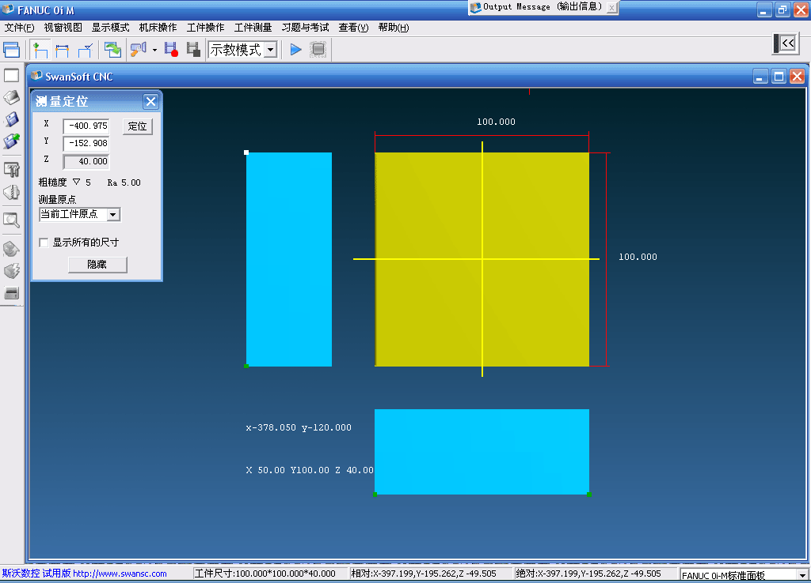

### 7.3 测量项功能说明

| 实测测量项 | 功能说明 | 依据 |
| --- | --- | --- |
| 刀路测量(调试) | 针对刀路进行测量（调试用途）；具体操作需以实测为准 | 实测菜单 |
| 特征点 | 测量工件上的点特征坐标 | 实测菜单 + `【官方·userguide/menu】` |
| 特征线 | 测量工件上的线特征 | 实测菜单 + `【官方·userguide/menu】` |
| 距离 | 测量两点/要素间距离 | 实测菜单 |
| 角度 | 测量两要素间夹角 | 实测菜单 |
| 测量退出 | 退出测量界面 | 实测菜单 |

### 7.4 step-by-step：完成一次加工结果测量

1. **完成加工**。按第 5 章流程完成程序执行至 M30，工件加工完成。校验节点：3D 视图中工件呈现加工后形状。
2. **进入测量界面**。执行 `工件测量 → 刀路测量(调试)` 进入测量模式（实测菜单未用"测量进入"字样，以实测为准）。校验节点：界面切换到测量状态。
3. **选择测量方式**。按测量目标选择：测点选"特征点"、测线选"特征线"、测距选"距离"、测角选"角度"（`【实测·菜单】`）。校验节点：测量工具就绪。
4. **拾取测量对象**。在 3D 视图中按界面提示拾取点/线/面（官方"特征点/特征线"测量方式，`【官方·userguide/menu】`）。校验节点：拾取点高亮显示。
5. **读取测量值**。读取测量结果显示（坐标/距离/角度）。校验节点：显示数值稳定。
6. **对比图纸公差**。将测量值与零件图纸公差对比，判定合格/超差。校验节点：误差在公差内则合格。
7. **超差处理**。若超差，回溯补偿设置（第 3 章）或坐标系（第 2 章）修正后重新加工测量。校验节点：复测合格。
8. **退出测量**。执行 `工件测量 → 测量退出`（`【实测·菜单】`）返回仿真界面。校验节点：回到正常仿真视图。

### 7.5 合法参数取值范围

| 参数项 | 取值/范围 | 依据 |
| --- | --- | --- |
| 测量方式 | 特征点 / 特征线 / 距离 / 角度 / 刀路测量(调试)（实测）；粗糙度分布（官方提及，需以实测为准） | 实测菜单 + `【官方·userguide/menu】` |
| 测量退出 | 单一菜单项 | 实测菜单 |
| 公差判定 | 以零件图纸/工艺要求为准 | — |
| 其余测量参数 | 以实测/官方帮助为准 | — |

### 7.6 功能边界与限制条件

1. 测量项以实测菜单为准；"粗糙度分布"虽在官方帮助出现，但实测菜单无此项，**需以实测为准**。
2. "刀路测量(调试)"的具体操作与输出**需以实测为准**（官方帮助未给细节）。
3. 测量精度受仿真模型离散化影响，结果用于教学/工艺验证，不替代实际三坐标测量。
4. 测量界面/对话框为 `#32770` 资源类（实测 child_windows_measured 中的"测量定位"对话框），自动化需坐标点击（`SOURCE_INDEX.md` 桥接边界）。
5. 拾取操作依赖视图显示，复杂工件建议先开启透明显示辅助（见第 6 章）。

### 7.7 校验节点汇总

| 步骤 | 校验方式 |
| --- | --- |
| 加工完成 | 工件呈加工后形状 |
| 进入测量 | 界面切换为测量状态 |
| 方式选择 | 测量工具就绪 |
| 对象拾取 | 拾取点高亮 |
| 数值读取 | 显示数值稳定 |
| 公差判定 | 对比图纸合格/超差 |
| 退出 | 回到仿真视图 |

---

## 本章节事实核查清单

> 下表列出本文档关键论断及其一手依据文件，供审阅与后续版本核对。

| 序号 | 关键论断 | 依据文件 | 依据类型 |
| --- | --- | --- | --- |
| 1 | 软件版本 SSCNC 7.2.2.0、主窗口类 ClassName_Swansoft_CNC_Simulation、CNC=37 | `SOURCE_INDEX.md` | 索引/系统清单 |
| 2 | 实测 9 大菜单及其全部子项（文件/视窗视图/显示模式/机床操作/工件操作/工件测量/习题与考试/查看/帮助） | `evidence/menu_structure_measured.json` | Win32 API 实测 |
| 3 | 实测"机床操作"含基准芯棒选择/寻边器选择/Z向对刀仪选择(100mm)/选择刀具 | `evidence/menu_structure_measured.json` | Win32 API 实测 |
| 4 | 实测"显示模式"含透明显示/显示刀轨/显示透明刀具/ACT 显示等 13 项 | `evidence/menu_structure_measured.json` | Win32 API 实测 |
| 5 | NC 程序编辑视图为 AfxFrameOrView100s；面板为自绘画布无键位子控件 | `evidence/menu_structure_measured.json`、`SOURCE_INDEX.md` | 实测/桥接边界 |
| 6 | 4 类坐标系统（机床/绝对/相对/剩余移动距离） | `source/help_kb_md/fanuc__fanuc_MPRG__ref_frame.md`、`hnc21__HNC21_mprg__ref_frame.md` | 官方帮助 |
| 7 | G54–G59 对应参数 1221–1226，公共偏移 1220，上电自动选 G54 | `source/help_kb_md/fanuc__fanuc_MPRG__GCode.md` | 官方帮助 |
| 8 | G 代码分组表（G00–G99 各组、模态/一般代码） | `source/help_kb_md/fanuc__fanuc_MPRG__GCode.md` | 官方帮助 |
| 9 | G40/G41/G42 直径补偿、D 地址 01–32；G43/G44/G49 长度补偿、H0 取消 | `source/help_kb_md/fanuc__fanuc_MPRG__GCode.md` | 官方帮助 |
| 10 | 车削刀尖方位号 0–9、G71/G72/G73/G76/G90/G92/G94、G96/G97、G98/G99 | `source/help_kb_md/fanuc__fanuc_TPRG__GCode.md` | 官方帮助 |
| 11 | 刀尖象限 3=外圆/2=内孔/8=螺纹（桥接 calculate_tool_offsets） | `SOURCE_INDEX.md`（桥接边界记录） | 桥接实测结论 |
| 12 | M 代码表（M00/M01/M02/M03/M04/M05/M06/M08/M09/M30/M98/M99 等） | `source/help_kb_md/fanuc__fanuc_MPRG__assistant.md` | 官方帮助 |
| 13 | FANUC 0iM/0iT 面板键位（PROG/POS/OFS/SYSTM/GRAPH/MESAGE/ALTER/INSERT/DELETE/CAN/EOB/SHIFT/INPUT）、Oxxxx 程序号、O9999 删全部、MDI/DNC | `source/help_kb_md/fanuc__fanuc0i_m__fanuc0i_m_sys.md`、`fanuc__fanuc0i_t__fanuc0i_t_sys.md` | 官方帮助 |
| 14 | KND 进给倍率 0–150%、快速倍率 F0/25%/50%/100%、急停/进给保持/M00/M30/复位、刀具几何与磨耗补偿 | `source/help_kb_md/knd__knd100m__knd100m_sys.md` | 官方帮助 |
| 15 | 828D 运行方式 MDA/AUTO/JOG/REFPOT/VAR/SINGL、CYCLESTAR/CYCLESTOP、急停与倍率旋钮、刀具号 100–199/200–299/700–800、绝对编码器可不回零 | `source/help_kb_md/siemens__siemens828d_m__siemens828d_m_sys.md` | 官方帮助 |
| 16 | 华中 HNC-21M 坐标系统与 FANUC 一致 | `source/help_kb_md/hnc21__HNC21_mprg__ref_frame.md` | 官方帮助 |
| 17 | GSK990M 用 G92 设定零件坐标系、参数 012 APRS 自动设坐标 | `source/help_kb_md/gsk__GSK990M_PRG__ref_frame.md` | 官方帮助 |
| 18 | 基准芯棒选择/寻边器选择（含型号列表） | `source/help_kb_md/userguide__menu.md` + 实测菜单 | 官方帮助 + 实测 |
| 19 | 工件测量官方提"特征点/特征线/粗糙度分布/测量进入"，实测为 6 项（含刀路测量(调试)/距离/角度/测量退出） | `source/help_kb_md/userguide__menu.md` + `evidence/menu_structure_measured.json` | 官方帮助 + 实测（差异已声明） |
| 20 | 37 个 CNC 配置名称（FANUC/SIEMENS/HNC/三菱/发格/海德汉/GSK/KND 等） | `SOURCE_INDEX.md`（general.ini 系统清单） | 系统清单 |
| 21 | 官方示例程序为 *.cnc，含 config.ini/control.ini/spec.ini/offset.dat/params.lib/prglib.lib | `SOURCE_INDEX.md` | 索引 |
| 22 | G00 非直线定位、G28/G30 需设中间点避免碰撞 | `source/help_kb_md/fanuc__fanuc_MPRG__GCode.md` | 官方帮助 |
| 23 | 未发现独立"碰撞检测"功能，采用透明显示+刀轨+单段观察法 | `evidence/menu_structure_measured.json` + `_index.json`（253 主题检索） | 实测 + 官方索引（事实边界） |
| 24 | 面板键位自动化需坐标点击（不能 PostMessage BM_CLICK） | `SOURCE_INDEX.md`（桥接边界）+ `evidence/menu_structure_measured.json` notes | 桥接实测 |
| 25 | 本文所有官方截图路径经文件存在性校验（位于 source/chm_cn 对应子目录） | 本地文件系统校验（18 条路径全部 OK） | 路径校验 |

---

## 附录 X. 术语与判定补遗（考核口径对齐）

以下条目为对照官方帮助与实测界面逐条复核后的标准表述，作为能力考核的判定基准：

- **寻边器（Edge Finder）用途**：用于**找正工件边缘/分中**（X/Y 向对刀），不用于切削、测转速或夹紧刀具。
- **几何补偿与磨损补偿的关系**：磨损补偿在几何补偿基础上叠加修正量（先几何后磨损，叠加生效）；两者不互相覆盖、也不完全独立。
- **G15 / G16（FANUC 官方帮助原文口径）**：G16 为**极坐标指令**（坐标值以半径+角度输入），G15 为**极坐标指令取消**（group02 码位）；示例中以 `G15 G80` 取消极坐标。
- **模态代码（形式代码）**：执行后继续维持，直到被同组代码替换。
- **一般代码（非模态代码）**：仅收到命令时起作用，不持续保持。
- **程序号 `O0010` 中的 `O`**：表示**程序号标识**（O 后接程序号，如 O0010、O9999 删除全部）。
- **M03**：主轴正转（CW）；M04 主轴反转；M05 主轴停止。
- **MDI 模式**：**手动数据输入执行**——通过操作面板逐行输入并执行单条 G/M 指令。
- **EMERGENCY 急停按钮**：**红色蘑菇头**造型（实测截图佐证，非蓝/黄/绿）。
- **SPINDLE SPEED OVERRIDE**：**主轴转速倍率旋钮**；RAPID OVERRIDE 控制 G00 快速移动倍率；FEEDRATE OVERRIDE 控制切削进给（F）倍率。

---

**文档结束**　|　v1.1　|　SSCNC 7.2.2.0　|　共 7 个核心模块

## 附录C：证据化 Computer-Use 控制契约（v1.2 实测，SSCNC 7.2.2.0 / FANUC 0iM 标准面板）

> 本节全部结论来自 2026-11-19 对运行中实例的 hwnd/消息级实测，非推测。

### C.1 激活通道（按优先级）
| 控件类型 | 通道 | 状态 |
|---|---|---|
| Button 子控件（面板55键、CRT软键/键盘、对话框按钮） | SendMessageW(hwnd, BM_CLICK) | 已验证产生真实响应 |
| Win32 菜单 | 枚举 GetMenu/GetSubMenu 后按命令ID发 WM_COMMAND | 已验证（9个顶层菜单全枚举） |
| 模式旋钮（自绘 Static） | 真实鼠标弧拖（见 C.2） | 已验证切至 AUTO 并驱动仿真 |
| 旋钮/大 Static 的普通点击、直线拖、BM_CLICK | — | 无效（自绘控件不吃合成消息） |

### C.2 模式选择旋钮（唯一非 Button 控件，已破解）
- 控件：操作面板对话框内 Static 控件，ID=9651（左上 96×107px，自绘旋转开关）。
- 定位：GetDlgItem(面板hwnd, 9651) 后 GetWindowRect 取实时矩形（面板随主窗移动，勿缓存坐标）。
- 手势：顺时针弧拖——按下于旋钮中心，沿半径约30px 圆弧从 -90 度拖到 +90 度（约1秒、24步），松开=前进一个模式档位。
- 档位验证（双通道）：
  1. BM_CLICK 循环启动键（ID=9518）→ 非 AUTO/MDI/示教/DNC 时弹模态「请切换到AUTO、MDI、示教或DNC模式!」；
  2. 3D 视图（AfxFrameOrView100s）逐帧像素差分：连续大位移=程序运行中。
- 实测记录：evidence/verify_auto_log.jsonl——第2个 CW 档位后循环启动，6帧中5帧运动（847163/13345/30352/856086 px），AUTO 仿真确认。
- 其余两个大旋钮：ID=9650（进给修调）、9652（主轴修调），同手势但不影响运行模式。

### C.3 必须回读的校验节点
- 每次输入后枚举可见对话框取文本，或读 CRT/3D 视图状态；禁止以「调用返回」当成功。
- 模态弹窗会禁用主窗与面板（IsWindowEnabled=0），处理完必须先解除再继续。
- 急停（ID=9506）与 JOG 类（9586/9606）行为已验证；急停弹「请释放紧停按扭!」。

### C.4 证据文件
computer_use_control_map.json（含 mode_knob_SOLVED）、opanel_dialog_templates.json（3个面板模板全控件解析）、mode_dialogs_parsed.json（794/795/800模式对话框）、controlor_panel_scan.json（Controlor DLL扫描）、verify_auto_log.jsonl、auto_hunt_log.jsonl。
